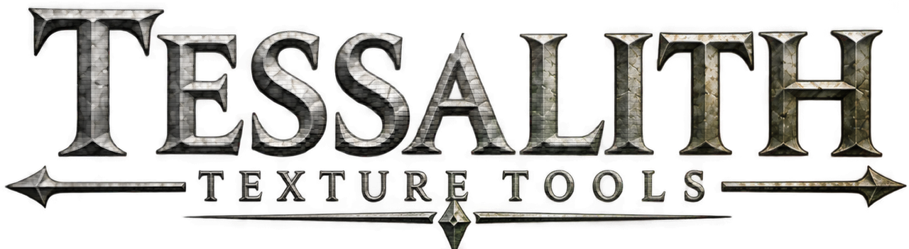

<p align="center"></p>

<h1 align="center">Tessalith</h1>

<p align="center">Converts texture source images to DDS for Skyrim SE/AE.</p>

---

Tessalith converts a folder of source images for Skyrim SE/AE. It works out what each file is from its name, groups files into material sets, packs loose maps into Skyrim's layouts, builds the mips and picks the format and colour tag each shader needs. The GUI (`tessalith.exe`) and the CLI (`sdc`) share one engine and one per-project `sdc.toml`, so both write the same bytes.

- **Targets:** `cs` (Community Shaders with TruePBR; default) and `vanilla` ([Presets and targets](docs/wiki/Presets-and-Targets.md)).
- **Scope:** it makes new textures. It does not fix an installed game folder.
- **Platform and version:** Windows x64, version 2.0.0 (see the [CHANGELOG](CHANGELOG.md)). GPL-3.0-or-later.

## Features

**Encoding and checks**
- BC1, BC3, BC4, BC5, BC6H and BC7 output, plus RGBA8, RGB8, R8 and RG8, with the [best encoder for each format](#uses-the-best-encoder-available). BC1 is encoded for NVIDIA and AMD decoders together.
- [BC7 weighting](docs/wiki/GUI-Texture-Panel.md#bc7-weighting-against-bc3) for data maps whose alpha matters.
- Every encode is decoded and checked against Skyrim's rules. DDS files made by other tools can be validated too.
- [Artist checks](docs/wiki/GUI-Artist-Checks.md#artist-checks): warnings for a flipped normal, missing UV coverage etc... They never block an export.

**Maps and packing**
- Inputs: PNG, TGA, TIFF, EXR, HDR, BMP, JPEG, WebP, PSD/PSB.
- SRGB / UNORM (Linear) tag chosen per map type and target shader. Sizes round to a power of two automatically.
- Cutout alpha: coverage-preserving mips, on by default. Normal mips are renormalised, and their variance is baked into TruePBR roughness.
- Loose maps are packed into `_rmaos` / `_rfaos` / complex `_m`, with suffix-based channel remapping (ORM to RMAOS is instant). The complex-material `_m` gate is checked.
- RNM normal-layer blending (`_bump`, `_detailnorm`, `_bent`, with optional masks `_bumpmask`, `_detailnormmask`, `_bentmask`). See [RNM normal layers](docs/wiki/Texture-Packing.md#rnm-normal-layers).
- [Generate from normal map](docs/wiki/GUI-Generate-From-Normal.md#generate-from-normal-map): height, AO and curvature maps from a set's normal.
- Complex grass (1:2 image, halves mipped apart) and [cubemaps](docs/wiki/Cubemaps.md).

**Skyrim and mod aware**
- Mod scan: meshes decide alpha meaning and set shader. 100,000 NIFs take 14 seconds, 1,500 plugins under 3 ([Mod scanning](docs/wiki/Mod-Scanning.md)).
- TruePBR: PGPatcher JSON written per set and validated, with every option exposed, plus the PGPatcher `_m` sidecar `.json`.
- PBR Landscape: PBRTextureSets and PBRMaterialObjects JSONs built from the EDIDs in your load order.
- [Also export as Vanilla and Complex material](docs/wiki/GUI-Also-Export.md#also-export-as-vanilla-and-cm): converts PBR sets to those two formats.
- Runs standalone or from MO2. From MO2 it fills in your MO2 location the first time; it skips MO2's virtual file system either way.

**GUI**
- Encoded-mip preview with pixel readout, lens and difference heatmap.
- [3D preview](docs/wiki/GUI-Set-Preview-3D.md#set-preview-3d) that matches Community Shaders' deferred rendering (**Accurate (deferred)**).
- Context-menu options for slots and lock commands.
- Colour picker with hex and RGB (0–255) inputs.

**NIF editing (in the 3D view)**
- Edit NIF fields and shader flags.
- Animation clock, key editor, controllers and clip playback, with an in-game preview.

**Command line**
- Batch conversion, inspect and validate with `sdc`. See the [CLI reference](docs/wiki/CLI-Reference.md).

**What sets it apart.** It starts from what the file is: suffix and folder give a sub-type, and the sub-type sets format, tag, alpha and mips. Unclear files are skipped until you decide them. It blocks combinations Skyrim mishandles, such as `_SRGB` outside TruePBR colour under `cs`, or BC4/BC5 on a normal map. A manifest lets re-runs redo only what changed.

## Uses the best encoder available

Each format uses the encoder that measured best. The numbers behind the charts are in [Research](docs/wiki/Research.md#encoder-measurements).

### BC7


`max` is opt-in: on the chart's images it gains 0.15 dB RGB and 0.04 dB alpha over u6 ([Research](docs/wiki/Research.md#bc7-gpu-and-cpu-encoders-speed-and-quality)). NVTT is not part of Tessalith; it is charted as a reference. For BC7 data maps with alpha, see the [BC7 weighting](docs/wiki/GUI-Texture-Panel.md#bc7-weighting-against-bc3) chart.

### Other formats


Footnotes and per-image counts: [Research](docs/wiki/Research.md#other-formats-best-encoders-per-format).

## Quick start

Build with Rust stable and the MSVC Build Tools ([Installation](docs/wiki/Installation.md)). This writes `sdc.exe` and `tessalith.exe` to `target\x86_64-pc-windows-msvc\release\`:

```
cargo build --release -p sdc -p sdc-gui
```

**GUI:** run `tessalith.exe`, **Open folder…**, pick the **Mode**, settle any amber-bordered texture, **Export**. Decisions go to `sdc.toml`; **Copy CLI command** gives the matching `sdc convert` line.

**CLI:**

```
sdc inspect textures --recursive
sdc convert textures --recursive -o out --accept-suggestions high
sdc validate out\textures\armor\iron\iron_n.dds --target cs
```

Exit codes: 0 done, 1 some files failed or were skipped, 2 usage or config error, 3 fatal, 4 validation failed.

The exe is unsigned, so Windows SmartScreen may warn on first run ([Installation](docs/wiki/Installation.md#the-release-zip)). Back up your mod folders before you convert in place.

## More

- Settings, presets, the scan database, logs and per-folder files: [Installation](docs/wiki/Installation.md#where-tessalith-keeps-its-files).
- [Known issues](docs/wiki/Troubleshooting.md#known-issues) and the [CHANGELOG](CHANGELOG.md).
- Design records: [.claude/DECISIONS.md](.claude/DECISIONS.md), [docs/presets-changelog.md](docs/presets-changelog.md) and the research pages in [docs/research/](docs/research/README.md).

## Documentation

| Start | Use | Reference |
|---|---|---|
| [Home](docs/wiki/Home.md) | [GUI guide](docs/wiki/GUI-Guide.md) | [CLI reference](docs/wiki/CLI-Reference.md) |
| [Installation](docs/wiki/Installation.md) | [Texture types](docs/wiki/Texture-Types.md) (packing, TruePBR, RNM, grass) | [Project config](docs/wiki/Project-Config.md) |
| [Getting started](docs/wiki/Getting-Started.md) | [Mod scanning](docs/wiki/Mod-Scanning.md) | [Presets and targets](docs/wiki/Presets-and-Targets.md) |
| [FAQ](docs/wiki/FAQ.md) | [NIF editing](docs/wiki/GUI-NIF-Edit.md) | [Validation and output](docs/wiki/Validation-and-Output.md) |
| [Troubleshooting](docs/wiki/Troubleshooting.md) | [Research behind the defaults](docs/wiki/Research.md) | |

Optional plugins for Photoshop, GIMP 3, Paint.NET and chaiNNer that open and save DDS live on the [`host-plugins` branch](https://github.com/Alistra-za/Tessalith/tree/host-plugins). It gets bug fixes but is not kept in step with the engine.

## Credits and licence

Tessalith is licensed under GPL-3.0-or-later; see [LICENSE](LICENSE). It builds on bc7e and rgbcx (Rich Geldreich / Binomial LLC), the Intel ISPC Texture Compressor and bcdec, among others. Third-party licences and the changes made to vendored code are listed in [THIRD_PARTY_NOTICES.md](THIRD_PARTY_NOTICES.md) and [LICENSES/](LICENSES/). Credits for ideas and prior work, including AlphaBloom's Auto Coverage, Ignacio Castaño's coverage-preserving mips and jiayev's TruePBR-Manager, are in [docs/CREDITS.md](docs/CREDITS.md).
