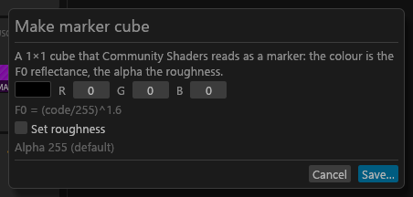
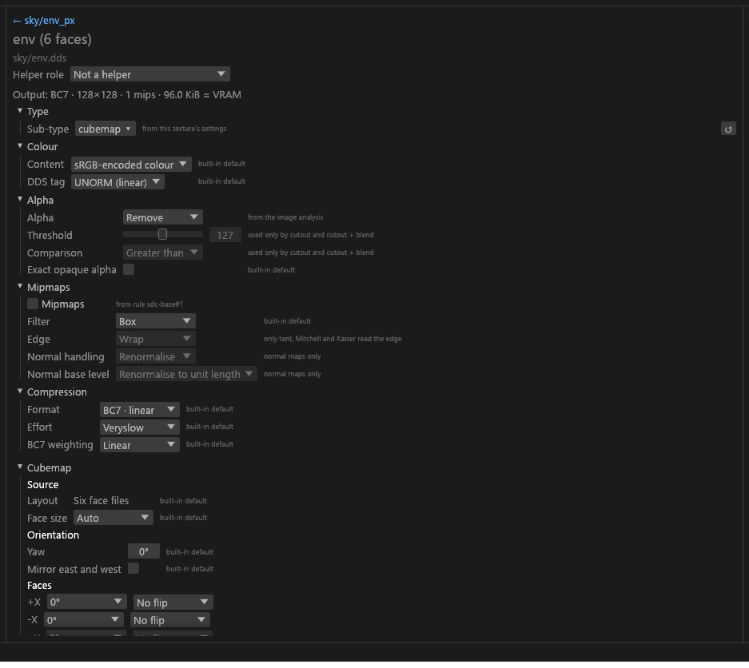

# Cubemaps

For modders making `_e` environment maps (the Environment Map and Eye shaders, NIF slot 4, plus room reflections in caves and temples). You give Tessalith six faces, a cross or a strip; it writes a cube DDS with a full mip chain. Make faces in another tool first if you only have a panorama or a mirror ball.

## Which face is which

Skyrim's world has X pointing east, Y north and Z up. Each face is named after the direction it shows:


| Face | Index | Shows | File suffix |
|---|---|---|---|
| +X | 0 | east | `_posx` or `_px` |
| −X | 1 | west | `_negx` or `_nx` |
| +Y | 2 | north | `_posy` or `_py` |
| −Y | 3 | south | `_negy` or `_ny` |
| +Z | 4 | **up: the sky** | `_posz` or `_pz` |
| −Z | 5 | **down: the ground** | `_negz` or `_nz` |

**The sky is +Z, not +Y.** Many tools and tutorials for other games put the sky on +Y. In Skyrim, +Y is north.

## Ways to make one

| You have | It looks like | How Tessalith knows |
|---|---|---|
| [Six images](#six-images) | six squares | file names end in a face suffix |
| [A cross](#crosses-and-strips) | a T-shaped net, 4:3 or 3:4 | the shape |
| [A strip](#crosses-and-strips) | six squares in a row, 6:1 or 1:6 | the shape |
| [A cube DDS](#an-existing-cube-dds) | a `.dds` cube | the file says so |
| [Nothing: a dynamic marker](#dynamic-marker) | no picture | `sdc cubemap-marker`, or **Make marker cube…** |

A file named `_e` (`chrome_e.png`) or under a `cubemaps` folder gets the `cubemap` type suggested with High confidence.

Only a crisp shape is a cube source: 4:3, 3:4, 6:1 or 1:6. A square or 2:1 image typed as a cube is Unresolved and skipped ("not a cube source: {w}x{h} is not six faces, a cross or a strip. Change this file's sub-type."). A panorama, mirror ball, angular map or photo has to become six faces, a cross or a strip first.

The shape settles the layout. `cubemap.layout` is for trusting a 4:3 or 3:4 image whose empty cells aren't flat (refused otherwise), or for `faces`:

```toml
[files."textures/cubemaps/studio_e.png"]
cubemap.layout = "hcross"   # faces, hcross, vcross, hstrip, vstrip
```

### Six images

Name them with the base name plus a face suffix:

```text
textures\cubemaps\
  chrome_e_posx.png   east
  chrome_e_negx.png   west
  chrome_e_posy.png   north
  chrome_e_negy.png   south
  chrome_e_posz.png   sky
  chrome_e_negz.png   ground
```

They become one `chrome_e.dds`, and the shader check sees a single `_e`. A face tag on any other name is left alone: `rock_px.png` is its own texture.

Tessalith never guesses a face. These are `CUBE-FACES` errors, and the faces aren't converted:

- two files for one face;
- a missing face;
- a face that isn't square;
- faces of different sizes;
- faces that resolve to different settings (one has its own `[files]` entry, say). Set things for all six with a rule or `[defaults]` so they match.

### Crosses and strips


4:3 is a horizontal cross, 3:4 a vertical cross, 6:1 a horizontal strip, 1:6 a vertical strip. The match is exact, and cell positions are the ones texassemble uses. Cells are read as stored faces; Tessalith never moves a face to another cell.

- **The sky goes in the centre cell** of a cross (+Z), not the top one. A cross from a tool that puts the sky on top shows the sky to the north in game: rearrange the cells, use six images, or export a cross with the sky in the centre.
- **The vertical cross's bottom cell:** tools disagree. Tessalith turns it 180° by default; if the ground comes out upside down, set `cubemap.vcross_negz_rotate = false`.
- **A 4:3 photo named `_e`** isn't mistaken for a cross: a cross's empty cells must be flat, or the file is refused with a message pointing at `cubemap.layout`. A layout you set yourself is trusted.
- **A layout that doesn't fit** the image (`hstrip` on 512×512) is `CUBE-FACES`.

### An existing cube DDS

Like any DDS it is skipped (`IN-DDS-SKIPPED`) unless you set `reencode = true` on the file, which costs some quality because the faces are decoded and encoded again. It is read as its six mip-0 faces (`cubemap.layout` must be unset or `hstrip`), can only be re-encoded as a cubemap, and cube arrays are refused.

### Dynamic marker


Community Shaders and ENB read a 1×1 cube whose +Y is black as "reflect the live scene" instead of a picture (a dynamic cubemap). In Community Shaders the +X pixel then sets the reflection's colour (RGB) and roughness (alpha). For ENB, PGPatcher already applies a dynamic cubemap with every feature ENB supports.

```text
sdc cubemap-marker --color 200,200,210 --roughness 0.3 -o textures\cubemaps\steel_e.dds
```

- `--color` is raw 0 to 255 codes on the +X face. +Y stays black, so the file is always a marker.
- `--roughness` is 0 to 1. Leave it out and Community Shaders uses its defaults.
- The flags are in the [CLI reference](CLI-Reference.md#sdc-cubemap-marker). Tessalith never writes a picture cube at 1×1, so a real cube can't turn into a marker.

In the GUI, **Make marker cube…** in **Export to ▾** (**More ▾** with no project open) opens a small dialog, with or without a project. **Colour** is raw codes; **Roughness** is optional (the *Set roughness* tick). **Save…** opens the file dialog, in `<textures folder>\cubemaps` when that exists, named `marker_e.dds`. A file Tessalith didn't write is kept: the dialog says so and stays open so you can pick another name. The bytes equal what `sdc cubemap-marker` writes.



If your cube looks right in game, you can stop here.

## Turning faces

Each edge of a face image points somewhere in the world. This is plain DirectX cube addressing, measured in game:


Compared with standing in the middle of the cube, every stored face is mirrored. If your six images are views from the centre (sky at the top for the four side views, north at the top for sky and ground), set these per face:

| Face | What to change |
|---|---|
| +X east | rotate 90° clockwise, then mirror left-right |
| −X west | rotate 90° clockwise, then flip top-bottom |
| +Y north | flip top-bottom |
| −Y south | mirror left-right |
| +Z sky | mirror left-right |
| −Z ground | mirror left-right |

Both settings are six-entry lists in face order (+X, −X, +Y, −Y, +Z, −Z), on the cube's entry:

```toml
[files."textures/cubemaps/chrome_e"]
cubemap.face_rotate = [90, 90, 0, 0, 0, 0]          # clockwise, applied first
cubemap.face_flip = ["h", "v", "v", "h", "h", "h"]  # h mirrors left-right, v flips top-bottom
```

They work on every layout, six separate files included. Faces exported by a cube tool (texassemble, CubeMapGen, cmft) are usually stored this way already and need nothing.

## Settings

Every `cubemap.*` key (ranges and defaults on [Project config](Project-Config.md#cubemap)) works in `[defaults]`, `[subtypes.cubemap]`, a rule, a `[files]` entry and `--set`.

### Styles

`cubemap.style` is a starting point for size, format and blur. The values each style sets are on its [key row](Project-Config.md#cubemap); any of them can be overridden by its own key.

| Style | Use it for |
|---|---|
| `vanilla_metal` | armour, weapons, ore, glass |
| `room` | interior room reflections, caves |
| `eye` | eyes |
| `hd` | close-up shiny surfaces |

### Blur

`cubemap.blur` is a cone blur across the faces, so no seams show. There is none unless a style sets one.

### Colour

Community Shaders reads a static cube with the game's own curve, `pow(colour, 1.6)`, not the sRGB curve, and Tessalith does the same:

- A PNG, TGA or other normal image is read as game-gamma colour. Mips, blur and resizing happen in linear light and are stored back with the 1.6 curve.
- A `.hdr` or `.exr` source is already linear and is only stored with the curve.
- `color.content = "srgb"` on a cube means the 1.6 curve. Other texture types keep the real sRGB curve.
- The colour settings (brightness, contrast, midtones, saturation, tint) work on that curve, so a change looks the same in game.

### HDR sources

An `.hdr` or `.exr` face whose brightest value is above 1 and that has no `cubemap.highlight_clamp` gets `LOSS-CLAMP-HDR`, because a bright sun would clip to white. Set `cubemap.highlight_clamp` to the level that should become full white. Brightness rolls off smoothly toward it (darker values come down a little too) and hue is kept.

### Face size

The default is one source cell rounded to a power of two, at most 4096 ([`cubemap.face_size`](Project-Config.md#cubemap)). A 1536×1152 cross has 384-pixel cells and becomes 256. Larger values scale up. Tessalith notes `DIM-RESIZED` when the face differs from the cell, and never `DIM-NPOT` on a cube.

## The cube panel in the GUI

A texture whose sub-type is **Cubemap** (under *Other* in the sub-type dropdown) gets a **Cubemap** section in its settings panel with the **Source**, **Orientation**, **Colour grade** and **Look** groups. Everything it writes goes to `sdc.toml` as the matching `cubemap.*` key, so the GUI and CLI make the same bytes.



- A six-file set is one item in the Textures column; its settings are written to all six face entries so the faces keep matching.
- Colours are raw 0 to 255 codes, not gamma-converted.

## Checks

Tessalith always writes six faces, every mip down to 1×1 built across faces so no seams appear, and a UNORM format (BC1, BC3, BC7, RGBA8 or RGB8). An sRGB tag on a cube is refused.

`CUBE-NO-MIPS` warns when `mips.levels` is `none` or 1: a cube without mips sparkles in game.

`sdc inspect` and `sdc validate` flag broken cube files (as `VAL-HEADER` in `validate`, each failing the file):

- a cube wider than 1 pixel with only one mip (a 1×1 marker is fine);
- a flat 2D texture named `_e`, or under `textures\cubemaps\`, where a cube is expected: exit 4, because the game reads those files as cubes <!-- D:FM22 -->;
- a 1×1 cube whose +Y isn't black (Community Shaders shows a nearly black static reflection);
- a cube in an sRGB format.

`sdc validate` judges a cube file as a `cubemap` unless you pass `--subtype`. A marker passes.
