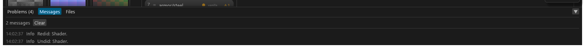

# The bottom panel, Messages and toasts

The panel along the bottom of the window, its tabs, and the short notices (toasts) Tessalith shows for routine results. For anyone looking for what Tessalith just did or said.

## The bottom panel

A panel runs along the bottom of the window in both views, full width. Collapsed it is one strip of tab buttons; click a tab to open the panel on it, and click the tab that is showing (or the **▼** at the right, *Collapse the panel*) to collapse it. Drag its top edge to resize.

| Tab | What it holds |
|---|---|
| **Problems (N)** | One row per thing that needs your attention, each with its fix as a button. See [Problems](GUI-Problems.md). |
| **Review** | Listed only while Review is open: what Export will do, and the questions it waits on. See [Review](GUI-Review-and-Export.md#review). |
| **Messages** | The notes of this session ([below](#messages)). The button's number counts notes you have not seen. |
| **Files** | The export's progress, counts and files. See [Files tab](GUI-Review-and-Export.md#the-files-tab). |

Review and Problems keep separate heights; see [Review](GUI-Review-and-Export.md#review) for Review's own size.

## Messages

The last 500 entries, newest first, with the time, the severity and the text. **Clear** empties the list. **Ctrl+M**, or a click on the **Messages** tab, opens this tab, or collapses the panel when it already shows Messages.

Every note that shows in the status line (the encoding-follows-type note, *Export cancelled*, *Picker result ignored*) is also logged here, as are the toasts. The log lives in memory only; it is gone when you close the window.

## Toasts

Routine results show as **toasts**: short notices at the bottom right that do not block anything. While the bottom panel is open they sit just above it, so they never cover its buttons (Review's Export included).

- *Saved*, *Export finished: N written, M skipped, K failed*, *Scan finished: …*, *Copied 3D view*, *Picker result ignored* and the *Undid / Redid* note each appear as one.
- A toast shows for 4 seconds (8 seconds for a warning), then goes.
- At most 3 are on screen; the rest wait their turn. A newer notice of the same kind ("Undid", "Saved", "Export finished") replaces the one still waiting.
- Holding the pointer over a toast keeps it.

Anything that needs a decision (Replace or Cancel, an external change, an error that blocks) stays a dialog ([Dialogs](GUI-Dialogs.md#dialogs)).
