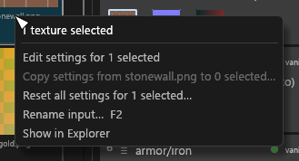
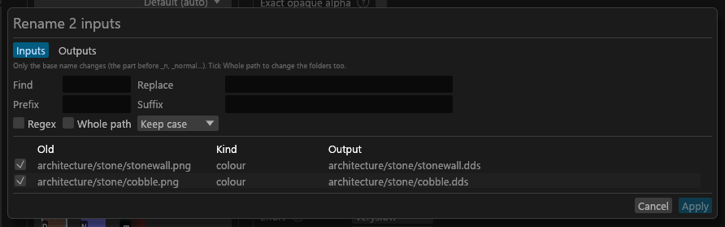

# Bulk editing and renaming

For anyone fixing many textures or sets at once, reading files under corrected names, or renaming a set's outputs.

## Selecting several

Ctrl+click adds or removes one entry, Shift+click selects the range in the order shown, and Ctrl+A selects everything shown. Helper rows take Ctrl+click and Shift+click too. Textures and sets are never selected together, and entries a filter hides stay selected and are edited.

## Editing them together

With two or more textures selected, the centre shows their settings in one panel. A row only writes when you touch it, and it writes every selected texture that can take the value; the reasons for the others are on hover. **↺** resets a field on all of them, even a locked one. With several sets selected, chips pick which of their maps to edit. **Re-encode n DDS files** does for the selected DDS inputs what **Re-encode this file** does for one ([Texture settings](GUI-Texture-Panel.md#dds-files-in-the-folder)).

Every bulk edit is one undo step and one plan. A read-only `sdc.toml` takes none. The Advanced drawer edits one texture only.

## The right-click menu

Right-clicking a selected tile or set keeps the selection; right-clicking another entry selects it alone.

- **Copy settings from <texture> to N…** opens a checklist of the last-clicked texture's own settings, all ticked. Untick what you want to keep. Textures only: to copy between sets, use **Select members of kind** first.
- **Reset all settings for N…** removes their `sdc.toml` entries after asking. It keeps your acknowledgements and skips a texture in a pinned slot.

## Renaming

Right-click a texture or a set, or press **F2**. The dialog has two modes.

| Mode | What it does | Saved where |
|---|---|---|
| **Inputs** | Reads a misnamed source under a corrected name (a normal map without `_n`, a file in the wrong folder). The tile shows *read as <name>*. The file on disk is never renamed, and it keeps its own settings and set. | `sdc.toml`: `[inputs."<file>"] as = "<new path>"`. **Clear input alias** in the tile menu removes it. |
| **Outputs** | Gives a PGPatcher PBR set's outputs a new base name, or with *Whole path* a new folder too. Each keeps its suffix (`steel.dds`, `steel_n.dds`, `steel_rmaos.dds`). The rows show game paths under the export folder (`textures/pbr/armor/wall`). <!-- D:HJ9 --> Outputs already exported under the old name stay where they are. The entry appears only when a selected set is a PGPatcher PBR set on Community Shaders; a mixed selection renames those sets and the label shows their count. A vanilla set renames through **Map to target**. <!-- D:HJ1 --> | The set's PGPatcher **Rename**, so the JSON follows, through slot commands when the set has more than one match ([Rename](GUI-PGPatcher-JSON.md#rename)). A set that already has an `output_name` in `sdc-project.toml` keeps writing under it, and the set editor can clear it. <!-- D:HJ2 --> |

Unless you tick *Whole path*, the dialog changes only the base name, the part before `_n`, `_normal` and so on. Tick *Regex* for a pattern and use `$1` in *Replace* for a group; *Whole path* also runs over the folders. In Outputs mode a new folder is written as PGPatcher slot commands ([Rename](GUI-PGPatcher-JSON.md#rename)). <!-- D:HJ5 --> **Apply** stays off while a row is red: two names collide, an output lands on a file another texture writes, Windows can't use the name, the path leaves `Data`, the extension changed, or an output name ends in a map suffix.

## Input name box

The set editor's heading shows the path the set's textures are read as, without the diffuse's suffix (`body` for `body_albedo.png`). Type a new one and press Enter, or click away: every member of the set gets an `[inputs]` alias as one undo step, and its TruePBR settings, pins and borrows follow.

A grey completion follows what you type, drawn from the last scan and this project's diffuse paths. Amber means the name is unknown, which only warns. A red outline means it can't be used, with the reason on hover.

| Key | Effect |
|---|---|
| **Tab** | Takes the grey completion up to the next `/`. |
| **Esc**, twice | The first closes the list, the second puts the old name back. |
| **Ctrl+Up / Ctrl+Down** | List the known names for the path segment (the part between two `/`) under the cursor, to replace just that segment. |

The **▾** lists the known paths under the folder before the last segment, with a filter box.

On a TruePBR set the **Match** box beside it picks the slot that list works on. **Match 1 · Diffuse** is the list above. **Match 2** to **Match 8** list the scan's textures for that slot, and a pick sets that match in the PGPatcher JSON without renaming anything. Tick **All slots** to see every known texture.
