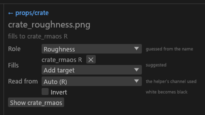
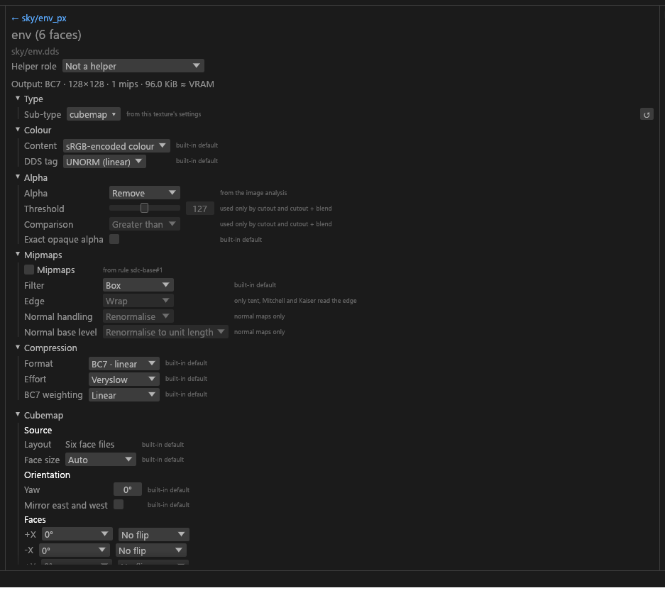
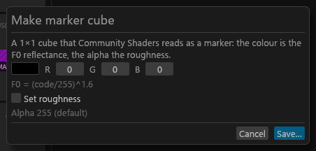

# Helpers and cubemaps in the GUI

The controls for helper textures (masks and raw maps that fill a channel of another output) and cubemaps. For anyone packing loose maps or making a cube. What each role, channel and cube setting means is on the concept pages: [Helper textures](Texture-Packing.md#helper-textures) and [Cubemaps](Cubemaps.md).

## Helper textures

A helper fills one channel of another output of its set and is never written as its own DDS. Which channel, when a suggestion applies and what happens when sizes differ are in [Texture packing](Texture-Packing.md#helper-textures).

### The Helpers group

Under the tiles, the Textures column has a **Helpers (n)** heading and one compact row per helper, sorted by set, then name. <!-- D:FB12 --> A row shows:

- a small thumbnail and the file name;
- where it goes: **→ <targets>** (for example *→ iron_rmaos R, iron alpha*), or **not used**. Hover for the full list or the reason (for example "iron.png already has alpha", "512x512, target 1024x1024: sizes differ", "no colour texture planned under vanilla", "rmaos.b is filled by iron_ao.png");
- the role chip (*Ambient occlusion*, *Opacity*, *Detail normal*, …). A role you set by hand shows as an amber chip with a pencil, **✎ Opacity**.

Click the **Helpers (n)** heading (▾ open, ▸ collapsed) to collapse or open the group. It is open by default, the choice is saved in `gui.toml`, and there is no heading when the project has no helpers.

- Collapsing is not a filter: **Clear filters** leaves it alone.
- Select all and the arrow keys never reach collapsed rows, and a Shift+click range skips them. A helper that stays selected inside a collapsed group is counted in the heading ("2 selected (1 in the collapsed Helpers group)").
- Revealing a helper, for example from the palette (Ctrl+K), opens the group.
- The search box and the other pills filter helper rows too.
- A helper whose file failed to load says so, and its warnings are listed in Problems.

Click a row to open its panel.

### The helper panel

The centre shows the helper's name, a link back to its set, and the same "fills to … / not used: …" line. Every control writes the helper file's own `[files]` entry in `sdc.toml` as one undo step, and the folder is planned again. With `sdc.toml` read-only, the controls are greyed out with the reason on hover.

- **Role.** What the file is. The hint says *guessed from the name* or *set by you*.
  - **Not a helper** (first in the list) makes it an ordinary texture: it becomes a tile and is converted on its own (`helper.role = "none"`).
  - Any other role makes it a helper of that kind even if its name says otherwise (`helper.role = "<role>"`). Picking the guessed role also writes it, which makes it count as set by hand: an assigned helper replaces what the channel holds, a guessed one only fills an empty channel.
  - **Reset** (only when set by hand) goes back to the name's guess.
- **Fills.** One line per channel the helper fills, each with a **✕** (*Stop filling <target>*), then **Add target**. Once the list is yours, every target in it is listed, including one that could not be filled.
  - **Add target** lists the channels the engine would accept in this set: a planned colour texture's alpha, the `_n`, `_f`, `_s` or `_cnr` alpha, and the packed channels.
  - While the list is the engine's suggestion, the hint reads *suggested*. Removing or adding a target writes the whole list as yours (`helper.fills = [...]`). Removing the last one writes an empty list, and the row then reads "not used: no targets chosen". **Reset** returns to the suggestion.
  - `_cnr` alpha (coat roughness) is never suggested; add it here if your roughness map is meant for the coat.
  - Targets the engine skipped are listed under the controls ("Skipped iron alpha: iron.png already has alpha").
- **Read from.** Which channel of the helper is used: **Auto (R)**, **R**, **G**, **B**, **A** or **Luminance** (`helper.read`). Auto removes the setting. Use it for a mask stored in another channel.
- **Invert.** Flips what the helper feeds, white to black (`helper.invert = true`). A gloss map feeding the packed roughness needs no Invert: give it the role *Glossiness*, and packing turns gloss into roughness (Invert there would write gloss into the roughness channel). An alpha fill has no automatic conversion, so there Invert is the only flip.
- **Show <output>** buttons under the controls select each output the helper fills.

### Making an ordinary texture a helper

Under the name in every image tile's settings is a **Helper role** combo reading *Not a helper*. Pick a role (the same list as the helper panel's) to make the file a helper of that kind, for example a mask whose name has no helper term. `helper.role` is written to its `[files]` entry as one undo step (greyed out, with the reason, while `sdc.toml` is read-only), and the tile becomes a row in the Helpers group. Without the GUI: `helper.role = "opacity"` on the file's `[files]` entry in `sdc.toml`, or `--set "file:**/<name>.helper.role=opacity"`.

A texture you made **Not a helper** shows "Not a helper (set by you)" in its settings, with **Reset**, which removes `helper.role` so the name's guess applies again. A `subtype` already on that file stays: a file with a sub-type set and no `helper.role` is an ordinary texture, so Reset does not bring its row back.

The set card's channel rows edit the same `helper.fills` lists ([Packed channel sources](GUI-Set-Editor.md#packed-channel-sources)).

## Cubemaps

A texture whose sub-type is **Cubemap** (under *Other* in the sub-type dropdown) gets a **Cubemap** section in its settings panel and a cross in the preview. Everything the panel writes goes to `sdc.toml` as the matching `cubemap.*` key, so the GUI and the CLI make the same bytes. What each setting does is in [Cubemaps](Cubemaps.md#settings).

**In the Textures column.** The six faces are one item ([Textures column](GUI-Textures-Column.md)). The size estimate counts all six faces and their mips. A six-file set's settings are written to all six face entries in `sdc.toml`, so the faces keep matching.

**Settings panel.** The section is drawn only when every selected texture is a cube. It has four groups:

| Group | Controls |
|---|---|
| **Source** | Layout, face size, and for a face, cross or strip source the per-face rotation and flip, plus *Turn -Z upright* on a vertical cross. |
| **Orientation** | Yaw, *Mirror east and west*. |
| **Colour grade** | The colour filters ([settings](Cubemaps.md#settings)). |
| **Look** | Style and blur. |

- The layout box never offers six face files. A six-file set shows "Six face files" as read-only text.
- A blur the engine fills in (the blur of a style or preset) cannot be unticked, so set 0 for no blur.
- A value in `sdc.toml` outside the engine's range is shown as it is, with the engine's message in red under the row. Tessalith never changes it; fix it in the box or in the file.
- Colours are raw 0 to 255 codes, not gamma-converted. A drag or colour pick writes once, when you let go.

**Not a cube source.** A square or 2:1 image typed as a cube shows the reason from [Cubemap sources](Cubemap-Sources.md#ways-to-make-one) in the settings panel's *Undecided* box and in its Review row. Change the sub-type to answer it.

**Cube preview.** The encoded side draws all six faces of the mip on show as one cross (4 by 3 faces), sized like a 2D preview, so a big cube previews at a lower mip. *Face labels* (on by default) names each face. *Heatmap* and *Tile 3×3* are off for a cube ("Not for cubes"), and there is no texel readout.

- A six-file set has six source buttons, +X to -Z, over the source side. Each shows the processed face (after turns, flips, sizing and mips), the same picture as its cell in the cross.
- A single-image cube's source side shows the input file itself (cross or strip).
- A set that cannot be built shows the engine's reason in the encoded pane, for example "faces differ in size" (the code is not shown).

**Make marker cube…** in **Export to ▾** (**More ▾** with no project open) opens a small dialog for a 1×1 dynamic-cubemap marker. It works with or without a project open.

- **Colour** is raw codes ([how they are read](Cubemap-Sources.md#dynamic-marker)). **Roughness** is optional (the *Set roughness* tick): ticked, it starts at 0.5; unticked, the alpha is 255. The alpha it will store is shown under the controls.
- **Save…** opens the file dialog (Enter never writes), in `<textures folder>\cubemaps` when that folder exists, named `marker_e.dds`.
- It never overwrites a file Tessalith did not write: it says it kept it and leaves the dialog open, so you can pick another name. The bytes equal what `sdc cubemap-marker` writes.

