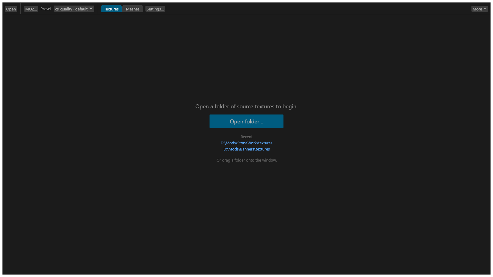
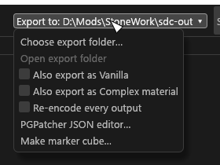
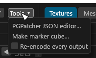
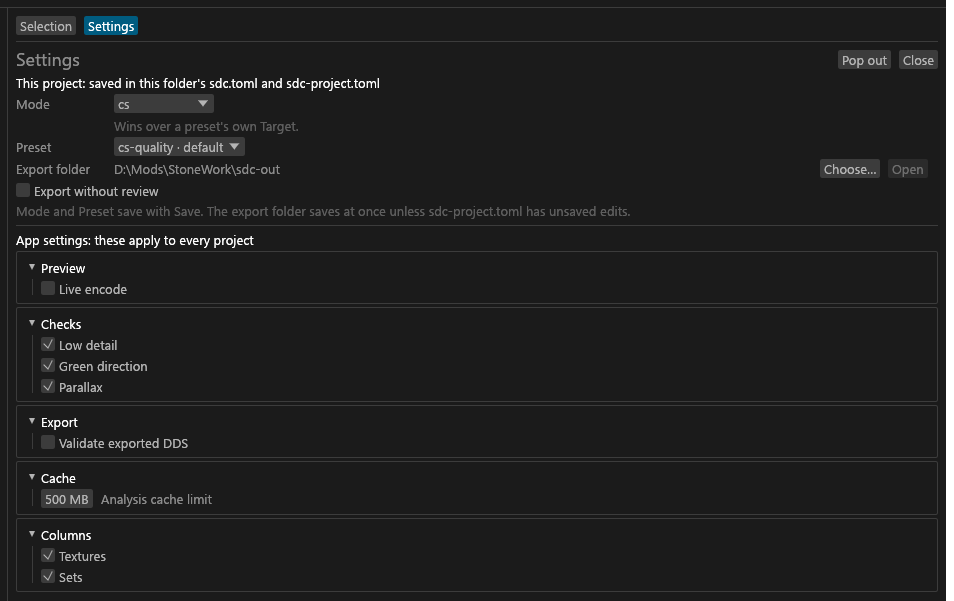

# Main window

For anyone opening a first folder: how it opens, what the header and the Settings tab do, and how to find a texture in the Textures column. The GUI saves your decisions in the folder's `sdc.toml`.

## Opening a folder

A launch without a project opens the **Textures** start screen. Click **Open folder…**, choose **Open** → **Open folder…**, pick one from **Recent** (the last 10), or drag a folder onto the window. A dropped file opens the folder that holds it. Tessalith reads the folder recursively and plans the conversion. Nothing is written to your textures.

Reopening a project restores the saved view and column widths. Run `tessalith.exe <folder>` to open that folder in place of the last project. If Tessalith can't read it, the start screen stays open and the status line gives the path and reason. With no project, the header hides **Undo**, **Redo**, **Save** and the export button, and the bottom tabs stay hidden. In **Meshes** you can browse the MO2 list and open a texture folder from the banner. Pending NIF edits bring back **Undo**, **Redo**, **Review** and the bottom tabs so you can export the edits on their own. <!-- D:JY10 -->

While it opens, a progress bar counts the files to plan and **Cancel** returns to the folder you had before, with its undo history. When planning finishes, the thumbnails appear, settings become available and the status line gives one next step. It points first to **Undecided** for missing types, then **Problems**, then **Export to ▾** for a missing destination. If the project is ready, it names the header button to press. <!-- D:JY11 -->

### When `sdc.toml` is rejected

An `sdc.toml` that can't be parsed, or that the engine refuses (an unknown field, an unknown type), is left out of the plan. A banner shows the error and the GUI stays read-only until you fix the file and press **Reload**. Most out-of-range values aren't a rejection: they are reported per file as `CFG-INVALID` ([Diagnostic codes](Diagnostic-Codes.md)).

When the rejected value came from a GUI edit, that edit is the top **Undo** step. Undo takes it back and makes the file editable again.

## Header

- **Undo** and **Redo** go up to 200 steps (**Ctrl+Z**, **Ctrl+Y**). Hover either button for the step it will apply.
- **MO2…** picks the scan source: [Mod scanning](Mod-Scanning.md). **Preset** picks the preset the folder converts with and saves it as `preset` in `sdc.toml`; its last entry, **Presets…**, opens the **Presets** tab: [Presets and targets](Presets-and-Targets.md).
- **Settings…** opens the [Settings tab](#settings-tab), where the Mode is set.
- **Save** (**Ctrl+S**) writes your project edits, including the value in the field you're typing in. A dot in the title means the project has edits to save. Type and alpha choices you make or undo need a save even if the value matches disk. For a new project with settings to write, **Write project files now** saves them before the first export. <!-- D:JY6 --> See [Review and Export](GUI-Review-and-Export.md#the-export-button) for the button beside **Save**.

As the header narrows, **Export to ▾** first cuts the export folder in the middle, down to its drive and last folder; hover it for the whole path. Then look in **⋯** for **Tools ▾**, then **MO2…**, then **Preset**. **Settings…** stays in the header. The destination, save and export controls stay together when they wrap. <!-- D:JY13,LC1 --> If a restored window is larger than your GPU can display, Tessalith reduces its size and logs the adjustment. <!-- D:JY17 -->

### Export to

**Export to ▾** holds the export folder, saved per project in `sdc-project.toml`. With none chosen it reads **Export to: not chosen ▾** and Review blocks the export: a project never takes over the folder you picked for another mod. <!-- D:FB1 -->

Click **Choose export folder…** to set the destination. The picker starts in the first folder that exists among this project's destination, your last accepted export folder and the project folder (the most recent project's parent with no project open). The pickers for Also folders, target mod and saving a report start at the project folder or the most recent project's parent. <!-- D:JY14 --> **Open export folder** opens it in Explorer. If the button is grey, the reason appears beside its name. The two ticks here are **Also export as Vanilla** and **Also export as Complex material**. [What each folder holds](Set-Shaders.md#also-export-as-vanilla-and-cm).

With a project open, **Tools ▾** holds **PGPatcher JSON editor…**, **Make marker cube…** and **Re-encode every output**. The JSON editor needs `cs` mode and a loaded sets document. With no project open, **Make marker cube…** is under **More ▾**. <!-- D:JY12 -->

### Status line and banner

Read `57 files → 68 textures (11 packed or generated) · 7 sets` as files found on disk, textures planned, and sets with cards. The status line also gives a VRAM estimate for the selection and the folder, and shows progress during an export. <!-- D:JY8 --> A banner appears under it when something needs you, such as a rejected `sdc.toml`. Everything it says is also kept in [Messages](GUI-Guide.md#messages).

## Settings tab

**Settings…** opens in the current view, even with no folder open. In **Meshes**, docked Settings, Presets and the JSON editor cover the mesh list. **Back to meshes**, **Close** or **Pop out** reveals it again. <!-- D:JY15 --> See [which edit Undo reverses over Meshes](GUI-NIF-Edit.md#pending-edits-undo-and-source-changes). The top section belongs to the open folder. The lower one applies to every project. <!-- D:JI1 -->

### This project

These rows are saved in the open folder's files. With no folder open, the section reads "No project open".

| Row | Writes |
|---|---|
| **Mode** | `target` in `sdc.toml`: **Community Shaders (cs)** or **Base game (vanilla)**. It beats a preset's Target ([which target wins](Presets-and-Targets.md#which-target)). The header's **Preset** list shows this mode's presets ([Presets and targets](Presets-and-Targets.md)). |
| **Preset** | `preset` in `sdc.toml`, the same value as the header's **Preset**. |
| **Export folder** (**Choose…**, **Open**) | The export folder in `sdc-project.toml`, the same value as [Export to ▾](#export-to). |
| **Export without review** | Sets `[project] export_without_review` in `sdc-project.toml`. [When Tessalith still opens Review](GUI-Review-and-Export.md#the-export-button). |

Mode and Preset save with **Save**, and are greyed while `sdc.toml` is read-only. The export folder saves at once, or with **Save** while `sdc-project.toml` has unsaved edits.

### App settings

These apply to every project and save to `gui.toml` at once.

| Group | Controls |
|---|---|
| Preview | **Live encode**: the expanded preview encodes again after every edit; off, use **Encode now**. The preview toolbar has the same switch. |
| Checks | **Low detail**, **Green direction**, **Parallax**: [Artist checks](Texture-Types.md#artist-checks). |
| Cache | **Analysis cache limit**: [Where Tessalith keeps its files](Installation.md#where-tessalith-keeps-its-files). |
| Columns | **Textures**, **Sets**: ticked shows the column. |

## Finding a texture

One tile per source file, with a thumbnail, name and badges. A packed output, or a texture whose alpha is data (a normal's specular, a mask), draws its colour only, without the alpha as transparency. <!-- D:LM15 --> An amber border means the texture waits for an answer ([Deciding](GUI-Texture-Panel.md#deciding)). Click selects a tile, double-click opens the 2D preview ([Previews](Previews.md)). Selecting several is on [Bulk editing and renaming](GUI-Bulk-and-Rename.md#editing-them-together).

Helper files (raw AO, metallic, roughness and other masks) are rows under the tiles, not tiles ([Packing PBR maps](Texture-Packing.md#helper-textures)). A cube made of six face files is one item ([Cubemaps](Cubemaps.md)).

### Filters

The pills *Undecided*, *Warnings*, *Failed* and *Not in a set* show how many textures each would list. *Not in a set* also counts a lone texture in a one-file set, which does export; only the **No set** label on a row means the texture isn't written ([Textures in no set](GUI-Sets-Column.md#textures-in-no-set)). *Undecided* and *Warnings* leave out textures in no set. <!-- D:HF1 --> **Filter ▾** adds *Filter by type*, *Output format*, *Set membership* and *Sort*, and the search box and the tile size buttons sit beside them. A texture shows only if it passes every filter, and a filter only hides: a selection keeps its hidden textures. **Clear filters** keeps the sort and the tile size. The type, format and set filters, the sort and the tile size are remembered in `gui.toml` ([Installation](Installation.md)). The four pills start off each time Tessalith starts, as the Sets pills do ([why](GUI-Sets-Column.md#finding-a-set)). <!-- D:LM12 -->
