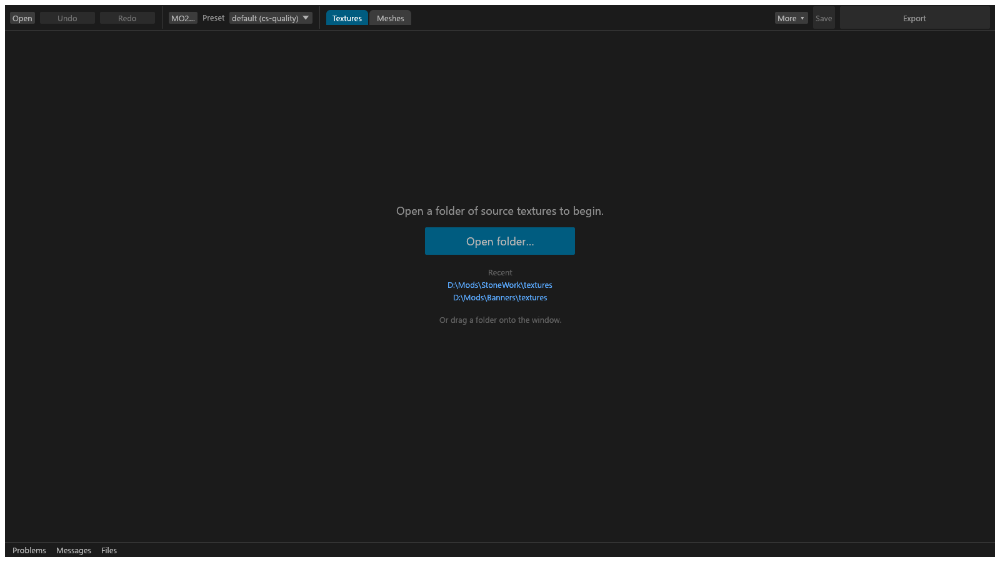
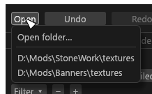
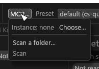
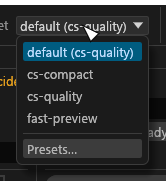
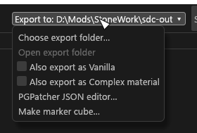

# Main window

How a folder opens, what the header holds, how the three columns are laid out, and the words the window uses. Start here if you are new to the GUI.

Tessalith (`tessalith.exe`) runs the same engine as `sdc convert`, so a folder you decide and export here converts to the same files from the command line. Every decision is saved in the folder's `sdc.toml`. The header picks one of two views: Textures (converter and set editor) or Meshes (mod scanning and NIF editing, see [Mod scanning](Mod-Scanning.md)).

## Opening a folder

Click **Open folder** on the start screen, choose **Open > Open folder…** in the header, pick a folder from the **Recent** list, or drag a folder onto the window. A dropped file opens the folder that holds it. The GUI reads the folder recursively, analyses every image and plans the conversion. Nothing is written to your textures.

### The start screen

With no folder open the window shows one large **Open folder** button in the middle, under the hint "Open a folder of source textures to begin." (after a cancelled open it reads "Opening cancelled"). Under the button is the **Recent** list; click a folder to open it. The last line is "Or drag a folder onto the window."

The Textures and Sets columns and the Advanced drawer are not drawn until a folder is open (the bottom strip is), and the column eyes in the header are hidden. The widths you dragged are kept and come back with the first folder.

### While a folder opens

The status bar shows a progress bar, "Analysing 1,234 / 5,000 files…".
- The total is the files Tessalith will plan: DDS inputs it does not re-encode and duplicate outputs are left out. Files analysed in an earlier open count too, so the bar fills on a re-open. Packed outputs are assembled after the bar is full.
- Thumbnails appear when the whole plan lands, not one by one (a DDS input Tessalith does not re-encode gets its tile image shortly after). Settings and bulk edit stay off until then. **Export** can be clicked and starts once the plan lands.
- **Cancel** stops the open and returns to the folder you had before, with its selection and undo history (its Files tab starts fresh). If there was none, the window reads "Opening cancelled". A cancelled folder you had not opened before is left out of **Recent**.
- The bar and **Cancel** show only while a folder opens. A re-plan after an edit shows its count as plain text.

### When `sdc.toml` is rejected

If the folder holds an `sdc.toml` that cannot be parsed, or that the engine rejects (an unknown field or `allow` code in a `[files]` entry, an unknown sub-type; most out-of-range values are reported per file as `CFG-INVALID` instead), the folder is planned without it:
- a banner shows the error in words; a line that names a code (`CFG-INVALID: …`) is kept whole in the **Messages** tab;
- the GUI stays read-only (editing and **Export** are off, and the file is never written) until you fix the file and press **Reload** in the banner.

When the rejected value came from a GUI edit, the undo history stays: that edit is the top **Undo** step, named "(sdc.toml rejected it: …)". **Undo** takes it back and makes the file editable again.

### File and folder dialogs

File and folder dialogs (Open folder, the export folder, MO2 instance, a folder to scan, Save report) do not freeze the window. Only one is open at a time; the other dialog buttons and Open folder in the palette are greyed out ("A file dialog is already open") until you answer or cancel.
- If you open another folder while the export folder or Save report dialog is still up, its answer is ignored. A folder picked in Open folder… always opens, as the latest choice.
- **Choose export folder…** is greyed out while an export runs.

## Header

The header is one row from about 1280 points of window width; in a narrower window **Export to**, **Save** and **Export** wrap onto a second line. The Meshes view draws the same header, with the status line and banner under it.

| Control | What it does |
|---|---|
| **Open** | A menu: **Open folder…**, then your last ten recent folders (or a greyed "No recent folders"). |
| **Undo** / **Redo** | Up to 200 steps (**Ctrl+Z**, **Ctrl+Y**); hover for the step ("Undo: Format"). Each has a fixed-width slot: a long NIF step label is cut in the slot, with the whole step on hover, so the row does not move. The status line then says "Undid: Format." until your next edit, and the bulk panel's result line clears. Undoing back to the last save clears the unsaved dot. Redo of a **Duplicate** is refused, with the reason, when a file is at the copy's path. |
| **MO2…** | The scan source: the MO2 instance (**Choose…**), its profiles, **Scan a folder…** and **Scan** / **Cancel**. Hover for the instance and profile. |
| **Preset** | The preset the folder converts with: the Mode's default, or a built-in or user preset of this Mode; hover names the Mode. The Mode (the target) is set in the **Presets** tab ([Presets](GUI-Presets.md#presets)). Saved in `sdc.toml` as `preset`. Greyed out until a folder is open. Its last entry, **Presets…**, opens the preset creator. |
| **Textures** / **Meshes** (tabs) | Switch views. |
| **Textures**, **Sets** (eye toggles) | Show or hide each column: an open eye shows it, a struck-through eye hides it; hover says what a click does. Right after the view tabs, Textures view with a folder open only. |
| **Export to ▾** | The export folder for this project, saved in `sdc-project.toml`. See [Export to](#export-to). |
| **Save** (Ctrl+S) | Write `sdc.toml` and `sdc-project.toml`. |
| **Export** | Convert the folder. See [Export](#export). |

### Export to

**Export to ▾** shows the export folder chosen for this project. A long path is cut in the middle; hover gives the whole path.

With a project open and no folder chosen for it, it reads **Export to: not chosen ▾**: a project never takes over the folder you picked for another mod. <!-- D:FB1 --> Review then lists "No export folder chosen" with a **Choose the export folder…** button, and offers no default folder. With no project open the same menu is a plain **More ▾**, even when `gui.toml` holds a folder. The folder dialog opens in the app-wide folder saved in `gui.toml`, if there is one; **Open folder…** opens in the parent of the most recent project, when that folder still exists.

The menu holds:
- **Choose export folder…**;
- **Open export folder**, greyed out with the reason when the folder cannot be opened;
- the checkable items **Also export as Vanilla** and **Also export as Complex material** (see [Also export as Vanilla and CM](GUI-Also-Export.md#also-export-as-vanilla-and-cm));
- under cs with a folder open, **PGPatcher JSON editor…** (a centre tab).

### Export

The big button at the right edge.
- **Review n files**, plain colour: something is undecided, blocked or waiting for a tick.
- **Export n files**, accent colour: Review would write without skipping anything.
- Plain **Export** with no folder open, or **Review n NIF edits** while NIF edits wait for Review.

Review adds ` + k NIF edits` for every pending NIF edit (a click writes nothing); an Export that skips a blocked NIF edit says so: `Export 2 files (skip 1 NIF edit)`. A click opens Review, or exports a clean project. While an export runs, the lower half of the button is a progress bar with done/total (hover for the file being written; **Cancel** is in the Files tab).

### Status line and banner

The window title shows the folder, with a dot when there are unsaved edits. The status line under the header shows the file and set counts, a VRAM estimate for the selection and for the folder, and the progress of anything running. A banner under it appears when something needs attention, for example an `sdc.toml` that failed to load, with a **Reload** button. On the Textures view, a scan row shows the scan's progress, status and errors.

**Messages** is a tab of the bottom panel. <!-- D:CD5 --> Its label counts the entries you have not seen. **Ctrl+M** opens it, and again collapses the panel.

## The three columns

From left to right: Textures, Sets, then the centre. The **Advanced** drawer is at the right edge, except with a set selected in 2D, where Advanced is the last tab under the set editor's slot rows. The bottom panel runs under all of them.

- **Textures**: one tile per file. See [Textures column](GUI-Textures-Column.md).
- **Sets**: one card per material set. See [Sets column](GUI-Sets-Column.md).
- **Centre**: the settings of the selected texture, or the set editor for a selected set. See [Texture settings panel](GUI-Texture-Panel.md) and [Advanced drawer](GUI-Advanced-Drawer.md).

Each column collapses to a thin strip with the **◀** on its heading; **▶** expands it. Keys, button layout and every dialog's buttons are on [Dialogs](GUI-Dialogs.md).

## Words

One word for each idea, everywhere in the window. The code, where there is one, is on hover.

- **Undecided.** A texture that waits for your answer (its sub-type, what its alpha means, its cube layout, or an acknowledgement). The Textures column counts them (*n undecided*), the pill is *Undecided*, a Problems row reads *Undecided: …* (or *Alpha: … — confirm* for the alpha question alone), and its fix is a button or the **Alpha type** dropdown. Export skips them.
- **Not ready.** A set with a problem in the set or in one of its textures; the opposite of *Ready* on the Sets column's pill.
- **Blocker.** A problem that stops the export (a red dot). Fix it or remove the texture.
- **Warning.** A problem that does not stop the export (an amber dot).
- **Check.** A hint from an artist check (Advanced → Checks): a map that will probably look wrong in game. It never blocks and never changes "ready" (a weak grey dot).
- **Pin.** *Pin this slot (always use this file)* keeps a set slot's file as it is in Tessalith (saved in `sdc-project.toml`, never in the PGPatcher JSON).
- **PGPatcher lock.** PGPatcher keeps the mesh's own texture in a slot ([Slot menus](GUI-Sets-Column.md#slot-menus)).
- **Field lock.** A field that the target or the sub-type fixes, greyed with the reason (for example the format of a type that allows only one). Not the PGPatcher lock and not a pin.
- **Half, Quarter, Eighth.** The Resize options. Each halving stops at the *Size floor*. A setting for a texture or a sub-type, not an answer to a question.
- **Set.** The textures that belong to one material: they share a name stem (and a PGPatcher JSON entry under Community Shaders).
- **Helper.** A source file that is not a texture of its own: it fills a channel of another output. It is never written as a DDS.
- **PGPatcher JSON.** The editor for the JSON PGPatcher reads, in the *PGPatcher JSON editor…* menu item and set button and in the tab or window title. *+ Add a delete section* adds a PGPatcher "delete" section.
- **Drop the alpha anyway.** The acknowledgement button of a texture whose varying alpha the chosen format or setting discards, once its alpha type is confirmed: the export writes the texture without its alpha. Every other blocking warning keeps *Acknowledge*.
- **Not exported yet.** What the Files tab says before the first export of the session; the counts (*converted*, *up to date*, …) appear once there are files.
- **Sub-type labels.** A sub-type reads as its id with spaces (*pbr albedo*); *Skin RFAOS* is the one name spelled out. The id (`skin_rfaos`) is on hover.
- **One accent.** The window has one non-status colour (teal), for selection. Red, amber and green are for status only.
