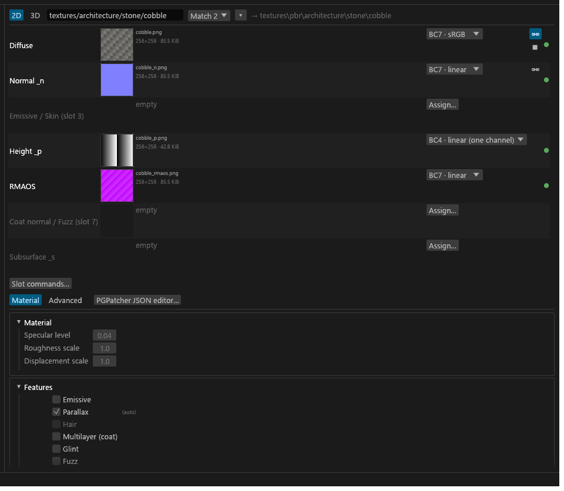
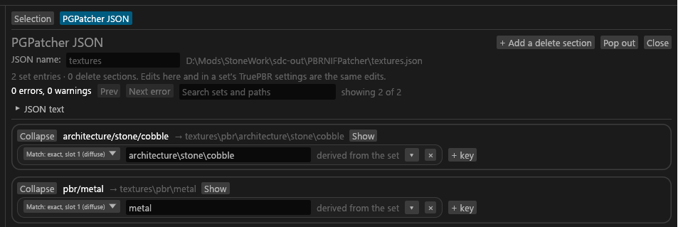

# PGPatcher settings and the JSON

This page is for mod authors making a PBR mod that PGPatcher patches: how to set a PBR set's PGPatcher values in Tessalith and get a JSON out of it. What each key does in game is in [PGPatcher's Mod Authors page](https://github.com/hakasapl/PGPatcher/wiki/Mod-Authors); this page covers how Tessalith edits and writes them.

## Before you start

- The set needs the **PBR** shader and the project needs `cs` mode. The JSON is written in `cs` mode only.
- Open the set and go to the set editor's **Material** tab. Everything below lives there or in the [JSON editor](#the-json-editor), and both edit the same values: a change in one shows in the other at once, and undo is shared.



## What's on the Material tab

| Group | What you set |
|---|---|
| Material | Specular level, Roughness scale, and Displacement scale while Parallax is on. |
| Features | Emissive, Parallax, Hair, Multilayer (coat), Glint, Fuzz. |
| Coat | Coat colour, specular level, roughness, strength, diffuse, normal, parallax and inner UV scale. Shown while Multilayer is on. |
| Subsurface | **Off / Standard / Foliage**, then colour and opacity. |
| Emissive, Glint, Fuzz settings | Their own values. Shown while the feature is on. |
| NiAlphaProperty | The `alphaprop_*` keys ([below](#nialphaproperty)). |
| Matching | The texture paths the entry matches (`match1` to `match8`). |
| CS PBR records | Community Shaders' records ([Set materials](GUI-Set-Materials.md#community-shaders-pbr-records)). |
| Advanced TruePBR settings | Path contains, Mesh path contains, Rename, UV and cubemap, vertex colours and depth, texture locks. |

Each group's header shows its state, like "Standard", "on", "2 matches" or an amber "matches nothing". Hover a plain-named key ("SSS width") to see its JSON key.

## Your textures turn features on

You rarely tick features by hand. Tessalith reads the set's files:

| File in the set | Turns on |
|---|---|
| `_cnr` | Multilayer and Coat normal |
| `_f` | Fuzz |
| `_p` | Parallax |
| `_g` | Emissive |
| `_s` | Subsurface: Foliage for Tree Anim meshes (or a trees/plants folder with no scan), Coat diffuse while Multilayer is on, Standard otherwise |

These read "(auto)", with the reason on hover, and go into the JSON. Untick one to store an explicit off, which wins over the file; ↺ removes your choice again. Remove the texture and its auto value goes with it.

## Features that can't go together

These are greyed out, with the reason on hover. A switch that's already on stays clickable so you can turn it off.

- Hair excludes multilayer, glint, fuzz, emissive, parallax and subsurface.
- Multilayer excludes subsurface.
- Multilayer, glint and fuzz exclude each other. (Coat normal needs Multilayer, so it can't go with fuzz either.)

A feature that's on without its texture blocks export, so add the texture or turn the feature off.

## Values you turned off are kept

Turn Coat, Emissive, Glint or Fuzz off and its values stay. The group reads "off" and "kept, not used", and you can still edit or reset them. They aren't written to the JSON until you turn the feature back on. Displacement scale works the same way with Parallax.

## Numbers and colours

- Numbers can't go below 0, and strengths, weights and opacities stay within 0–1. A value outside that is clamped, and the box tells you.
- Colour swatches take a `#RRGGBB` (the `#` is optional). Beside each TruePBR colour are three boxes, one per channel, from 0 to 10. <!-- D:AG133 --> Values above 1.0 are real: a fuzz colour of 1.25 is common, and opening the swatch won't clamp a stored 1.25.
- ↺ resets one field. There's no whole-set reset. The defaults themselves are fixed ([why](#quick-qa)).

## Subsurface

Pick one mode: Standard writes `subsurface`, Foliage writes `subsurface_foliage`, Off writes neither. Both modes need an `_s`. Export asks first if you pick Foliage for meshes that aren't Tree Anim, or Standard for meshes that are (that check needs a scan).

## A PBR set with no PBR albedo

A set with PBR maps (a lone `_f`, an `_rmaos`) but no `pbr_albedo` diffuse still gets a JSON entry under Community Shaders, as long as it has a filled slot (a set of only released DDS files gets none). Use it when your mesh keeps a vanilla diffuse and only adds PBR maps. <!-- D:HL5 -->

- **The match key** comes from the first of these that exists: the mapping's base, the mapped record's slot 1, the set's diffuse, the set id's own path.
- **Slot 1 is written**, as the mapping's slot 1 or else `textures\<that path>.dds`, so the mesh keeps its texture: PGPatcher skips a shape whose slot 1 points at a `textures\pbr` copy that doesn't exist.
- **Every filled slot names its output path.** An empty slot 2 or 6 takes the mapped path, or else `lock_normal` / `lock_rmaos` is written. A `slotN` or lock you set yourself wins.
- A vanilla diffuse isn't sRGB, so the mesh can look washed out; the set's info row in [Problems](GUI-Problems.md) says so. It works with PGPatcher 2.3.1 and Community Shaders (confirmed by the owner). <!-- D:HL7 -->
- On another target the set stays "PBR, no JSON", and its badge says "PBR set (no JSON on this target)".

## Matching

The entry applies when any of its paths matches. The set's diffuse path is on by default.

- **+** adds a path for slot 3 to 8, and **×** removes one. A row with no path matches nothing and isn't written.
- **IMPORTANT** A set that matches nothing is left out of the JSON. Export asks first, but check the Matching header for an amber "matches nothing" before you ship.

## Rename

**Rename** (Advanced TruePBR settings) takes a new file name, no folders. Your outputs keep the matched texture's folder under `textures\pbr\` and take the new name. Tessalith writes it as `match_diffuse` + `rename`, because `match_diffuse` is the key PGPatcher renames from. So a renamed set has exactly one match: **+** and **Match on this** are greyed until you clear Rename, and older extra rows say "not written".

If your matches point at different textures and Rename is empty, you get a warning: the output name depends on which match hits first. Point them at the same texture.

## NiAlphaProperty

These keys set the shape's alpha blending and testing in the NIF. A key that's off isn't written.

- **Override flags** writes `alphaprop_flags`. Build it with the checkboxes the way NifSkope does, or type the number. Turning it on starts at 4844: testing on, Greater, Src Alpha / Inv Src Alpha, blending off.
- **Alpha test threshold** writes `alphaprop_thresh` (0–255, starts at 128).
- **Create NiAlphaProperty if missing** adds one to shapes that have none. Without it, the flags and threshold only change shapes that already have one, and Export warns you.
- **Delete NiAlphaProperty** removes it and wins over the other alpha keys.
- **No sorter** does nothing in Skyrim SE: a RenderDoc capture showed the game draws blended shapes in their stored order either way. I keep the switch only so a stored value survives a round trip; Tessalith never sets it.

## Where the JSON goes

After a complete export, Tessalith writes `<export folder>\PBRNIFPatcher\<name>.json`. `<name>` is the **JSON name:** field in the JSON editor, which defaults to the folder name.

- Only sets that exported fully go in. Advanced skin sets have no entry.
- **IMPORTANT** Tessalith never overwrites a JSON it didn't write without asking you first. An identical file is left alone without a prompt.

## The JSON editor

Open it from **Export to ▾ → PGPatcher JSON editor…**, from the button beside the Material tab, or from the command palette. It shows the whole JSON as one tab, with one entry per PBR set and then your delete sections. **Pop out** gives it its own window.



- Each entry shows its set's keys with the same controls as the Material tab. **Show** jumps to the set.
- **+ key** adds any schema key. Keys Tessalith doesn't know show in amber and are kept as you wrote them.
- The **▾** [path picker](GUI-Set-Editor.md#path-pickers) on a match lists the scanned textures for that slot. Without a scan it lists only your project's paths.
- **JSON text** shows the file exactly as it would be written now, with **Copy**.

### Deleting vanilla shapes

**+ Add a delete section** makes PGPatcher delete the shapes it matches, for example a vanilla glow shape your PBR base shape replaces. Delete sections belong to no set, are saved in `sdc-project.toml` and are written with `delete: true` after the set entries.

If a delete section would hit one of your own sets, that set is struck through and outlined amber, and its set editor warns you too.

### Errors and warnings

The header reads "N errors, M warnings". Errors block Export; warnings are what Export will ask you about. **Next error** (F8) and **Prev** (Shift+F8) jump between them. The search box narrows the entries by set name or any path in them, but the counts always cover everything.

## Quick Q/A

**Why is my set missing from the JSON?** It matches nothing, it didn't export fully, it's an Advanced skin set, or the project isn't in `cs` mode.

**Why does my coat value do nothing?** Multilayer is off. The value is kept ("kept, not used") and goes into the JSON when you turn Multilayer back on.

**Can I change PGPatcher's defaults?** No. Every JSON Tessalith writes starts with the same `default` block:

```json
"default": {
  "emissive": false,
  "parallax": false,
  "displacement_scale": 1.0,
  "specular_level": 0.04,
  "roughness_scale": 1.0,
  "subsurface": false
}
```

Most mod authors never touch the `default` block, so I fixed it. That buys three things:

- `emissive`, `parallax` and `subsurface` become plain switches. An entry writes `true` when the feature is on and leaves the key out otherwise.
- The common values are written once. A set that uses specular 0.04, roughness scale 1.0 or displacement scale 1.0 doesn't repeat them; an entry only lists what differs.
- The file is a little smaller and much easier to read: each entry shows only what makes that set different.

To use another value, set it on the set (**Material** tab) and that entry carries it.
