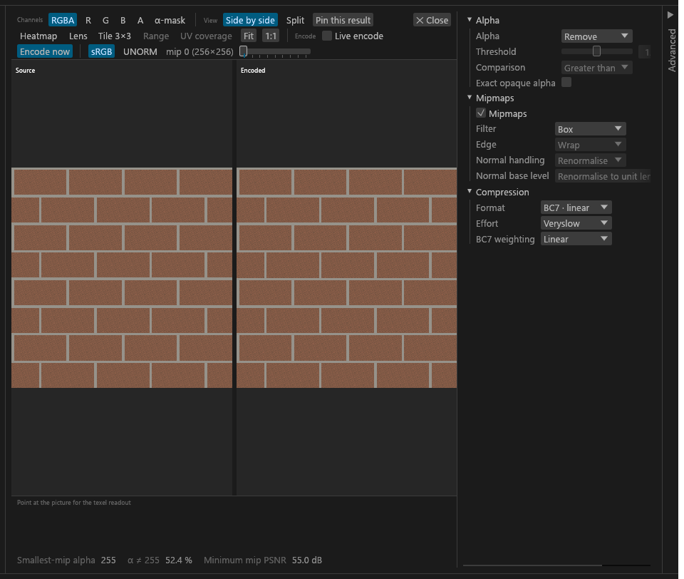
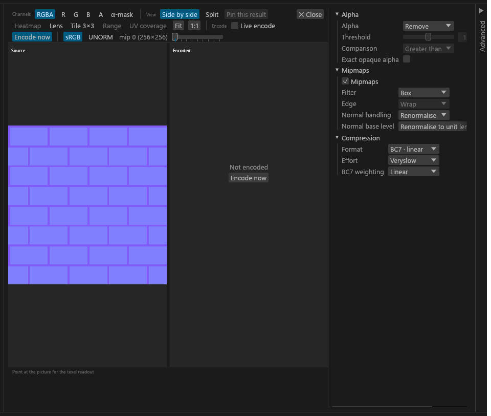

# The 2D preview

The expanded view of one texture: its source beside the encode Export would write, with readouts, a lens and a heatmap. For anyone checking what an encode does to a texture before exporting.

## The 2D preview

Double-click a tile (or a set member), or select it and press **Enter** or **Space**, to expand it into a preview with a Source side and an Encoded side. **Esc** or a double-click in a viewport collapses it again. The preview keys are listed in [Keyboard](GUI-Keyboard.md#keyboard): **[** and **]** step through the textures in the Textures column's order, **1** to **6** pick the channel buttons, **PageUp** and **PageDown** step through the mips, **L** toggles the lens and **T** the 3×3 tiling.

- **Live encode** is off by default. Encoding happens when you press **Encode now**. Switch Live encode on to encode after every edit (a short pause after each edit, then the encode starts). A result that no longer matches the settings is badged *stale* until it is replaced.
- Each previewed mip is byte-identical to the same mip of the DDS that Export writes.
- The preview encodes only mips whose larger side is at most 4096 pixels. A GPU that cannot hold a texture that large lowers the limit, and the preview says so.
- A DDS file in the folder previews as stored (there is no source side). Uncompressed DDS files preview from the CPU decode; BC2 and signed BC6H show "cannot be previewed".
- With no usable GPU the preview is off and says "No usable GPU: the preview is off; everything else works". Deciding, editing and Export still work.

## Toolbar

Three labelled clusters in one wrapping flow, with only **✕ Close** pinned to the right:

| Cluster | Controls |
|---|---|
| **Channels** | RGBA, R, G, B, A and the alpha mask. |
| **View** | A *Heatmap* of the difference to the source, *Lens*, *Tile 3×3*, the *UV coverage* overlay ([Artist checks](GUI-Artist-Checks.md#preview-overlay)), *Fit*, *1:1*, and the exposure slider for HDR formats. |
| **Encode** | *Live encode* and **Encode now**. |

After them come the sRGB / UNORM display and the mip slider. Both panes show the values the file stores, so a source and its encode look alike under either display. HDR formats are tone-mapped for display (`x / (1 + x)` per colour channel, then sRGB), and so are the tiles of stored HDR files.

A narrow toolbar wraps onto more rows in that order. **Encode now** is filled in the accent colour while it can encode.

Scroll zooms and dragging pans. Readouts under the viewports show the PSNR, alpha and normal-length checks for the mip on show.

## Readouts and tools

- **Texel readout.** Point at the picture, and the strip under the viewports shows the texel under the cursor: its coordinates at the mip on show, the source and the encoded RGBA as 0–255 and as floats, and the difference per channel with its largest (the channel the heatmap measures).
  - The numbers are the stored values. The first line says how the view reads them (sRGB-encoded, or linear under UNORM; HDR formats show floats only).
  - A channel button narrows the readout to that channel.
  - For a normal map it also shows both normals as vectors, the encoded one's length and the angle between them in degrees.
  - A side the preview does not hold (no encode yet, a DDS input's source, a mip above the limit) shows "—". Both sides read the same texel.
- **Lens** (**L**): a circle 160 points across that follows the cursor and magnifies the view 8× with no smoothing, centred on the texel under the cursor, with a crosshair. It shows in both viewports.
- **Tile 3×3** (**T**): the picture repeats three by three, to check the seams. Zoom, pan and the readout work on the tiled view; *Fit* fits all nine copies.
- **Exposure.** For HDR formats (BC6H, RGBA16F) a slider from −8 to +8 EV scales the values by 2^EV before the tone map. It starts at 0 for every texture.
- **Heatmap legend.** With the heatmap on, a colour bar under the viewports shows the scale from 0 to the *full scale* (the difference drawn white). A slider sets it from 0.005 to 0.5 (0.1 by default, about 25 codes of 255).
  - The heatmap is made in the background; after a full-scale change the previous one stays on show until the new one lands.
  - After a mip change the plain image shows instead, because a heatmap of another mip does not fit. The legend label reads "updating…", greyed, until the current heatmap is ready.

## Width and the settings strip

The preview never gets narrower than 480 points of picture. While a texture is expanded, the Textures and Sets columns and the Advanced drawer give way to keep that: the centre needs at least 520 points (the 480, the 24-point strip and the panel margin), and from 1280 points wide, 776 (with the 280-point settings panel in place of the strip). They get their chosen widths back when the preview closes.

The texture's settings sit in their own panel on the right of the preview.

- In a window 1280 points wide or wider, the panel starts open, and opening Advanced does not collapse it. With Advanced open at 1280 the picture can then be narrower than 480.
- In a narrower window, when the panel does not fit beside a 480-point preview, it starts as a narrow **Settings** strip; click it to open the panel.
- Once opened, the settings stay open until the preview closes, including when you expand another texture directly.

The Advanced drawer keeps the width you dragged it to, and is not saved to `gui.toml` until you drag it.
