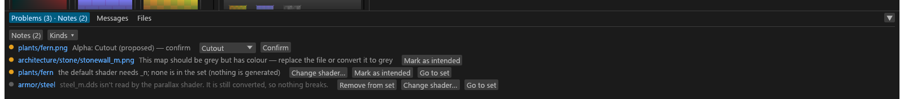

# Problems

For anyone getting a folder ready to export: the bottom panel's **Problems** tab lists one row per thing that needs you, each with its fix as a button, and keeps what Tessalith did on its own under **Notes**. What a code means is in [Diagnostic codes](Diagnostic-Codes.md).

## Reading a row

Rows come blockers first, then undecided textures, then warnings, then checks. Notes that have a button come last ([Problems and Notes](#problems-and-notes)). <!-- D:JO3 -->

| Dot | Meaning |
|---|---|
| Red | **Blocker**: stops the export. Fix it or remove the texture. |
| Amber | **Warning** (the export goes ahead) or a decision you owe. |
| Grey | **Check**, a hint from an artist check ([Texture types](Texture-Types.md#artist-checks)): a map that will probably look wrong in game. It never blocks and never changes "ready". |
| Grey, a note | **Info**: something Tessalith did for you, and why the output is fine. **Intended**: a row you marked as intended. |
| Green, a note | **Queued**: a fix that waits for the next export. <!-- D:JO9 --> |
| Green, on a tile or card | Nothing to decide. |

A row names where it is (a texture, set or file you can click; "Project" when it belongs to no file) and says the action in words. Hover it for the engine's message and code (`LOSS-ALPHA-DATA`), which is what Troubleshooting uses. Its buttons sit right after the sentence: the fix, a second fix if it has one, **Mark as intended**, then **Go to set** on a set row. <!-- D:JO10,JO13 -->

## Problems and Notes

The tab counts the two apart: `Problems (2) · Notes (67)` is 2 rows that need you and 67 that don't. <!-- D:JO3 -->

- **A problem** is a row about an output that may be wrong or a file that isn't written. A set with one isn't ready ([what Ready means](GUI-Sets-Column.md#reading-a-set-card)). Check rows count here too, but never against Ready. <!-- D:JO1,JO5 -->
- **A note** needs nothing from you: Tessalith used a default and the row says why that's fine (no metallic map, so the surface reads as not metal), you marked the row as intended, or a fix waits for the next export. Notes never count against Ready. <!-- D:JO1,JO2 -->
- **Where notes show:** the list shows the problems, then the notes that have a button. The **Notes (67)** pill lists every note, or the set's notes while a set filter is on. <!-- D:JO3 -->
- **Nothing left:** with no row at all the tab reads `Problems`. With only notes it reads `Problems (0) · Notes (67)`, and the list's first line reads "No problems. Notes (67) lists what Tessalith did for you." <!-- D:JO3 -->

## Rows and their fixes

A row you must act on has its fix as a button.

| Row | Fix |
|---|---|
| A blocker, for example a set that matches nothing | Its own button, or **Go to set**. |
| *Failed: …* | None: the texture failed to plan. |
| *Undecided: …* | The type buttons and **Acknowledge** ([below](#deciding-from-the-list)). |
| *Undecided: This type isn't available in this mode…* | **Set type…**, or change the mode in **Settings…**. A type with a fallback has **Acknowledge** instead: [Sub-types](Texture-Types.md#sub-types-what-each-file-becomes). <!-- D:JF3 --> |
| *Undecided: not a cube source (…)* | **Set type…**: the only answer is a different sub-type. |
| *Alpha: … — confirm* | The **Alpha type** dropdown and **Confirm**: [Deciding](GUI-Texture-Panel.md#deciding). |
| Warnings on a set | **Go to set** ([below](#go-to-set)). They never hold back Export or open Review. |
| A file's export warnings, after an export | Click the file. |
| A note about a change Tessalith made for you | **Undo this change** while that step is still the last one. While it has the button the note stays in the list, after the problems. <!-- D:FC3,JO3 --> |
| `CHAN-NORMAL-LENGTH`, a short normal | **Rebuild Z**, which sets the file's `channels.reconstruct_z`. On a file you already exported the row then reads *Rebuild Z is on for this file: export again to rewrite it*, a queued note with no button, until the next export. <!-- D:JO9 --> |
| `CHK-Z-SIGN` (a check) | **Rebuild Z**, which clears the row. <!-- D:JO15 --> |
| `SHADER-EXTRA-MAP`, a note: *{file} isn't read by the {shader} shader…* | **Remove from set** for that file, then **Change shader…**. The file leaves the set as **Remove member** does: [Textures in no set](GUI-Sets-Column.md#textures-in-no-set). <!-- D:JO15 --> |
| `SHADER-MISSING-MAP`, `SHADER-UNAVAILABLE` | **Change shader…**, a menu of the shaders the set's shader combo offers. <!-- D:JO15 --> |
| `SHADER-NORMAL-SPECULAR`, a note: *{file} is a vanilla normal…* (a PBR set's own normal) | **Use PBR normal**, which writes `subtype = "pbr_normal"`: the alpha is dropped and any `_rmaos` in the set bakes from it. Off on a locked slot or a read-only `sdc.toml`. A DDS kept as it is gets no button and reads *{file} is a kept DDS…*: it is not converted again, so its type can't drop the alpha. A DDS set to be encoded again (`reencode = true`) gets the button. <!-- D:JP3 --> |
| *The file name and the contents point to different types* | **Set type…**, the type picker. <!-- D:JO15 --> |
| *Parallax is on but the source has no alpha* | **Turn parallax off**, which writes `alpha.parallax = false`. <!-- D:JO15 --> |
| A PGPatcher feature clash | **Turn off {feature}** for each of the two; neither is the default. <!-- D:FN5 --> |
| *sdc.toml is read-only* (or `sdc-project.toml`) | **Clear read-only flag**, on that file only. <!-- D:FC10 --> |
| *Looks like complex grass, but is not tagged as grass* | **Tag as grass**, which writes `subtype = "complex_grass"`. <!-- D:FC10 --> |
| *Colour divided by alpha on load (premultiplied EXR)* | **Straight alpha**, which writes `alpha.exr_straight = true`. <!-- D:FC10 --> |
| *No albedo in this set; the mesh keeps {path}…* (a PBR set with no albedo) | No button: the set still exports. |
| *No mesh of the latest scan uses this diffuse yet…* (the PGPatcher entry is still written; LOD meshes don't count) | No button: the set still exports. |
| *No texture set of the latest scan uses this texture* (grey) | No button: the set still exports. |
| *Replaces {file} of the target mod in the load order* (an output the target mod already ships) | No button: the set still exports. Rename its outputs to keep the target's file ([Renaming](GUI-Bulk-and-Rename.md#renaming)). <!-- D:HL6 --> |
| *Preset {id} was skipped: it clashes with {other} on aliases* | **Remove aliases from {id}**: [Presets and targets](Presets-and-Targets.md#checking-and-installing). |
| *{n} saved settings name no file in this mode ({mode})* (grey, on Project; hover lists them) | **Entries ▾** lists each `[files]` entry with its own **Remove**; **Remove all** deletes every one as one undo step. [Before you remove one](#unmatched-files-entries). <!-- D:JI6 --> |

**Remove from set**, **Delete set**, **Remove match**, **Turn off {feature}**, **Turn parallax off**, **Clear read-only flag** and **Remove aliases from {id}** run on a mouse click only. Enter and Space do nothing on them, so a key press never takes a file out of a set or switches a feature off. <!-- D:JO16 -->

### Mark as intended

A warning you checked and want to keep as it is (a `_flow` map you made small on purpose) needs no fix:

1. Click **Mark as intended** on its row. The row moves to Notes with a grey dot and stops counting against Ready.
2. To take it back, click the **Notes (n)** pill, then **Undo mark** on the row.

Each click is one undo step. <!-- D:JO4 -->

- **Where it's kept:** `[project] intended` in `sdc-project.toml`, by the row's code, where it is and its sentence. Renaming a set keeps its marks; deleting the set drops them. When the sentence changes (another file name, another number), the row shows again. <!-- D:JO4 -->
- **Warnings and checks only:** blockers, questions and a file that failed validation in the last export have no mark. Fix those, or export again. <!-- D:JO4 -->
- **Greyed** with no project open and while `sdc-project.toml` is read-only; the hover says why. <!-- D:JO4 -->
- **No mark for a whole kind at once:** hide the kind instead ([Hiding kinds of row](#hiding-kinds-of-row)). <!-- D:JO4 -->
- **In hovers:** a tile's hover, a file's warnings in the **Files** tab and a set's check badge list marked rows last, under "Marked as intended:". <!-- D:JO4 -->

### Go to set

**Go to set** selects the set and opens it in the [Set editor](GUI-Set-Editor.md), closing an expanded texture preview first. When the row is about one slot or file (a missing map, a map the shader doesn't read, a PBR set's vanilla normal), the editor scrolls to that slot row or file and outlines it for two seconds. A row about the whole set opens the set and outlines nothing, and so does any row while the editor shows **3D**. <!-- D:JO8,JO14,JP3 -->

### Unmatched [files] entries

A `[files]` entry in `sdc.toml` whose key names no file does nothing. That happens when the file was renamed, moved or deleted. Problems lists every such entry in one grey row.

Check the mode in the row before you remove anything. Some files are planned only under `cs`, so an entry that names no file in `vanilla` can still match in `cs`.

- **Remove** and **Remove all** are greyed while the plan runs and while `sdc.toml` is read-only.
- **Remove all** is also greyed while `sdc.toml` names a different mode from the one in the row. Its hover lists what it deletes.

## Deciding from the list

- An undecided texture with a suggestion shows **Set type: X ✓** (a click decides it) and a **▾** for the type picker, which has a search box and the suggestion on top. With no suggestion it shows **Set type…**. **Accept all suggestions (n)** decides every texture that has one, as one undo step.
- Tab to a row and press Enter or Space to accept its suggestion and move on to the next row.

An accept is an edit in memory: **Save** writes it to `sdc.toml`.

## What the GUI writes on its own

When a plan settles, every sub-type taken from a High-confidence suggestion (including one the scanned meshes or a GRAS grass model gave it) and every alpha meaning taken from the meshes (also `remove`, an alpha they never read) is written to `sdc.toml` as a `[files]` entry, as if you had chosen it.

- It is one undo step, `Set {n} types automatically` (`values` when an alpha meaning is among them), and one Info row with **Undo this change**.
- These types alone, and the [switch off Advanced Skin](#sets-that-left-advanced-skin), don't count as your edits: no title dot, and no unsaved question on close, open or reload. <!-- D:JQ56 -->
- A file you already decided is never touched, and an Undo stays undone until the folder reopens.
- It re-types only while the type is still Tessalith's own pick. A type you changed is kept.
- A file that waits for a type records nothing: [why](Texture-Types.md#how-files-form-a-set).

### Sets that left Advanced Skin

A `_fuzz` or `_sheen` map doesn't make a set Advanced Skin ([why](Texture-Types.md#suffixes)). When you open a project, or `sdc.toml` is read again, Tessalith clears a recorded `skin_albedo` on a set's diffuse when only such a map made the set skin. The set then takes the shader its other maps give. <!-- D:JQ8,JQ56 -->

- **The row** reads *{n} set{s} left Advanced Skin (a _fuzz or _sheen map alone no longer picks it)*. Hover it for one line per file, `{file}: skin albedo → {type}`, then the types recorded with it, then *A _fuzz or _sheen map alone no longer makes a set Advanced Skin. To keep a set skin, choose Advanced Skin as its shader.* <!-- D:JQ19 -->
- **Undo this change** sits on the row while the switch is the last step. The switch and the types recorded with it are one undo step. <!-- D:JQ17,JQ56 -->
- **An undone switch runs again** the next time `sdc.toml` is read. The row's hover says how to keep a set skin. <!-- D:JQ56 -->
- **Not switched:** a set whose shader you picked, a set that other skin maps or types keep skin, and every set while `sdc.toml` is read-only. <!-- D:JQ8,JQ20 -->

## Narrowing the list

Click a row's subject to select it in the Textures view. Arriving from a count (**N undecided**, a set's **⚠** badge) opens the list narrowed, with a chip to clear it. The **Checks** pill narrows to check rows.

## Hiding kinds of row

**Kinds ▾** hides kinds of warning and info row for this project, such as every missing specular. Blocks and questions can't be hidden, and neither can a queued note. Hiding changes what the list and the tab's count show; a hidden row still counts for Ready. <!-- D:JO6,HC4 -->

- **The tab** counts hidden problem rows apart: `Problems (12 · 60 hidden)`. A hidden note counts nowhere. <!-- D:JO6 -->
- **The list's first line** says what is hidden, with the project's numbers: "2 kinds hidden in this project (60 rows). Hidden rows still count for Ready." <!-- D:JO6 -->
- **Kinds ▾ (n hidden)** counts the rows this list hides, notes included. <!-- D:JO6 -->
- **Showing them again:** tick the kind again in **Kinds ▾**, or click "+k more in Problems" on a set's status line, which shows the hidden kinds of that set's rows again ([Set editor](GUI-Set-Editor.md#is-the-set-ready)).
