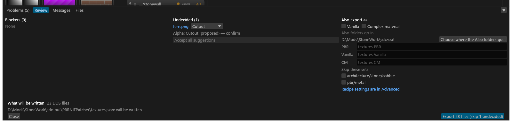

# Review and Export

What **Export** does, the Review panel that opens when something needs a look first, and the Files tab that shows an export's progress. For anyone exporting a folder.

## Export

**Export** converts the folder into the export folder (**Export to ▾** in the header; see [Export to](GUI-Main-Window.md#export-to) for how the folder is chosen and where it is saved). It cannot write into the folder it reads, and Review blocks the export until a folder is chosen ("No export folder chosen"). With no folder open at all, Review's Export writes the NIF edits alone, to that folder (no textures, no `sdc-out`). With an `sdc-project.toml` that does not parse, the chosen folder goes to `gui.toml` instead.

1. Export saves `sdc.toml` and `sdc-project.toml` first.
2. When something needs an answer, [Review](#review) opens in the bottom panel instead of exporting.
3. If a source file changed on disk since it was planned, the textures concerned show "changed on disk" and the Textures column offers **Reload**, which re-reads only the changed files. Export checks first and plans again by itself; the GUI also checks whenever its window regains focus.
4. The bottom panel opens on its [Files tab](#the-files-tab).
5. After a complete export, the PGPatcher JSON is written ([Where the JSON goes](GUI-PGPatcher-JSON.md#where-the-json-goes)). NIF edits are written after the textures ([NIF edits](#review)).

**The header button.** **Export** reads "Review n files" until the project is clean (a folder chosen, files to write, planning finished, nothing undecided), then "Export n files" in the accent colour. <!-- D:FB1 --> With no folder open it reads plain "Export". Hover it for "N files, M problems" and what Review still has open.

**Copy CLI command** (Files tab) copies the `sdc convert` command that reproduces this export: the same folder (with `--recursive`), output and thread count, and `--accept-suggestions high`, as the GUI plans. Export saved `sdc.toml` first, so the command gives the same manifest records and DDS bytes for everything `sdc.toml` decides. The CLI reads neither `sdc-project.toml` nor the scan, so set edits (moved files, created sets, borrows, set renames, output names, set shaders) and the mesh and grass evidence do not apply, and sets that depend on them come out differently. The sub-types and alpha meanings that evidence decided are written to `sdc.toml`, so those carry over.

The hash of each JSON Tessalith writes is recorded at once in `_sdc/generated.json` beside `sdc-project.toml`, so discarding unsaved edits after an export, a crash, or a read-only `sdc-project.toml` does not make the next export ask about Tessalith's own JSON. <!-- D:FC11 -->

Files an earlier export wrote that the project no longer produces stay in the export folder; Tessalith never deletes them.

With [Also export as Vanilla and CM](GUI-Also-Export.md) on, Export always opens Review, and Review's Export writes three folders.

## Review

Press **Export**: a clean project exports at once, but when something is blocked, undecided or worth a second look, Review opens in the bottom panel instead of a dialog. It opens for any of these: a blocker, an undecided texture, a PGPatcher JSON edited outside Tessalith, or NIF edits waiting to be exported (Review's **Export** is the only way they are written).

- Review does not lock the window. Keep editing and its lists update; Export from Review uses the plan current at that moment.
- Review never exports by itself, not even when you decide the last texture: its **Export** button is the only way out. Enter does nothing there.
- When Export becomes available, the button in Review and in the header turns to the accent colour; losing it takes both back.
- **Size.** Review opens at 40 % of the window's height, worked out when Review first opens; drag its top edge to change that, and Tessalith remembers your height. Review and Problems keep separate heights. Under 1200 points of window width the sections stack in one scrolling column (Blockers, Undecided, then Also export as when it shows). In the Meshes view with a NIF selected the bottom panel stops where the 3D preview keeps its 160 points; your height comes back in the Textures view.

Each column's heading carries its count: **Blockers (n)**, **Undecided (n)**. Pitfalls and other warnings are not listed here: they are Warning rows in [Problems](GUI-Problems.md) and never hold back Export.

- **Blockers** (red), with **Go to set**. A missing export folder is a blocker, so it counts; so do a missing preset (with **Choose preset…**) and a read-only `sdc.toml`. <!-- D:FP8 --> Export stays greyed out, with the reason beside it ("Fix 2 blockers first"), until they are fixed.
- **Undecided**: one row per texture with its question and the same buttons as a [Problems](GUI-Problems.md#deciding-in-problems) row: **Set type: X ✓** with ▾ for another type, the **Alpha type** dropdown, or **Acknowledge for this texture** (or **Drop the alpha anyway**, see [Words](GUI-Main-Window.md#words)). Click the name to select the texture. **Accept all suggestions** works as in [Problems](GUI-Problems.md#deciding-in-problems); the others stay listed. A texture decided here leaves the list.

**Overwrite questions** (in Blockers): a PGPatcher JSON edited outside Tessalith ("<name> was edited outside Tessalith") and a NIF whose export path holds a file Tessalith did not write ("<path> was not written by Tessalith") each have **Keep the edited file** or **Overwrite it**. Neither is chosen until you click, and Review's **Export** stays off ("Answer Keep or Overwrite for <name>") until every one is answered. The answer is tied to the file as it is now: a change to the file before you press Export is asked again; a change during the export is kept, with a note. The answer applies to the next export only; closing Review or a reload clears it. The Community Shaders PBR and complex-material JSON show their state only; a file of those edited outside Tessalith is kept, with a note.

**What will be written**: the number of DDS files and one line per JSON file with its state on disk: *will be written*, *will be replaced (written by Tessalith)*, *edited outside Tessalith* or *cannot be read; kept*.

**NIF edits (n)**, at the top of the footer, lists each NIF with pending edits: `path · mod · n unused blocks removed · written to <export folder>`. A NIF edit that cannot be exported is listed apart under **NIF edits skipped (n)** as `path: reason` in amber; it never holds back the textures. A NIF edit blocked only by the missing export folder is listed under **NIF edits skipped until an export folder is chosen (n)** instead, and **NIF edits (n)** counts only the edits that will be written. Review's own **Export** names only the NIF edits it writes, and lists a blocked one with what it skips (`Export 2 files + 1 NIF edit (skip 1 undecided, 1 NIF edit)`). The NIF edits are written once the texture export (and, with Also on, its final walk of the folders) has ended; a cancelled export writes none. The result is a line in Messages and in the export notes.

**Export 20 files (skip 2 undecided)** exports the decided textures and skips the rest; it never decides for you. **Close** closes Review and cancels an Export it had queued.

If a source changed on disk or a plan is still running, a click on Export waits for the plan and then checks again (Review shows "Planning…" beside its Export button until the plan lands); a new blocker or unanswered question in the meantime stops the export and says why in Review. Opening another folder or reloading closes Review and exports nothing. If the plan fails, Review stays open with its blockers.

## The Files tab

The **Files** tab of the bottom panel opens when Export starts. One row per file, with its state: queued, running, converted, validation failed, up to date, skipped, failed, cancelled.

- While the export runs, its line reads *done/total · elapsed · files/s · ETA*. Files per second is the average of the last 10 seconds, and the ETA appears once 3 files have finished or 2 seconds have passed.
- **Failed only** (failed, or failed validation) and **Has warnings** narrow it; together they show the files that match both. Click a row to select that texture. **Show in Explorer** on a row selects the written output once it exists, otherwise the source file.
- A file's export warnings show when you hover its row, and the **Problems** tab lists them, once the export has ended, as rows that select the file.
- **Cancel** stops the batch. **Save report…** writes the report (JSON Lines or Markdown) in the background and says "Saved report: <path>" (or why it failed) in the status line and a toast. **Copy CLI command** copies the matching `sdc` command ([above](#export)). **Open export folder** opens the export folder in Explorer (greyed out, with the reason, until Export has created it). **Close** collapses the panel.
- What the export did besides converting (a JSON written, not written or kept, the borrowed-slot copies, files left in place) is listed under **Notes**, a collapsible list that scrolls when it is long. The Markdown report has the same lines under *Notes*; the JSON Lines report is the engine's event stream without its per-mip progress events. <!-- D:FN4 -->
- When Export ends, one Info line counts the artist-check warnings ("Checks: 3 warnings on 1 texture and 1 set; see Problems").
