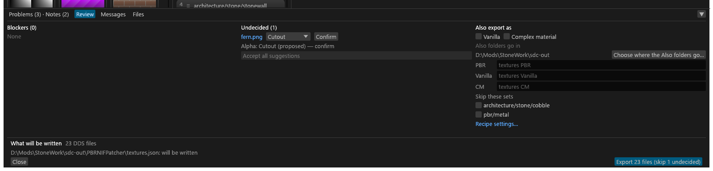

# Review and Export

For mod authors exporting a project or a few sets, Review shows which files Tessalith will touch. The Files tab shows what happened.

## The Export button

Click **Review n files…** in the header to review the whole project. Pending NIF edits appear beside the file count. **Export** in the **Ctrl+K** palette does what the header button says, even with Review open for one set or group. If the header says **Export n files now**, the palette starts the whole-project export immediately. <!-- D:JY2 -->

To skip Review on a clean export, tick **Export without review next time** beside **Close** in Review. Clear **Export without review** in **Settings…** to bring Review back. Both controls need an open, writable project that has finished opening. <!-- D:JY3 --> The choice belongs to this project and starts off. It saves at once if the project document is clean, or with your next **Save** if you have edits. <!-- D:JY1 -->

**Export n files now** writes on click. You'll see it when planning has settled, there are files to export, and nothing needs review. Blockers, undecided textures, counted problems, writable NIF edits, edited PGPatcher JSON or an applicable **Also export** tick bring you to Review. Checks, Notes, queued fixes and marked warnings don't prevent a clean export. <!-- D:JY2 -->

## What Export does

1. Check the files and resolve any blockers in [Review](#review).
2. Click Review's **Export** button. Tessalith saves pending settings in `sdc.toml` and `sdc-project.toml` before writing outputs.
3. If a source changed on disk, Tessalith plans again and checks whether the export can proceed.
4. The [Files tab](#the-files-tab) opens when the export starts.
5. After a complete texture export, Tessalith writes the [PGPatcher JSON](GUI-PGPatcher-JSON.md#where-the-json-goes), then any [NIF edits](GUI-NIF-Edit.md).

Export can't write into the folder it reads. With no export folder chosen, Review blocks the write. [Choose the destination](GUI-Main-Window.md#export-to).

**IMPORTANT:** files an earlier export wrote that the project no longer produces stay in the export folder. Tessalith never deletes them.

Discarding edits, a crash or a read-only `sdc-project.toml` never makes the next export ask about Tessalith's own JSON. <!-- D:FC11 -->

## Encoding every output again

Export encodes only what changed ([what counts as changed](Validation-and-Output.md#re-runs-and-if-changed)). After a Tessalith update that changes how a texture type is encoded, or to rebuild a mod from scratch:

1. Open **Tools ▾** in the header and tick **Re-encode every output**. The menu stays open.
2. Start a whole-project or scoped export and confirm it if Review opens.

- Tessalith re-encodes the outputs included in this export that the destination's manifest already records.
- A file there that Tessalith has no record of is still kept and reported as `OUT-UNKNOWN-EXISTING` ([why](Validation-and-Output.md#re-runs-and-if-changed)).
- The tick is for one export: it clears itself when that export starts, so the next **Export** encodes only what changed again. It is off each time Tessalith opens and isn't saved. <!-- D:JA11,JA12 -->

When an export keeps outputs instead, its **Export details** in the Files tab say how many of each kind, for example `1 kept at a higher quality target`, and point you to this item.

## Exporting part of the project

Use these when you're tuning one set and don't want to wait for the whole mod, or when finished sets should stop being rewritten.

- **Export set** (a card's right-click menu), **Export n sets** (the menu of a selection) and **Export group** (a group header's menu) export only those sets. A borrowed slot or resolved slot link brings its source set along, including any sets it borrows from. <!-- D:HF10 -->
- These commands open Review for the selected sets. The same [project preference](#the-export-button) allows a clean selection to export immediately. Other sets' problems don't hold it back. Project-wide blockers still apply. Review's button names the selection, for example **Export group Armor**. Closing Review or finishing the export clears the export scope. <!-- D:JY2 -->
- **Exclude from export** on a group header leaves its sets out of every whole-project **Export** until **Include in export**. **Export group** on an excluded group still exports it, and the group stays excluded. A set borrowing from an excluded set doesn't bring it in: the excluded set's file on disk is used as it is. <!-- D:HF11 -->
- Files of the sets left out stay exactly as they are in the export folder: Tessalith doesn't touch, rewrite or report them. Their per-set JSON files stay too, and the PGPatcher JSON keeps their entries ([Where the JSON goes](GUI-PGPatcher-JSON.md#where-the-json-goes)). <!-- D:HF12 -->
- A partial export writes the PBR folder only. Its Review omits the [Also settings](Set-Shaders.md#turn-it-on). An excluded group gets no Vanilla or CM files.

These entries are greyed while an export runs, and **Export set** is greyed on a set whose files are all gone.

## Review

Review opens in the bottom panel. You can edit the project with Review open and its lists update. Deciding the last texture doesn't start the export. Click **Export** to write, or **Close** to leave.

- **Blockers** (red) carry the buttons of [Rows and their fixes](GUI-Problems.md#rows-and-their-fixes). A missing export folder, a missing preset (**Choose preset…**) and a read-only `sdc.toml` count as blockers. <!-- D:FP8 --> Export stays greyed with the reason ("Fix 2 blockers first").
- **Undecided** rows carry the same buttons as Problems, and **Accept all suggestions**: [Deciding from the list](GUI-Problems.md#deciding-from-the-list). Warnings aren't listed here: they never hold back Export ([Problems](GUI-Problems.md#rows-and-their-fixes)).
- **What will be written** groups the primary outputs by path under **Will be written**, **Up to date**, **Kept** and **Protected**. While it says *checking which changed…*, you can still export. A path labelled *depends on this export* shows where the file goes. Tessalith can only tell during export whether it will write or change that file. **Will be written** counts only definite writes. The list also shows the state of each JSON. <!-- D:JY7,JY8 -->
- **Also updated:** lists other paths the export can change, including project settings, ownership records, the output manifest and borrowed-slot copies. Hover an entry for its full path and purpose. An extra output folder has one entry for its contents. <!-- D:JY4 -->
- **NIF edits** lists each edited NIF. An edit that can't be written appears in amber with its reason. You can still export the textures. Cancelling the texture export leaves the NIFs alone.

**Export 20 files (skip 2 undecided)** writes the decided textures. **Close** cancels an export queued from Review.

### Options

**Options** starts closed. Open it for **Also export as**, the extra folder names, CM settings, skipped sets and **Recipe settings…**. An Also blocker opens this section and gives its reason under **Blockers**. When Options is closed, its heading still names the active folders and any skipped sets. <!-- D:JY5 --> With an Also tick on, **Export 20 files + Vanilla folder** counts the primary PBR files. The extra folders are planned during export. <!-- D:JF1 --> [Choose the Also folders and recipe](Set-Shaders.md#where-the-folders-go).

### Overwrite questions

A PGPatcher JSON edited outside Tessalith, or a NIF whose export path holds a file Tessalith didn't write, asks **Keep the edited file** or **Overwrite it**. Neither is preselected, and Review's **Export** stays off until each is answered. The answer is tied to the file as it is now and applies to the next export only. The Community Shaders PBR and complex-material JSON are never overwritten when edited outside; they are kept, with a note.

## The Files tab

The **Files** tab opens when Export starts, with one row per file and its state. **Failed only** and **Has warnings** narrow it, and **Show in Explorer** on a row selects the written output.

- **Save report…** writes the report as JSON Lines or Markdown.
- **Copy CLI command** copies the matching command line: [CLI reference](CLI-Reference.md#does-the-cli-use-my-gui-edits).
- **Export details** lists what the export did besides converting, including JSON files written or kept, borrowed-slot copies and files left in place. The Markdown report has the same lines under **Export details**. <!-- D:FN4,JY19 -->

Read the result in **Files** or **Messages**. Written, up-to-date, failed, kept, protected and cancelled outputs account for the progress total. Skipped source files have a separate count. With Also folders, each phase reports its own results. <!-- D:JY8 --> An Info line counts the artist-check warnings.
