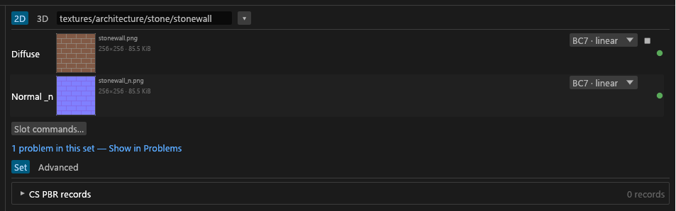
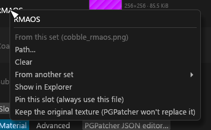

# Set editor and mapping to a target

For anyone filling a material set's slots, wiring packed channels, or pointing a set at a record, mesh or file of your target mod. Cards, moves and filters are on [Sets column](GUI-Sets-Column.md).

## The set editor

Select a set and the centre column shows its heading row (the input name box, [Bulk editing and renaming](GUI-Bulk-and-Rename.md#input-name-box); the **Match** box on a TruePBR set; **2D | 3D**, see [Previews](Previews.md)), then the slot rows, then two tabs. **Material** (**Set** on a vanilla set) holds the PGPatcher settings ([PGPatcher settings and the JSON](GUI-PGPatcher-JSON.md#whats-on-the-material-tab)) or a material card ([Advanced skin](PBR-Landscape.md#advanced-skin), [PBR Landscape](PBR-Landscape.md)). **Advanced** has the same sections as the [Advanced drawer](GUI-Texture-Panel.md#advanced-drawer).

## Slot rows

One row per PGPatcher slot the set's shader uses, in slot order, at most 8. A filled slot the shader can't use stays, amber, with the reason on hover. The cubemap has no row: set it with a slot command.

- Landscape sets add **Projected noise** and **Detail normal**. They aren't PGPatcher slots: [PBR Landscape](PBR-Landscape.md).
- Slot 7 holds the set's `_cnr` or `_f`. With both, the row turns red, lists each with a ✕ to take one out, and export warns "_cnr and _f both use slot 7", because PGPatcher has one slot 7. A `_g` and an `_sk` on slot 3 clash the same way.
- A `_coat` fills Subsurface, which then reads **Coat colour + strength**.
- A complex `_m` has no row. Its **Enable parallax** box sits under the rows ([Texture settings](GUI-Texture-Panel.md#changing-a-setting)).
- **Match on this** (Diffuse, Normal) makes PGPatcher apply the entry to meshes with that exact texture in that slot ([Matching](GUI-PGPatcher-JSON.md#matching)). **Opaque** (Diffuse) strips the alpha.

Drop a file from Explorer on a row to fill it. It must be a texture of the open folder and fit the slot; files are never copied, and the row says why if it refuses. The **Shader** dropdown lists the Mode's shaders, **Auto** clears your pick, and how a shader is chosen is on [Set shaders](Set-Shaders.md#how-the-shader-is-picked).

## Slot menus

Right-click a slot row, or a member chip on a card.

- **Clear**, **From this set** and **Path** are one undo step each. On a borrowed slot, From this set and Clear both drop the borrow. <!-- D:HC7 -->
- **From another set** links the slot to a map of another set. It needs the same slot kind.
- **Pin this slot (always use this file)** keeps the slot's file as it is. A pinned slot refuses drags and slot commands, bulk edits skip it (*slot locked*), and automatic re-typing leaves it alone. Pinning the diffuse of an Advanced skin set has a side effect: [Texture types](Texture-Types.md#suffixes). The pin is saved in `sdc-project.toml`, never in the PGPatcher JSON.
- **Keep the original texture** / **Let PGPatcher replace the texture** toggles the slot's PGPatcher lock (`lock_diffuse`, `lock_normal`, `lock_emissive`, `lock_parallax`, `lock_rmaos`, `lock_cnr`, `lock_subsurface`) on a set that writes a PGPatcher entry. PGPatcher then leaves the mesh's own texture in that slot. The file is still exported, and the card shows a padlock, *kept by PGPatcher*. A `slotN` command on the same slot wins ("slotN overrides the lock"). There is no cubemap lock, because `lock_cubemap` would clear the slot.
- **Show in Explorer** selects the source file.

**Slot commands…** on a row is the same list plus *Pin slot N*.

## Packed channel sources

Under a packed output (`_rmaos`, `_rfaos`, `_m`, `_p`), each channel has a **Source** picker: a helper or **Value**. Picking a helper adds the channel to that helper's `helper.fills` and takes it off the others, as one undo step ([Packing PBR maps](Texture-Packing.md#helper-textures)). **Value** uses the channel's `packing.fill.*` with a **Reset**; it is greyed when the channel's file feeds it by name. The engine still decides: a pick that can't fill the channel shows the helper as not used, with the reason.

## Shared helpers

Under the slot rows, each helper the set shares ([Sets column](GUI-Sets-Column.md#moving-textures-between-sets)) has a row with its name, outlined amber like a borrowed slot. Click the row to open the helper; its panel lists every set that shares it under **Shared with**. A shared helper is offered in the **Source** pickers above. **✕** (**Stop sharing**) takes it out of this set only; the file stays where it is. If the file is deleted from disk, the share clears itself and Messages says so. <!-- D:HH7 -->

## Mapping to a target

**Map to target…** in a set's menu ties the set to something that already exists, so its files are written where that thing points: a texture set record (`TXST`) of your plugins, or a mesh or a texture file of your target mod. A mapped set's menu has **Change mapping…** and **Remove mapping**, which puts the outputs back on their default names.

- **Greyed when** no [scan](Mod-Scanning.md) with records exists and no target mod is set ("Scan your mods first"), and for a PGPatcher PBR set with an albedo under `cs` with no target mod: those name their outputs in the JSON, so use **Rename outputs**. <!-- D:HG8,HL4 -->
- **The target mod** is the mod folder you're working on. The dialog's top row shows it, read only, with **Choose…** and **Clear**. A folder that is your export folder, sits inside it or holds it is refused, with the reason in red. Tessalith only reads the target and never writes into it. <!-- D:HL1 -->
- **Three kinds of row.** With a target mod the list has a kind column: **Record** (a record of the target's plugins), **Mesh** (the texture paths of a mesh's shapes) and **File** (a texture file base such as `textures/…/arch`, its suffixes grouped). With no target mod the list is every winning record of the scan. A mesh or file mapping is stored as `base` in `[sets.txst]`; a slot the source lacks goes to the base's folder, with the file's default name on the base's name. Only loose files are listed: a BSA-packed target gives its records only, and a target that isn't in the scan gives none ("Records come from the MO2 scan; this mod isn't in it", or "...this folder has no plugin" for a plain texture folder). <!-- D:HL3 -->
- **`used by (N)`** counts the target's records and its distinct mesh paths (meshes sharing a colour path count once) that name the row's colour path, the row's own mesh or record included, so you see what a file replaces. <!-- D:HL2 -->
- **The picker** lists the scan's winning records by EDID, FormID, plugin and colour path. Typed words must all match. A picked row shows each file's new path or "keeps its own path". **Map** stores it, and so does Enter while no widget has focus (not in the search box, not on a focused button); a click outside doesn't. <!-- D:HG8 -->
- **The mapping survives load-order changes.** <!-- D:HG8 --> `[sets.txst]` in `sdc-project.toml` copies the record's paths, so a new scan never moves an output by itself. The card shows `Record: …`. The target mod itself is kept as `[project] target_mod` in the same file, and only the GUI reads it.
A slot file is written at the record's path, ahead of **Rename outputs**. A file with no slot in the record keeps its path. A record path outside `textures/` or not ending in `.dds` is never written, and two sets on one path give the duplicate-output row. A file already there that Tessalith didn't write is kept and reported as `OUT-UNKNOWN-EXISTING` ([Validation and output](Validation-and-Output.md#re-runs-and-if-changed)). <!-- D:HG5,HG6 -->

An empty slot of a mapped set reads one of three ways:

| Row | Meaning |
|---|---|
| Amber, borrowed | Another set in the project writes the record's path. Nothing is added to `sdc-project.toml`, and one `_n` is written. <!-- D:HG7 --> |
| Grey **From record: body_s.dds** | No set writes the path. The slot counts as supplied: no missing-map warning. |
| **empty** | The record names nothing for the slot. |

A file the set has, a borrow and a pin all win over a fill. **Clear** turns a fill off and brings its missing-map warning back; **From {set}** or **Use the record's slot** turns it on again. <!-- D:HG7,HG9 --> After a scan, a mapped set whose paths differ from the record gets a Problems row "Record {EDID} changed" with **Use new paths**. A record missing from the scan gets an Info row and the mapping stays. <!-- D:HG8 -->

On the command line: [what it reads from your project](CLI-Reference.md#does-the-cli-use-my-gui-edits).
