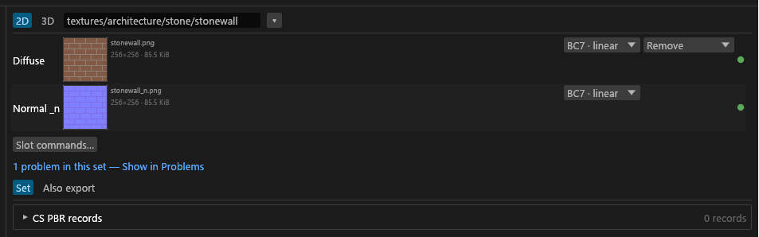
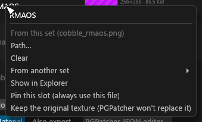
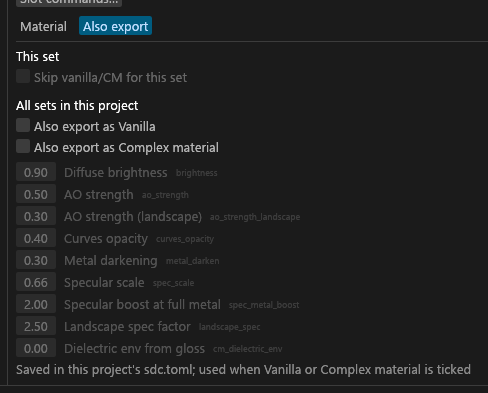

# Set editor and mapping to a target

For anyone filling a material set's slots, wiring packed channels, or pointing a set at a record, mesh or file of your target mod. Cards, moves and filters are on [Sets column](GUI-Sets-Column.md).

## The set editor

Select a set to open its editor. The centre column shows [readiness](#is-the-set-ready), the [input name box](GUI-Bulk-and-Rename.md#input-name-box), **Match** on TruePBR sets, and [**2D | 3D**](Previews.md). In 2D, [Output files](#output-files) and slot rows precede two tabs. **Material** (**Set** without PGPatcher JSON) holds [PGPatcher settings](GUI-PGPatcher-JSON.md#whats-on-the-material-tab) or an [Advanced skin](PBR-Landscape.md#advanced-skin) or [PBR Landscape](PBR-Landscape.md) card. [**Also export**](#also-export-tab) holds Vanilla and CM settings.

## Is the set ready?

Readiness stays above the slot rows as you scroll. See [what counts against Ready](GUI-Sets-Column.md#reading-a-set-card). <!-- D:JO7 -->

- "Ready: nothing in this set needs you." with a green dot.
- "Not ready:" with an amber dot, up to three reasons as buttons, then "+k more in Problems" for the rest.
- A red dot instead means the set blocks the export, as on its card. <!-- D:JO7 -->
- "Not ready: this set has no files yet." with no reason buttons, for a set you created that has nothing in it yet. A set whose entries match no file lists what is wrong instead, such as "No file matches …". <!-- D:JO7 -->

Click a reason to go to its fix:

- **A missing map** reads "no {slot} (Assign…)". The editor switches to 2D if it shows 3D, then scrolls to that slot row and outlines it, as [Go to set](GUI-Problems.md#go-to-set) does, and puts the keyboard on its **Assign…**. A slot named with its own brackets reads "no Emissive / Skin, slot 3 (Assign…)". <!-- D:JO7 -->
- **Any other reason** unhides its kind and opens its row. Focus can land on an action, the row, or neither. [Keyboard focus in Problems](GUI-Problems.md#narrowing-the-list). <!-- D:JO7 -->
- **+k more in Problems** shows the hidden kinds among this set's reasons again, then opens the [ordinary set filter](GUI-Problems.md#narrowing-the-list). <!-- D:JO7 -->

## Output files

In 2D, **Output files** lists DDS files from the set’s slots and members, including slotless files and files displaced by a share or link. Labels use the row title or filename. Paths outside the export folder are absolute. Hover for the full path. The closed header counts files on disk (“2 of 3 on disk”). Those files have **Show in Explorer**. <!-- D:JR3 -->

## Slot rows

Rows follow the shader’s PGPatcher slots in order (up to 8). An unusable filled slot stays amber. Hover for the reason. Set the cubemap with a slot command.

If any row has a format dropdown, the headings read **Slot**, **File** and **Format**. Diffuse’s alpha dropdown adds **Alpha**. Hover for the full format. <!-- D:JR4 -->

Borrowing **Normal** makes [your roughness bake use the lender’s highest-priority normal](Texture-Packing.md#variance-and-gloss-bake) your shader accepts. The slot can show another file. A lender can supply its own normal while displaying a borrowed one.

When a PGPatcher entry or skin material uses a borrowed slot, **Problems** warns if no entry or material uses your own DDS. Export still writes it, and the warning can name a pack missing from **Output files**. The row names the lender and, when known, each shared pack input’s owning set. <!-- D:LB -->

Remove the share or the own file, or drop the borrow. If a mesh or another mod uses the DDS, choose **Mark as intended** for this set and slot. <!-- D:LB -->

- Landscape sets add **Projected noise** and **Detail normal**. They aren't PGPatcher slots: [PBR Landscape](PBR-Landscape.md).
- Slot 7 takes `_cnr` or `_f`. With both, the red row lists each with a ✕ to remove it. Export warns “_cnr and _f both use slot 7”. Slot 3 treats `_g` and `_sk` the same way.
- A `_coat` fills Subsurface, which then reads **Coat colour + strength**.
- A complex `_m` has no row. Its **Enable parallax** box sits under the rows ([Texture settings](GUI-Texture-Panel.md#changing-a-setting)).

With the JSON panel open, **Match on this** (the Flags link mark) matches meshes using that exact own or borrowed Diffuse or Normal texture. For a linked row use [Matching](GUI-PGPatcher-JSON.md#matching) on the Material tab. <!-- D:JR1,JR4 -->

Drag a texture from Explorer onto a compatible row. The file must belong to the open folder. The row explains refusals. No files are copied. **Shader** lists the Mode’s shaders. **Auto** clears your pick. See [Set shaders](Set-Shaders.md#how-the-shader-is-picked).

`sdc.exe` doesn't read your shader pick. So when you pick **PBR**, **PBR grass** or **PBR Landscape** for a set with a `_fuzz` or `_sheen` map, Tessalith writes the types `sdc.exe` needs, in the same undo step:

- `subtype = "pbr_fuzz"` on the fuzz map. It gets none when the set has its own `_f`, when you set its `helper.role`, or when it is a DDS kept as it is.
- The PBR type (`pbr_albedo`, `pbr_normal`, `pbr_emissive`) on eligible members whose type Tessalith chose.

Picking **Auto** or a shader outside the PBR family takes back what that pick wrote, unless you changed it since. A shader outside the PBR family, other than **Advanced Skin**, also restores `diffuse` and `glow` on colour and glow maps Tessalith typed while the set was PBR, so `sdc.exe` types those files the same way (the fuzz map is another matter: [Does the CLI use my GUI edits?](CLI-Reference.md#does-the-cli-use-my-gui-edits)). A file in a pinned slot keeps its type either way. <!-- D:JQ9,JQ16,JQ31,JQ54,JQ59 -->

### Picking a shader for a normal

The set’s own, unlocked Normal slot follows your shader pick when Tessalith recorded its type and still owns that choice. **PBR**, **PBR grass**, **PBR Landscape** and **Advanced Skin** use `pbr_normal`. **Eye** can use `msn`. Picking a regular tangent-space shader restores `normal` or `landscape_normal`. Returning to **Auto** from an explicit PBR-family or Eye pick clears the followed type, even if you click **Auto** before the Eye plan finishes. Tessalith can then record the next suggestion. A type or alpha policy you chose stays yours. A kept DDS keeps its type. When a normal follows its set’s shader, Tessalith changes its settings only if the entry controls one input. The same check applies to **Keep alpha**, a shader pick, the diffuse’s **Switch** and **Revert**, and **Reset all**.

If a cube face is read through `wall.png.tga`, recording its type can also mark `wall.png` as a cubemap. A mesh scan can write an alpha setting for `wall.png` that also applies to `wall.png.tga`. If the second file is a shared normal, **Remove** can drop its alpha without a **Keep alpha** row, as before this release. <!-- D:JS5,JS6 -->

## Alpha

The Diffuse row's alpha dropdown shows the texture's alpha type (**Remove**, **Cutout**, **Blend**, **Cutout + Blend**, **Data**: [Alpha](Texture-Types.md#alpha)). Picking another type writes `alpha.policy` as one undo step. **Confirm** sits beside it while the alpha is asked, and **↺** goes back to the inherited type once the texture has its own. <!-- D:JI5 -->

## Slot menus

Right-click a slot row, or a member chip on a card. **Show in Explorer** there selects the source file.

- **Clear**, **From this set** and **Path** each take one Undo step. Clear and From this set drop a share on a borrowed slot. <!-- D:HC7 --> On a set that writes a JSON entry, a cleared row reads “Left out of the JSON: you cleared this slot.” **Use this file** removes the clear and uses the file underneath, including a shared file. <!-- D:JR1 -->
- **From another set** links slots 1 to 8 to a map for the same game slot. Slot 7 offers Coat and Fuzz, slot 3 Emissive and Skin. Click the source set to open it. An external **Path** reads “set by path”. **Unlink** removes the slot command and keeps any share underneath. Both Unlink and Use this file are off on a pinned slot. <!-- D:JR1 --> A link to a local map can turn on [automatic feature settings](GUI-PGPatcher-JSON.md#your-textures-turn-features-on).
- On an Advanced skin set's empty **Skin wet** or **Skin detail** row, **Assign…** lists that kind of file from the set's own folder, if it's in no set or alone in a set of its own that you haven't changed. A file still waiting for a type is listed as *undecided* and is typed for the slot when you pick it. Pick a file to move it into the set, as one undo step. **From another set** borrows another set's map instead. These two slots have no Path. <!-- D:JD1 -->
- **Pin this slot (always use this file)** keeps the slot's file as it is. A pinned slot refuses drags and slot commands, bulk edits skip it (*slot locked*), and automatic re-typing leaves it alone. Pinning the diffuse of an Advanced skin set has a side effect: [Texture types](Texture-Types.md#suffixes). The pin never goes into the PGPatcher JSON ([where it's saved](GUI-Sets-Column.md#where-set-edits-are-saved)).
- **Keep the original texture** / **Let PGPatcher replace the texture** toggles the slot's PGPatcher lock (`lock_diffuse`, `lock_normal`, `lock_emissive`, `lock_parallax`, `lock_rmaos`, `lock_cnr`, `lock_subsurface`) on a set that writes a PGPatcher entry. PGPatcher then leaves the mesh's own texture in that slot. The file is still exported, and the card shows a padlock, *kept by PGPatcher*. A `slotN` command on the same slot wins ("slotN overrides the lock"). There is no cubemap lock, because `lock_cubemap` would clear the slot.

**Slot commands…** on a row is the same list plus *Pin slot N*.

## Packed channel sources

The set's shader and maps pick the packed map, `_rmaos` or `_rfaos`; the row's title shows which. A `packing.recipe` in `sdc.toml` can change that ([Clear recipe](GUI-Problems.md#clear-recipe)). <!-- D:JR10 -->

Under a packed output, each editable channel has a source picker: a helper or **Value**. A long file name is cut at the front, so you can still read its suffix, and the full name shows on hover. <!-- D:JR4 --> Picking a helper adds the channel to that helper's `helper.fills` and takes it off the others, as one undo step ([Packing PBR maps](Texture-Packing.md#helper-textures)). **Value** uses the channel's `packing.fill.*` with a **Reset**; it is greyed when the channel's file feeds it by name. The engine still decides: a pick that can't fill the channel shows the helper as not used, with the reason.

## Also export tab

The set editor's second tab holds the [Also export as Vanilla and CM](Set-Shaders.md#also-export-as-vanilla-and-cm) settings: one switch for this set, then the ones every set shares. <!-- D:JI2 -->

- **This set:** **Skip vanilla/CM for this set** keeps a PBR set out of the Vanilla and CM folders. It stays greyed until you turn on one of the two ticks below. A set that isn't PBR reads "Also export reads PBR sets only; this set is not one".
- **All sets in this project:** **Also export as Vanilla** and **Also export as Complex material** (the same ticks as in **Export to ▾**), then the [recipe](Set-Shaders.md#the-recipe) numbers. The numbers stay greyed until a tick is on, and they apply to every set. The line under them says so: they're saved in this project's `sdc.toml` and used when **Vanilla** or **Complex material** is ticked. <!-- D:JK1 -->
- Hover a greyed control for the reason: an export is running, or `sdc.toml` is read-only. Outside the `cs` mode an unticked **Also export as** box is greyed too.

## Shared helpers

Under the slot rows, each helper the set shares ([Sets column](GUI-Sets-Column.md#moving-textures-between-sets)) has a row with its name, outlined in the text colour, with two linked rings before the name. Click the row to open the helper. **Shared with** lists every set sharing it. Channel source pickers include shared helpers. **✕** (**Stop sharing**) removes it from this set only. The file stays put. Deleting the file clears the share and adds a line to Messages. <!-- D:HH7 -->

## Mapping to a target

Choose **Map to target…** to write the set’s files at paths from a plugin’s texture set record (`TXST`), a target mesh or a target texture. Use **Change mapping…** to pick another target or **Remove mapping** to restore the default output names.

- **Greyed when** no [scan](Mod-Scanning.md) with records exists and no target mod is set ("Scan your mods first"), and for a PGPatcher PBR set with an albedo under `cs` with no target mod: those name their outputs in the JSON, so use **Rename outputs**. <!-- D:HG8,HL4 -->
- **The target mod** is the mod folder you're working on. The dialog's top row shows it, read only, with **Choose…** and **Clear**. A folder that is your export folder, sits inside it or holds it is refused, with the reason in red. Tessalith only reads the target and never writes into it. <!-- D:HL1 -->
- With a target mod, choose **Record** (from its plugins), **Mesh** (texture paths on its shapes) or **File** (a texture base such as `textures/…/arch`, with suffixes grouped). Without a target mod, the list shows every winning scan record. Mesh and file mappings store `base` in `[sets.txst]`. A slot the source lacks goes to the base's folder, with the file's default name on the base's name. Only loose files appear. A BSA-packed target supplies records only. A target outside the scan has none (“Records come from the MO2 scan; this mod isn't in it”, or “…this folder has no plugin” for a texture folder). <!-- D:HL3 -->
- **`used by (N)`** counts the target's records and its distinct mesh paths (meshes sharing a colour path count once) that name the row's colour path, the row's own mesh or record included, so you see what a file replaces. <!-- D:HL2 -->
- Search winning records by EDID, FormID, plugin or colour path. Every search word must match. Select a row to see each file’s new path or “keeps its own path”. Click **Map** to save. Enter also saves while no widget has focus. Clicking outside leaves the mapping alone. <!-- D:HG8 -->
- **The mapping survives load-order changes.** <!-- D:HG8 --> `[sets.txst]` in `sdc-project.toml` copies the record's paths, so a new scan never moves an output by itself. The card shows `Record: …`. The target mod itself is kept as `[project] target_mod` in the same file, and only the GUI reads it.
A slot file is written at the record's path, ahead of **Rename outputs**. A file with no slot in the record keeps its path. A record path outside `textures/` or not ending in `.dds` is never written, and two sets on one path give the duplicate-output row. A file already there that Tessalith didn't write is kept and reported as `OUT-UNKNOWN-EXISTING` ([Validation and output](Validation-and-Output.md#re-runs-and-if-changed)). <!-- D:HG5,HG6 -->

An empty slot of a mapped set reads one of three ways:

| Row | Meaning |
|---|---|
| The other set's file, dot hover **borrowed from {set}** | Another set in the project writes the record's path. Nothing is added to `sdc-project.toml`, and one `_n` is written. <!-- D:HG7 --> |
| Grey **From record: body_s.dds** | No set writes the path. The slot counts as supplied: no missing-map warning. |
| **empty** | The record names nothing for the slot. |

A file the set has, a borrow and a pin all win over a fill. **Clear** turns a fill off and brings its missing-map warning back; **From {set}** or **Use the record's slot** turns it on again. <!-- D:HG7,HG9 --> After a scan, a mapped set whose paths differ from the record gets a Problems row "Record {EDID} changed" with **Use new paths**. A record missing from the scan gets an Info row and the mapping stays. <!-- D:HG8 -->

On the command line: [what it reads from your project](CLI-Reference.md#does-the-cli-use-my-gui-edits).
