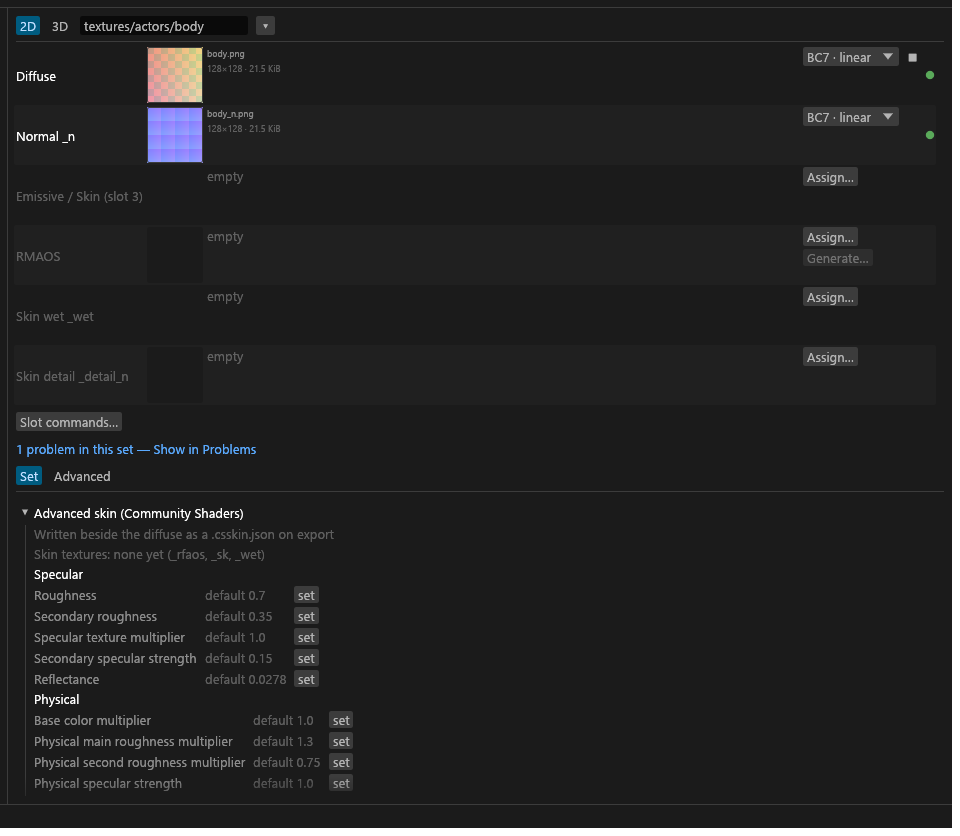
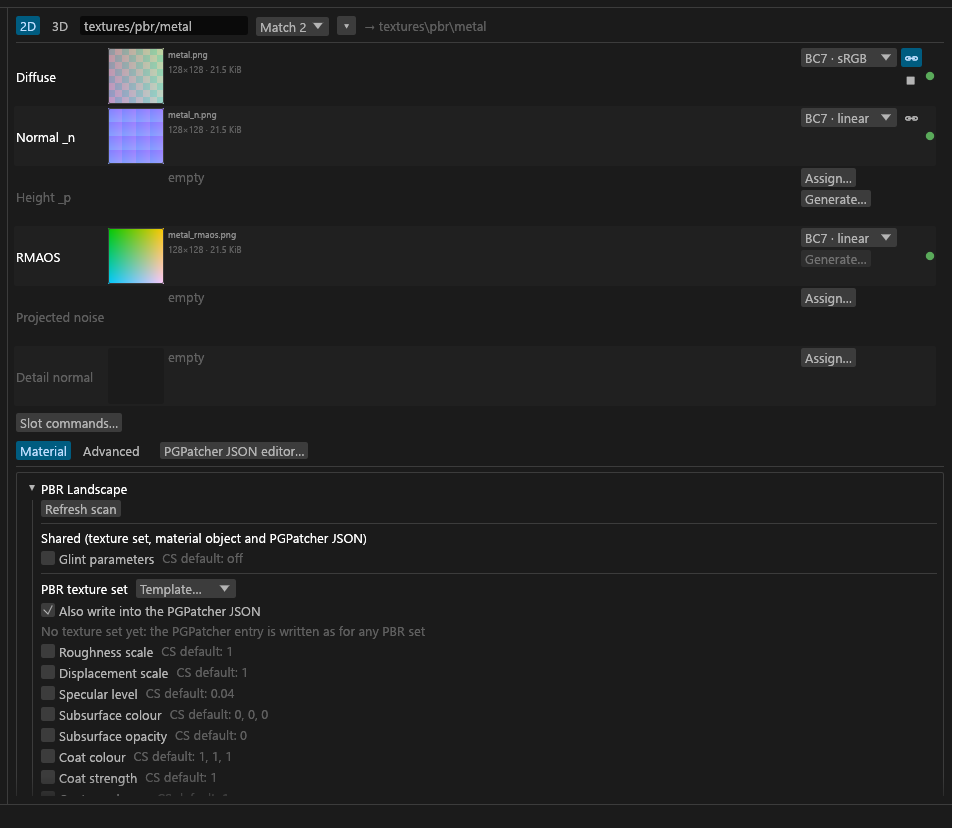

# Set materials

The material cards a set gets in place of, or beside, the PGPatcher settings: Advanced skin, PBR Landscape, Community Shaders PBR records and PBR grass. For anyone making skin, terrain or grass materials for Community Shaders. The ordinary TruePBR settings are on [PGPatcher settings and the JSON](GUI-PGPatcher-JSON.md).

## Advanced skin card

A set whose diffuse is an **Advanced skin** (`skin_albedo`) gets an **Advanced skin (Community Shaders)** card instead of the TruePBR settings. It lists the set's skin textures (`_rfaos`, `_sk`, `_wet`, `_detail_n`) and the 22 per-material Community Shaders skin settings in six groups: Specular, Physical, Edge & detail, Transmission, Fuzz and Wet.

- **Choosing the Advanced Skin shader** on a set's card (Community Shaders target) also makes the set's diffuse `skin_albedo`, so a packed `_rmaos` becomes `_rfaos`, in the same undo step. It does this when the diffuse's sub-type was inferred or is plain `diffuse`; a sub-type you picked yourself (say `pbr_albedo`) is kept. Choosing another shader, or Auto, puts back what was there before (inferred, or your `diffuse`), and the packed output returns to `_rmaos`, unless you have changed the diffuse's sub-type since or pinned its slot. Tessalith remembers which diffuses it changed in `sdc-project.toml` (`[project] auto_skin`).
- **The shader decides the reading, unless the diffuse is pinned.** While a set's shader is Advanced Skin, its diffuse reads as `skin_albedo` whether its sub-type is inferred or written as plain `diffuse`; only another sub-type you picked yourself stays. A pinned Diffuse slot blocks this: the set reads and packs as it would without the shader (Tessalith writes nothing into a pinned slot), while a diffuse already written as `skin_albedo` keeps it. The packed output is `_rfaos` (*RFAOS (skin) (auto)* on the card) when the set can build one and the card's recipe does not say RMAOS; a set with only a metallic map, or with a pre-packed `_rmaos`, keeps it. A set saved with the Advanced Skin shader switches on open, with nothing written.
- Each setting is **not set** (the Community Shaders default shows beside it, for example "default 0.7", and nothing is stored) or an explicit value on this set. **set** stores the default as a value you can then change; **↺** returns it to not set. Presets, defaults and rules never fill these, and sets do not inherit from each other.
- Values are saved in the set's `skin` table of `sdc-project.toml` under the Community Shaders key names. Keys from before 2.1 (`SkinMainRoughness`, `F0`, `UseSSS` and the rest) are not read; the next edit of the set removes them, and the card starts from not set. <!-- D:HB5 -->
- **Export writes the material file.** Every export writes `<diffuse>.csskin.json` beside the set's exported diffuse, with the values you set, the paths of the set's `_rfaos`, `_wet` and `_detail_n`, and the diffuse's size and hash. Only values you set are written, and a card you never touched writes none. There is no button and no opt-out. <!-- D:HB1 -->
  - **A value outside its range blocks the export** with a red Problems row naming the set and the setting; it is never clamped or written. Edit it on the card.
  - **A texture a slot does not export is left out** of the file, with an amber row. A path in the file always names a file the export wrote or one already in the export folder.
  - **A set with no diffuse, or one whose diffuse is borrowed, writes no file** and gets an amber row. Community Shaders keys a material on the diffuse file, so only the set that exports the diffuse writes the file; if that set is an Advanced skin set, its card sets the material. <!-- D:HB2 -->
  - **A grey `_wet` is not exported.** Community Shaders no longer reads a grey wet map; use a normal with a mask in alpha. The set's other files still write (`SKIN-WET-GREY`). <!-- D:HB3 -->
  - **Wet and detail slots can be borrowed** like the game slots, by Advanced skin sets only: a borrowed slot's menu offers **Clear**, and the file points at the host set's exported texture.
  - **A borrowed `_n` is not named in the file.** The file has no normal, so the game reads the normal the mesh names; point the mesh at the host's `_n`. The `_rfaos` still bakes from the host's `_n`, which is the only normal written. <!-- D:HC7 -->
  - **An edited `.csskin.json` is always kept**, and Export says so. Delete it to let Tessalith write it again. A file no skin set writes any more is left in place and listed in the export notes.
- **No PGPatcher JSON.** A skin set has no TruePBR settings, no PGPatcher JSON entry (the next export that writes the JSON leaves it out), no entry in the JSON editor and no PGPatcher checks. Its pill reads "skin" and its hover "Advanced skin". Its textures still encode as skin textures. If no PBR set is left, the JSON is not written and the old file stays as it was.
- **Where skin sets write.** A skin set's files go to their normal paths (mirroring the source folders), not under `textures\pbr\<prefix>\`, and **Rename** names its outputs with an output name, as for any set without JSON.
- Number boxes limit to the Community Shaders range for their setting (for example 0–1, 0–10 for the specular texture multiplier, 0.1–100 for the detail tiling) and keep 4 decimals. Each edit is one undo step, and a drag on one value is one step. Bulk edit does not touch these.

### Shared-map sets

A skin set with no colour map, holding only `_n`, `_sk`, `_wet` and `_detail_n`, shows only those cards; other skin sets borrow its maps. Mapped to a texture set record whose colour path a skin set in the project writes, it is an Advanced skin set itself, and a shader you chose on it wins. Skin variants then share one `_n` and `_sk` and keep their own diffuse and `_rfaos` each. [Mapping, slot states and existing files](GUI-Sets-Column.md#texture-set-records).

## PBR Landscape

Under the Community Shaders target, a PBR set (an `_rmaos`, a PBR albedo or the raw PBR maps) under `textures\landscape\`, with a `landscape` folder in its path, or with a Community Shaders texture-set block gets the **PBR Landscape** shader automatically; you can also pick it in the Shader list. It converts exactly like a PBR set; only the cards and the set's pill change. Its maps are the albedo (a landscape diffuse or plain diffuse also fills it), `_n`, and optionally `_rmaos` and `_p`. Any PBR set under `textures\landscape\` counts, trees, grass and mountains included; pick PBR in the Shader list for one that is not terrain.

The set editor shows a **PBR Landscape** card, open by default. It edits the same blocks that the [CS PBR records](#community-shaders-pbr-records) panel edits for other sets (a PBR Landscape set has no such panel).

- At the top, **Also write into the PGPatcher JSON**. Until you click it, it follows the scan: with no scan yet the entry is written; after a scan it is ticked either way: with "Used by N meshes" when meshes that are not LOD use the diffuse, and with a note (an info row in Problems) when none do yet. A click stores on or off, and **Back to auto** returns it to the scan. A set whose colour map is a landscape diffuse rather than a PBR albedo has no PGPatcher entry: the box is off and greyed, and says how to change that.
- The card starts with a **Shared** section holding the glint parameters, which the texture set and the material object read the same way, so one edit writes both. **Unsync** in the Material object section gives it its own value, and **Sync Glint parameters** takes the shared one again.
- Below come the texture set (template, the fields, the EDIDs with suggestions from the scan; the first edit creates the block, and only Undo or picking PBR removes it again) and a **PBR material object** section (add or remove, template, fields, EDIDs). Fields show plain names; hover one for its exact JSON key.
- Roughness and specular are separate rows: the texture set's values multiply the `_rmaos` map, while the material object's replace it.
- Community Shaders' landscape shader reads only roughness, displacement, specular and glint, so while the box is off the subsurface, coat, fuzz and inner-layer rows are hidden (one line says how many), unless they hold a value. With the box on they show, because the meshes that share the texture read them.
- Under the card, **PGPatcher JSON settings** (a framed group) holds the TruePBR settings: open while the entry is written, collapsed and marked "not written" while it is not.

The pill on the set's card says what the set writes (the [set card](GUI-Sets-Column.md#set-cards) hover has the long form). CS records are written for a block with at least one EDID. In the 3D preview a PBR Landscape set is shown on the plane, like a set with a texture-set block.

## XPMF profile card

A Landscape or PBR Landscape set (either target) gets an **XPMF profile** card in the set editor, with its header reading "on" or "off". What the profile is, the file it writes and each key are on [XPMF profiles](XPMF-Profiles.md).

- **Write XPMF profile** adds or removes the set's `[sets.xpmf]` block, as one undo step. Turning it off removes the block's values; Undo brings them back. While it is off the card shows only the toggle.
- With it on, the card has one row per key. A key you have not set shows the value Tessalith fills, or XPMF's own default, greyed. A number row has **Override**, which starts a value of your own; a text row takes a path or text; a list row takes patterns, and Enter adds one. **Reset** on a row drops your value.
- **Editor IDs** and **Exclude editor IDs** offer the material object records of the scan (single-pass ones only) as you type.
- A row the preview cannot show says "Not shown in the preview" on hover. `specularMult` is hidden while PBR is on.
- An amber line at the top of the card says why the profile would not be written now (for example, no editor IDs, a value the schema refuses, or a set id that gives the same file name as another landscape set's). A set that is no longer a Landscape set but still has the block keeps this line and the toggle, so the block can be removed.
- A set read-only on disk greys the card, with the reason on hover.

## Community Shaders PBR records

A set can also write Community Shaders' own runtime files: a **PBR texture set** (`<export>\PBRTextureSets\<EDID>.json`) and a **PBR material object** (`<export>\PBRMaterialObjects\<EDID>.json`). Open **CS PBR records** (collapsed; its header reads "N records") in the set editor's Material tab and add either block.

- **Template** fills the block's values from the built-in library. PBR landscape template values by Faultier (https://www.nexusmods.com/profile/Faultierfan?gameId=1704), from Faultier's PBR landscape modders resource. A block with no EDIDs takes the template's EDIDs; EDIDs you added are never removed.
- **EDIDs** are the records the file is for, and the file name is the EDID exactly, case included (Community Shaders matches the exact case). After a plugin scan in the Meshes view, texture-set EDIDs are suggested from the texture sets that use the set's diffuse, and material objects can be picked from the scanned records. A warning says when an EDID is not in the scan, differs only in case (one click fixes it), or names a material object that is not single-pass (Community Shaders then ignores the file). An EDID that cannot be a file name, or that two sets bind, is not written.
- A texture set also drives the set's PGPatcher entry: roughness, specular, displacement, subsurface and coat values and glint come from the block, so the two files cannot drift. The entry is written only when the latest scan finds meshes (not LOD) that use the set's diffuse; **PGPatcher entry for statics** can force it on or off.
- Every number is written with a decimal point. A file you edited outside Tessalith is never overwritten (the export report says so; delete it to let Tessalith write it again), and a file Tessalith wrote for an EDID no set binds any more is reported, not deleted.
- If `sdc-project.toml` changed on disk while the export ran, recording the written JSON files asks **Overwrite with my changes** or **Reload from disk**, as a save does. The same holds for the PGPatcher and complex material JSON.
- In the 3D preview a set with a texture-set block is shown on the plane, with a **Tiling** slider (1× to 3×) that only changes the preview. The tiling is one value for the session and stays when you switch sets.

## Complex grass

How a complex-grass texture is tagged, in the GUI and the CLI, and its warnings are in [Complex grass](Set-Shaders.md#complex-grass).

## PBR grass

Community Shaders draws grass with its own shader, which reads only the albedo, `_n`, `_rmaos` and an optional `_s`. A PBR set whose albedo a grass (GRAS) record uses gets the **PBR grass** shader automatically after a Meshes-view scan that included plugins; you can also pick it in the set's Shader list (Community Shaders target only). The command line never picks PBR grass by itself; use `--set set:<id>.shader=pbr_grass`.

- The TruePBR settings of a PBR grass set show only what grass reads: roughness scale, specular level, subsurface (Standard or Foliage, on automatically when the set has an `_s`), matching, vertex colours, locks and slots. The JSON editor shows the same grass view, and its **+ key** menu does not offer the hidden keys. Other keys the set already has stay in `sdc-project.toml` and come back if you switch the set to PBR, but they are not exported.
- PBR grass meshes need PGPatcher 2.1.0 or later to be patched.
- `PBR-GRASS-DETECT` on the albedo means its bottom-left texel looks like a complex-grass normal, so Community Shaders' grass shadow pass would cut the shadows wrong; change that texel. The check covers single-file albedos only: a packed albedo gets no note.
- The 3D preview draws PBR grass with the object PBR shader and says so, and does not claim UV scale applies ([Known issues](Troubleshooting.md#known-issues)).
