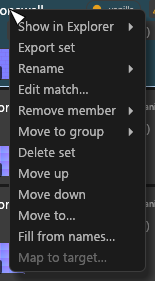

# Sets column

For anyone grouping textures into material sets: reading a set card, finding a set, and moving textures and sets around. Selecting a set opens the [Set editor](GUI-Set-Editor.md) in the centre.

## Reading a set card

One card per material set. Its title is the set's id. When the id doesn't fit, part of it is cut (`…/stone/banner` for `architecture/stone/banner`), but the title keeps at least the id's last two parts, more when two sets would read the same. When the part that tells it apart is the whole id, the card keeps the whole id and may wrap it. A title that doesn't fit beside the status pill takes its own line. <!-- D:JR2,JR5 --> A status pill shows what the set is ("vanilla", "PBR → JSON", "PBR, no JSON" for a PBR set on a target that writes none, "PBR Landscape", "skin"), with a red dot when it blocks export, amber when it isn't ready and green when it is. A set is ready when neither it nor its textures has a problem row; notes, rows you marked as intended and checks don't count ([Problems and Notes](GUI-Problems.md#problems-and-notes)). <!-- D:JO5 --> A created set with no files of its own usually has an amber dot. For a borrower with no engine key, check **Project** in Problems for a blocked **Rename** path. A project-wide blocker can also turn the dot red on a card with an empty id. Hover the pill for what the set writes and the state of each packed output. **⚠ n** opens the [ordinary set filter in Problems](GUI-Problems.md#narrowing-the-list). The shader combo sits on its own row. Click empty card area to open the set.

Under it is one chip per slot of the shader, lettered by the slot's suffix. If the set owns or borrows a packed file, its chip reads RMAOS or RFAOS for that file. Linking slot 6 changes the thumbnail and keeps the lettering. An Advanced skin set with only a metallic input keeps RMAOS. The letter sits bottom-left on every chip. <!-- D:HE1 --> A small thumbnail on a chip's corner is a [helper](Texture-Packing.md#helper-textures) feeding that slot. A slot linked from another set ([From another set](GUI-Set-Editor.md#slot-menus)) has a small link mark at the top centre of its chip; hover the chip for the linked path. A slot you cleared shows its letter dimmed. <!-- D:JR1 --> An amber outline marks a slot borrowed from another set, and a red **?** a borrow whose set is gone or a file that is gone. A slot shared from a set that shares it in turn reads the set that has the file; a loop of shares fills nothing and shows the **?**. <!-- D:JN1 --> Delete that middle set, or **Clear** its share, and the far set keeps the texture: its share passes on to the set the middle one shared from. <!-- D:JN4 --> Right-click a **?** for **Remove from set** (or **Delete set** when nothing is left); each one is also a Problems row.

A set whose files are all DDS inputs Tessalith doesn't re-encode, such as a released mod's, is listed as "vanilla" with empty slots and no JSON entry. **Re-encode this file** on its diffuse makes it a full set.



The card's right-click menu holds **Export set** ([Exporting part of the project](GUI-Review-and-Export.md#exporting-part-of-the-project); with two or more sets selected it reads **Export n sets**), **Rename**, **Edit match…** ([PGPatcher settings and the JSON](GUI-PGPatcher-JSON.md#matching)), **Remove member**, **Delete set**, **Move to group** ([Groups](#groups)), **Move up**, **Move down**, **Move to…**, and **Map to target…** ([Set editor](GUI-Set-Editor.md#mapping-to-a-target)). Right-clicking a member that fills a slot opens that slot's menu instead: [Slot menus](GUI-Set-Editor.md#slot-menus). The **Rename** submenu is [Renaming](GUI-Bulk-and-Rename.md#renaming).

## Finding a set

The search box matches a set's id or label, never its key. The pills *Not ready*, *Ready* and *No JSON* and **Filter ▾** (by shader) narrow the list, and they combine. Hover *Ready* or *Not ready* for what Ready means. A filter only hides: the selection, the editor and the bulk panel stay. **Go to set** from Problems on a hidden set tells you it is hidden and offers **Clear filter**. The pills and the shader are remembered in `gui.toml`, the search text isn't.

## Groups

Fold the sets you've finished into a group, so the column shows only what you're working on. A group is a header row with its name, how many sets it holds and the worst status among them (red blocks export, amber isn't ready, green is ready), and its sets sit indented under it. <!-- D:HF6 -->

- **Make one:** right-click a set, or a selection, then **Move to group** → **New group…** and type a name. Names are unique, upper or lower case alike; a taken name stays in the dialog with the reason. A group is gone when its last set leaves it.
- **Fold it:** click the header. Whether it's folded is kept per project in `gui.toml` and is not an undo step.
- **Join one:** **Move to group** → the group, or drag a set by its **≡** handle onto the header. Dragging a texture onto a header does nothing. <!-- D:HF8 -->
- **Header menu:** **Export group**, **Exclude from export** (**Include in export** takes it back; the header then carries an *Excluded* tag; both are explained in [Exporting part of the project](GUI-Review-and-Export.md#exporting-part-of-the-project)), **Rename…**, **Ungroup** (the sets stay) and **Select all sets**.
- **With a filter on,** a header shows only while a set in it passes, and reads `2 of 7`. A filter never folds or opens a group, and a set with no card isn't counted.
- **Revealing a set opens its group:** a click on a texture or **Go to set** in Problems unfolds the set's group. **Move to…** also unfolds it when the moved set has files of its own. <!-- D:HF7 -->

## Moving textures between sets

- Drag a texture from the Textures column onto a card to move it there, or onto empty space to start a new set. A filled slot asks **Replace** or **Cancel**.
- A texture dragged from another set asks **Move it here**, **Share (borrow its finished output)** or **Duplicate the source for this set**. A shared `_rmaos` is never variance-baked: [Packing PBR maps](Texture-Packing.md#variance-and-gloss-bake). For normal maps, see [Sharing specular alpha](#sharing-specular-alpha).
- A shared slot follows its texture. Move the texture to another set, start a new set with it, or bring it in with **Fill from names…**, and every set that shared it now shares it from there, in the same undo step. Share another texture into a slot other sets share, and they share the new one from its set. Replacing the texture by a move or a duplicate keeps them on the set, with the new file. <!-- D:JN2,JN3 -->
- A helper (an AO, a roughness, an opacity map) dragged onto another set asks the same, but **Share (use this file here too, no copy)** writes no file: that set packs or fills from the helper as if it were its own. A pick or setting on the helper (what it fills, read from, invert) applies everywhere it is used. A helper in no set can be shared too: drag its row from the Textures column. It then feeds only the sets that share it, and the question has no Duplicate. A set with no texture of its own can't take a share. The shared rows and **Stop sharing** are on [Set editor](GUI-Set-Editor.md#shared-helpers). <!-- D:HH5 -->
- **Fill from names…** finds files in the set's folder named like its diffuse plus a suffix the engine knows (`_n`, `_p`, `_rmaos`, exporter tails like `_normal`). A dialog lists each with the slot it fills, all ticked; **Fill** moves the ticked ones in as one undo step.

### Sharing specular alpha

On Community Shaders, a regular set reads specular from its normal’s alpha. When your edit first makes a regular set share a PBR, PBR Grass, PBR Landscape or Advanced Skin set’s normal through the Normal slot, Tessalith can write `alpha.policy = "data"` in the same Undo step. <!-- D:JS7 -->

- The current plan and your edit must identify the owner, borrowers and their shaders. If two set IDs differ only in case, the first entry supplies the share. Replacing the borrower’s own normal changes its membership, so that Share leaves alpha alone.
- The file must be a tangent-space normal in the plan, with varying alpha or analysis still to come. A model-space normal (`msn`) in the same slot keeps its own alpha settings. Pinning the Normal slot on the set that owns the file protects it even if that set shows another borrowed normal. Tessalith skips a kept DDS, a planned **Data** value and any alpha policy you set for the file.
- Both project files must be writable. Tessalith uses the exact full filename, a single case-insensitive full-name match, or a new full name when no table matches. An extensionless match alone, ambiguous full names or a key that also matches another input prevent the write.

Clearing the last regular share can take back the automatic **Data**. If the owner’s slot is pinned or the entry also controls another input, Tessalith keeps both the value and its ownership record. Choosing **Data** yourself claims only the entry you edited. When the plan finds shared specular that would be lost, check [Keep alpha in Problems](GUI-Problems.md#keep-alpha).

## Reordering and deleting sets

Drag the **≡** handle, or use **Move up** and **Move down**. They are off while a Sets filter is on, because a hidden set would shift the numbers. **Move to…** stays on and takes a position or a name; it is also the quick way to make a long move. While you drag, the mouse wheel scrolls the list. <!-- D:JL6 -->

**Delete set** works on every set and asks nothing: it is one undo step, and the toast (`Deleted set {name} (3 textures now in no set)`) has an **Undo** button. The textures are not deleted. They go to *no set* and the automatic set does not come back, so a delete sticks after a new plan or a reopen. A set with no files left just goes. A texture other sets share goes to the first of them in the column that can take it, as its own, and the others share it from there; the toast says where it went. A set is passed over when its slot is locked, it already has a file in that slot, or it has no files and you didn't create it. If none can take it, it goes to *no set* like the rest (a packed map leaves with its raw maps), and the toast names the sets left with an empty slot. <!-- D:HF1,JN4,JN5 -->

## Textures in no set

**Remove member** puts a texture in no set, whichever way it got into the set: grouped by name, moved in, or the only one in the set. A texture other sets share goes to the first of them that can take it instead, as Delete set does, unless the set still has another file in that slot. A packed map can't be removed, because it follows its raw maps. <!-- D:HF1,JN5 -->

- A no-set texture is on no card and Tessalith writes nothing for it, so a stray `_f`, `_ao` or `_mask` file stops showing up as a set of its own (or as `mouth_ao~2`).
- It stays in the Textures column, and its row reads **No set** where a type would be. Its warnings and questions count for nothing: no Problems row, no Review row, no number in the status bar, and Export doesn't stop to ask about it.
- A same-named file in a set (`rock.png` in no set, `rock.tga` in a set) isn't `IN-DUPLICATE`: the no-set file writes nothing, so it can't clash.
- To put it back, drag it onto a card, or onto the empty space to start a new set. Right-click it in the Textures column for **Back to its automatic set**: that is the only way to bring back a big automatic set once Undo has gone.
- If the file is deleted from disk, its entry clears itself and Messages says so.

The list is `no_set` under `[project]` in `sdc-project.toml`. An older `remove` line there still means what it did, a one-file set that exports.

## Where set edits are saved

Set edits go to `sdc-project.toml`, next to `sdc.toml`: the set order, created sets, moves, borrows, helper shares, shader choices, output names, slot pins and the PGPatcher settings. If it can't be parsed, the sets and the JSON go read-only, a banner says why, and Problems has a red row with **Open in editor** and **Reload**. Editing `sdc.toml` carries on. On the command line: [CLI reference](CLI-Reference.md#does-the-cli-use-my-gui-edits).

Set groups are one `[[groups]]` table each. `sets` holds set ids, like `[project] order`, and `excluded` is only there while it's `true`:

```toml
[[groups]]
name = "Armor"
sets = ["armor/steel", "armor/iron"]
excluded = true
```

A group sits where its first set sits in the column, and its other sets follow it, in order. Names are unique, upper or lower case alike. A set with no card (a lone file waiting for a type, or a set whose files are all in no set) isn't shown or counted in its group, and being in a group never gives it a card. Whether a group is collapsed is kept per project in `gui.toml`, not in this file.
