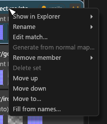

# Sets column

For anyone grouping textures into material sets: reading a set card, finding a set, and moving textures and sets around. Selecting a set opens the [Set editor](GUI-Set-Editor.md) in the centre.

## Reading a set card

One card per material set. A status pill shows what the set is ("vanilla", "PBR → JSON", "PBR, no JSON" for a PBR set on a target that writes none, "PBR Landscape", "skin"), with a red dot when it blocks export, amber when it isn't ready and green when it is. Hover the pill for what the set writes and the state of each packed output. **⚠ n** opens the set's problems, and the shader combo sits on its own row. Click empty card area to open the set.

Under it is one chip per slot of the shader, lettered by the slot's suffix. On an Advanced skin set the RMAOS chip reads RFAOS, and the letter sits bottom-left on every chip. <!-- D:HE1 --> A small thumbnail on a chip's corner is a [helper](Texture-Packing.md#helper-textures) feeding that slot. An amber outline marks a slot borrowed from another set, and a red **?** a borrow whose set is gone or a file that is gone. Right-click a **?** for **Remove from set** (or **Delete set** when nothing is left); each one is also a Problems row.

A set whose files are all DDS inputs Tessalith doesn't re-encode, such as a released mod's, is listed as "vanilla" with empty slots and no JSON entry. **Re-encode this file** on its diffuse makes it a full set.

The card's right-click menu holds **Rename**, **Edit match…** ([PGPatcher settings and the JSON](GUI-PGPatcher-JSON.md#matching)), **Remove member**, **Delete set**, **Move up**, **Move down**, **Move to…**, and **Map to target…** (**Change mapping…** once mapped; [Set editor](GUI-Set-Editor.md#mapping-to-a-target)). Right-clicking a member that fills a slot opens that slot's menu instead: [Slot menus](GUI-Set-Editor.md#slot-menus). The **Rename** submenu is [Renaming](GUI-Bulk-and-Rename.md#renaming).

## Finding a set

The search box matches a set's id or label, never its key. The pills *Not ready*, *Ready* and *No JSON* and **Filter ▾** (by shader) narrow the list, and they combine. A filter only hides: the selection, the editor and the bulk panel stay. **Go to set** from Problems on a hidden set tells you it is hidden and offers **Clear filter**. The pills and the shader are remembered in `gui.toml`, the search text isn't.

## Moving textures between sets

- Drag a texture from the Textures column onto a card to move it there, or onto empty space to start a new set. A filled slot asks **Replace** or **Cancel**.
- A texture dragged from another set asks **Move it here**, **Share (borrow its finished output)** or **Duplicate the source for this set**. A shared `_rmaos` is never variance-baked: [Packing PBR maps](Texture-Packing.md#variance-and-gloss-bake).
- **Fill from names…** finds files in the set's folder named like its diffuse plus a suffix the engine knows (`_n`, `_p`, `_rmaos`, exporter tails like `_normal`). A dialog lists each with the slot it fills, all ticked; **Fill** moves the ticked ones in as one undo step.

## Reordering and deleting sets

Drag the **≡** handle, or use **Move up** and **Move down**. They are off while a Sets filter is on, because a hidden set would shift the numbers. **Move to…** stays on and takes a position or a name; it is also how you make a long move, since a drag only reaches the cards on screen.

**Delete set** works on every set and asks nothing: it is one undo step, and the toast (`Deleted set {name} (3 textures now in no set)`) has an **Undo** button. The textures are not deleted. They go to *no set* and the automatic set does not come back, so a delete sticks after a new plan or a reopen. A set with no files left just goes. <!-- D:HF1 -->

## Textures in no set

**Remove member** puts a texture in no set, whichever way it got into the set: grouped by name, moved in, or the only one in the set. A packed map can't be removed, because it follows its raw maps. <!-- D:HF1 -->

- A no-set texture is on no card and Tessalith writes nothing for it, so a stray `_f`, `_ao` or `_mask` file stops showing up as a set of its own (or as `mouth_ao~2`).
- It stays in the Textures column, and its row reads **No set** where a type would be. Its warnings and questions count for nothing: no Problems row, no Review row, no number in the status bar, and Export doesn't stop to ask about it.
- A same-named file in a set (`rock.png` in no set, `rock.tga` in a set) is no longer `IN-DUPLICATE`: the no-set file writes nothing, so it can't clash.
- To put it back, drag it onto a card, or onto the empty space to start a new set. Right-click it in the Textures column for **Back to its automatic set**: that is the only way to bring back a big automatic set once Undo has gone.
- If the file is deleted from disk, its entry clears itself and Messages says so.

The list is `no_set` under `[project]` in `sdc-project.toml`. An older `remove` line there still means what it did, a one-file set that exports.

## Where set edits are saved

Set edits go to `sdc-project.toml`, next to `sdc.toml`: the set order, created sets, moves, borrows, shader choices, output names, slot pins and the PGPatcher settings. If it can't be parsed, the sets and the JSON go read-only, a banner says why, and Problems has a red row with **Open in editor** and **Reload**. Editing `sdc.toml` carries on. What `sdc convert` does with this file: [Review and Export](GUI-Review-and-Export.md#does-the-cli-use-my-gui-edits).
