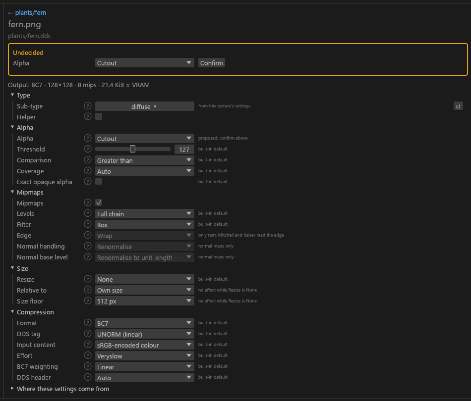

# Texture settings

For anyone with one texture selected who wants to change how it encodes, or to answer the question it is waiting on. Several textures selected: [Bulk editing](GUI-Bulk-and-Rename.md#editing-them-together). A set selected: [Set editor](GUI-Set-Editor.md).

## Reading the panel

The centre column groups a texture's settings as Type, Alpha, Mipmaps, Size and Compression. <!-- D:JI3 --> Each value says where it came from, for example "from sdc.toml", "suggested" or "from the meshes that use this texture". A line at the top gives the output format, size, mip count and VRAM; greyed options carry their reason on hover.

## Changing a setting

Every row writes one key of the texture's `[files]` entry. The values each key takes are in [Project config](Project-Config.md#fields). Hover the **?** beside a row, or its label, for what the row does; it still works while the row is greyed out.

| Row | Key |
|---|---|
| Sub-type | `subtype` |
| Helper (images only) | `helper.role`: [Texture packing](Texture-Packing.md#helper-settings) |
| Alpha, Threshold, Comparison | `alpha.policy`, `alpha.threshold`, `alpha.compare` |
| Enable parallax (complex `_m` only) | `alpha.parallax`: ticked keeps the `_m` alpha as parallax height, unticked writes alpha 0 |
| Coverage, 1-bit alpha, Exact opaque alpha | `mips.coverage`, `encoder.bc1_alpha`, `alpha.exact_opaque` |
| Normal handling, Normal base level | `mips.normal`, `mips.normal_base` |
| Baked in (`msn` only) | `channels.msn_source`: [Texture types](Texture-Types.md#model-space-normals-msn) |
| Mipmaps: Levels, Filter, Edge | `mips.levels`, `mips.filter`, `mips.edge` |
| Size: Resize, Relative to, Size floor | `resize`, `resize_relative_to`, `resize_floor`: [below](#resize-and-size-floor) |
| Format | `format` |
| Input content, DDS tag (under Compression) | `color.content`, `color.tag` |
| Effort | The search setting of the texture's format: [below](#effort) |
| BC7 weighting, Perceptual | `encoder.bc7_weights`, `encoder.perceptual` |
| DDS header | `header` |

- **Normal base level** stores mip 0 at unit length. Pick *Keep as authored* only when the short normals are deliberate.
- A PBR set's normal map bakes its detail into the set's `_rmaos` or `_rfaos` roughness, so its Normal handling row reads *decided by the texture set*.
- The Sub-type picker is the one the Problems **Set type…** button opens.
- For an emissive, the reason it is BC6H or BC7 sRGB shows under Compression (`FMT-HDR-SOURCE`).

### BC7 weighting against BC3

*BC7 weighting* sets how much the built-in BC7 encoder weighs alpha against colour. It shows only for BC7.

| Option | Use | Writes |
|---|---|---|
| **Linear** (default) | Every channel weighs the same. | Clears `encoder.perceptual` and `encoder.bc7_weights`; over an inherited value it writes `perceptual = false` and `bc7_weights = "linear"`. |
| **Perceptual** | bc7e's own weights. Greyed on anything but colour without data alpha. | `perceptual = true` |
| **Alpha ×2**, **×8**, **×16** | Alpha error counts 2, 8 or 16 times. | `bc7_weights` |

I'd reach for ×8 as the alternative to BC3 on delicate alpha, because it keeps more RGB than BC3 does. ×16 suits a `_n` with specular in its alpha. The measurements are in [Research](Research.md) ([BC7 alpha weights](../research/bc7e-tuning.md#bc7-alpha-weights-against-bc3-2026-10-21)).

### Effort

**Effort** sets how long the encoder searches. Each format's encoder reads its own key, so the row writes the key of the texture's format: <!-- D:JI4 -->

| Texture's format | The row offers, and writes |
|---|---|
| BC7, BC6H | The seven levels from **Ultrafast** to **Max**, as `encoder.effort`. |
| BC1 | **Fast** or **Default**, as `encoder.bc1_search`. |
| BC3 | Three choices that set both keys: **Fast** sets both to `fast`, **Default** both to `default`, **Max** the radius to `max` and the BC1 search to `default`. |
| BC4, BC5 | The same three choices as BC3, written to `encoder.bc45_search_radius` alone. |
| Any other | Nothing: the row is greyed with "this format has no search setting". |

- **Fast** on BC1 and BC3 is for a quick look: it encodes in a fraction of the time and comes out a little less exact. The `fast-preview` preset sets it for you. What each value does: [Project config](Project-Config.md#encoder).
- A BC3 pair that no choice names, set by a preset or by hand in `[files]`, reads **Custom: search fast, radius max** (its own values). Pick a choice to set both.

### Resize and size floor

**Resize** is `resize` (None, Half, Quarter, Eighth), **Relative to** is `resize_relative_to` (the texture's own size or one of the set's slots) and **Size floor** is `resize_floor`: the longer side a halving never goes below. A resized texture shows a `DIM-RESIZED` note. Values: [Project config](Project-Config.md#fields).

## Deciding

A texture whose name follows the conventions decides itself: a High-confidence suggestion is written to the project ([what the GUI writes on its own](GUI-Problems.md#what-the-gui-writes-on-its-own)), and until then its sub-type reads **(auto)**. The naming rules are in [Texture types](Texture-Types.md).

An **amber border** means the texture still needs an answer: a Medium or Low sub-type suggestion, the meaning of its alpha, or a blocking warning. The centre column then shows an *Undecided* box.

| Question | Controls |
|---|---|
| What kind of texture is this? | A sub-type dropdown and **Confirm**. |
| What does the alpha channel mean? | An **Alpha** row, the dropdown set to the proposal, and **Confirm**. Pick another type, or press Confirm to keep the proposal. The rows below already read as the proposal. <!-- D:FM35 --> |
| "IN-GREEN-UNSTATED" on a plain `_normal` | The map is converted as DirectX. Press **Treat as OpenGL (flip green)** if it is an OpenGL map; **Treat as DirectX** undoes it. |
| A blocking warning | **Acknowledge for this texture**, or **Drop the alpha anyway** when the chosen format discards a varying alpha you've already confirmed: the export writes the texture without its alpha. |
| A type the mode doesn't have | A sub-type dropdown and **Confirm**. No **Acknowledge**: it couldn't lift this one. <!-- D:JF3 --> |

Each answer is a field value or an `allow` code on the file's `[files]` entry. Your choice always wins over a suggestion. A field the target or the sub-type fixes is greyed with the reason (a field lock); it is not a pin and not a PGPatcher lock.

### Alpha from the meshes

After a [mod scan](Mod-Scanning.md), a colour map whose alpha varies takes its alpha meaning from the meshes that use it, and isn't asked:

| Meshes using the texture | Result |
|---|---|
| Any mesh with alpha blending | Blend |
| Alpha testing | Cutout, at the strictest mesh threshold |
| Both | Cutout + Blend |
| No mesh with alpha | Remove |

The Alpha row then reads *from the meshes that use this texture*. Your own choice still wins.

## Used by meshes

After a scan, **Used by meshes (N)** lists the meshes that use the texture, winner first. **Show in Meshes** opens the Meshes view filtered to it: [Mod scanning](Mod-Scanning.md).

## DDS files in the folder

A DDS input is left as it is and not written. **Re-encode this file** writes `reencode = true` for it as one undo step, and **Stop re-encoding** takes it back. Which DDS files Tessalith reads, and why it skips the rest: [Texture types](Texture-Types.md#which-files-tessalith-reads).

## Where these settings come from

To see what set a value (a built-in default, a preset, a rule, `sdc.toml`, the image analysis), open **Where these settings come from**, the folded section at the bottom of the panel. It lists every field of the texture with its value and its source, and puts the values that differ from the `sdc-base` preset in bold. Tick **Show only what differs from sdc-base** to hide the rest; the tick stays as you move between textures. It only reads: change a value in the rows above. <!-- D:JI3 --> How presets and rules stack: [Presets and targets](Presets-and-Targets.md).

## How edits are saved

Each edit becomes a `[files."<path>"]` entry in `sdc.toml`, keyed by the path relative to the folder (packed outputs without the extension, like `landscape/rock01_rmaos`). The GUI writes only `target`, `preset`, `[export]`, `[files.*]` and `[inputs.*]`. Comments, ordering, rules and every other table stay byte for byte as you wrote them ([Project config](Project-Config.md#files)).

Unsaved edits put a dot in the window title until you **Save** (**Ctrl+S**); Export saves first. If `sdc.toml` changed on disk while you have unsaved edits, saving asks for **Reload from disk** or **Overwrite with my changes**.

**Encoding follows type.** A format or tag the texture's type doesn't allow never stays: when a type changes, when a project opens, after an undo, in a pinned slot too. A format you set is reset so the type's default applies; if that default isn't allowed either (a preset or rule gives it), the best format the type allows is set, usually BC7. An Info row in Problems says which, with **Undo this change** when your edit caused it. Opening a project that needed it leaves it unsaved, so **Save** writes the fix.

**Grey maps are BC4 or R8.** Every map of the Grayscale group (envmask, height, model-space specular, skin `_sk`, projected noise, gray) is offered and kept as BC4 or R8 only, in the Format row, the slot combo, bulk edits, Copy settings and the Presets tab. The CLI still writes what `sdc.toml` says.
