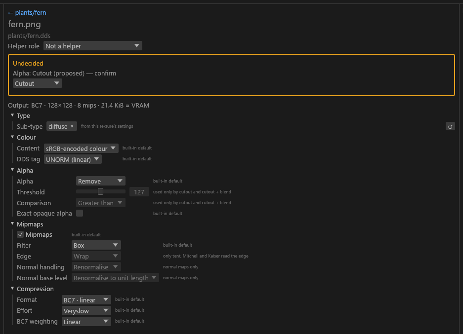
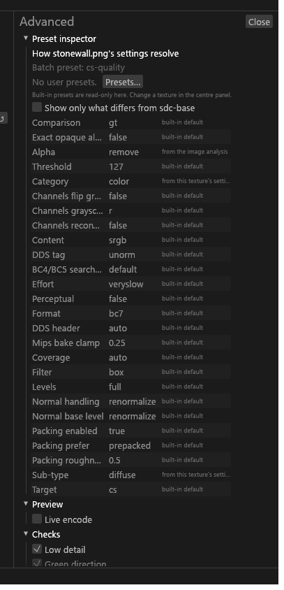

# Texture settings

For anyone with one texture selected who wants to change how it encodes, or to answer the question it is waiting on. Several textures selected: [Bulk editing](GUI-Bulk-and-Rename.md#editing-them-together). A set selected: [Set editor](GUI-Set-Editor.md).

## Reading the panel

The centre column groups a texture's settings as Type, Colour, Alpha, Mipmaps and Compression. Each value says where it came from, for example "from sdc.toml", "suggested" or "from the meshes that use this texture". A line at the top gives the output format, size, mip count and VRAM; greyed options carry their reason on hover.

## Changing a setting

Every row writes one key of the texture's `[files]` entry. The values each key takes are in [Project config](Project-Config.md#fields).

| Row | Key |
|---|---|
| Sub-type | `subtype` |
| Content, DDS tag | `color.content`, `color.tag` |
| Alpha, Threshold, Comparison | `alpha.policy`, `alpha.threshold`, `alpha.compare` |
| Enable parallax (complex `_m` only) | `alpha.parallax`: ticked keeps the `_m` alpha as parallax height, unticked writes alpha 0 |
| Coverage, 1-bit alpha, Exact opaque alpha | `mips.coverage`, `encoder.bc1_alpha`, `alpha.exact_opaque` |
| Normal handling, Normal base level | `mips.normal`, `mips.normal_base` |
| Baked in (`msn` only) | `channels.msn_source`: [Skin](Skin.md#model-space-normals-msn) |
| Mipmaps: Levels, Filter, Edge | `mips.levels`, `mips.filter`, `mips.edge` |
| Format, Effort | `format`, `encoder.effort` |
| BC7 weighting, Perceptual | `encoder.bc7_weights`, `encoder.perceptual` |

- **Normal base level** stores mip 0 at unit length. Pick *Keep as authored* only when the short normals are deliberate.
- A PBR set's normal map bakes its detail into the set's `_rmaos` or `_rfaos` roughness, so its Normal handling row reads *decided by the texture set*.
- The Sub-type picker is the one the Problems **Set type…** button opens.
- For an emissive, the reason it is BC6H or BC7 sRGB shows under Compression (`FMT-HDR-SOURCE`).

### BC7 weighting against BC3

*BC7 weighting* sets how much the built-in BC7 encoder weighs alpha against colour. It shows only for BC7.

| Option | Use | Writes |
|---|---|---|
| **Linear** (default) | Every channel weighs the same. | Clears `encoder.perceptual` and `encoder.bc7_weights`; over an inherited value it writes `perceptual = false` and `bc7_weights = "linear"`. |
| **Perceptual** | bc7e's own weights. Greyed on anything but colour without data alpha. | `perceptual = true` |
| **Alpha ×2**, **×8**, **×16** | Alpha error counts 2, 8 or 16 times. | `bc7_weights` |

I'd reach for ×8 as the alternative to BC3 on delicate alpha, because it keeps more RGB than BC3 does. ×16 suits a `_n` with specular in its alpha. The measurements are in [Research](Research.md) ([BC7 alpha weights](../research/bc7e-tuning.md#bc7-alpha-weights-against-bc3-2026-10-21)).

## Deciding

A texture whose name follows the conventions decides itself: a High-confidence suggestion is written to the project ([what the GUI writes on its own](GUI-Problems.md#what-the-gui-writes-on-its-own)), and until then its sub-type reads **(auto)**. The naming rules are in [Texture types](Texture-Types.md).

An **amber border** means the texture still needs an answer: a Medium or Low sub-type suggestion, the meaning of its alpha, or a blocking warning. The centre column then shows an *Undecided* box.

| Question | Controls |
|---|---|
| What kind of texture is this? | A sub-type dropdown and **Confirm**. |
| What does the alpha channel mean? | "Alpha: Cutout (proposed) — confirm" and an **Alpha type** dropdown already set to the proposal. Pick the type you want, or pick the shown one to confirm it. <!-- D:FM35 --> |
| "IN-GREEN-UNSTATED" on a plain `_normal` | The map is converted as DirectX. Press **Treat as OpenGL (flip green)** if it is an OpenGL map; **Treat as DirectX** undoes it. |
| A blocking warning | **Acknowledge for this texture**, or **Drop the alpha anyway** when the chosen format discards a varying alpha you've already confirmed: the export writes the texture without its alpha. |

Each answer is a field value or an `allow` code on the file's `[files]` entry. Your choice always wins over a suggestion. A field the target or the sub-type fixes is greyed with the reason (a field lock); it is not a pin and not a PGPatcher lock.

### Alpha from the meshes

After a [mod scan](Mod-Scanning.md), a colour map whose alpha varies takes its alpha meaning from the meshes that use it, and isn't asked:

| Meshes using the texture | Result |
|---|---|
| Any mesh with alpha blending | Blend |
| Alpha testing | Cutout, at the strictest mesh threshold |
| Both | Cutout + Blend |
| No mesh with alpha | Remove |

The Alpha row then reads *from the meshes that use this texture*. Your own choice still wins.

## Used by meshes

After a scan, **Used by meshes (N)** lists the meshes that use the texture, winner first. **Show in Meshes** opens the Meshes view filtered to it: [Mod scanning](Mod-Scanning.md).

## DDS files in the folder

A DDS input is left as it is and not written. **Re-encode this file** writes `reencode = true` for it as one undo step, and **Stop re-encoding** takes it back. Which DDS files Tessalith reads, and why it skips the rest: [Texture types](Texture-Types.md#which-files-tessalith-reads).

## How edits are saved

Each edit becomes a `[files."<path>"]` entry in `sdc.toml`, keyed by the path relative to the folder (packed outputs without the extension, like `landscape/rock01_rmaos`). The GUI writes only `target`, `preset`, `[files.*]` and `[inputs.*]`. Comments, ordering, rules and every other table stay byte for byte as you wrote them ([Project config](Project-Config.md#files)).

Unsaved edits put a dot in the window title until you **Save** (**Ctrl+S**); Export saves first. If `sdc.toml` changed on disk while you have unsaved edits, saving asks for **Reload from disk** or **Overwrite with my changes**.

**Encoding follows type.** When a texture's sub-type changes, a format or tag you set that the new type doesn't allow is reset, so the new type's default applies. An Info row in Problems says which, with **Undo this change**; a texture in a pinned slot is left alone.

## Advanced drawer

The drawer at the right edge holds what isn't per texture or is rarely needed: the preset inspector ([Presets and targets](Presets-and-Targets.md)), **Live encode** ([Previews](Previews.md)), a few advanced texture fields, the artist checks ([Texture types](Texture-Types.md#artist-checks)), the Also export recipe ([Set shaders and Also export](Set-Shaders.md#also-export-as-vanilla-and-cm)) and **Unmatched [files] entries**, with **Remove**, for entries that name no file. It edits one texture at a time, also with several selected. With a set open in 2D it is the set editor's last tab.

### Resize and size floor

**Resize** is `resize` (None, Half, Quarter, Eighth), **Relative to** is `resize_relative_to` (the texture's own size or one of the set's slots) and **Size floor** is `resize_floor`: the longer side a halving never goes below. A resized texture shows a `DIM-RESIZED` note. Values: [Project config](Project-Config.md#fields).
