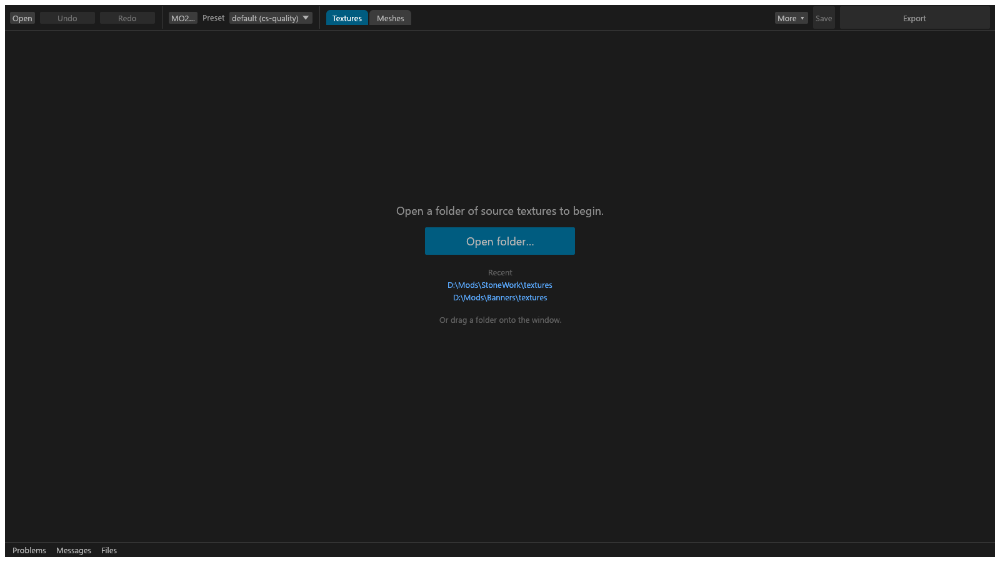
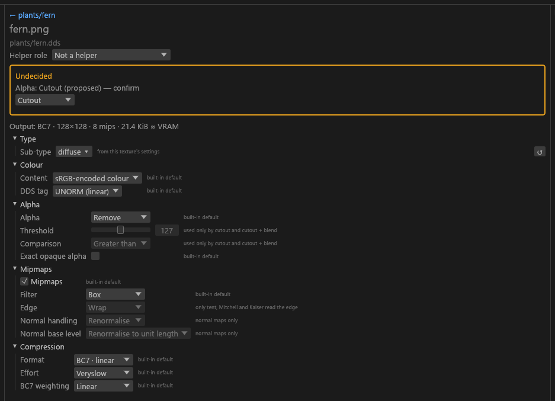
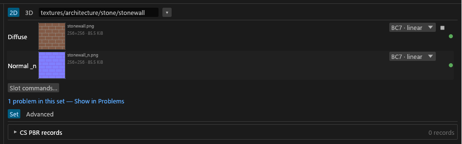
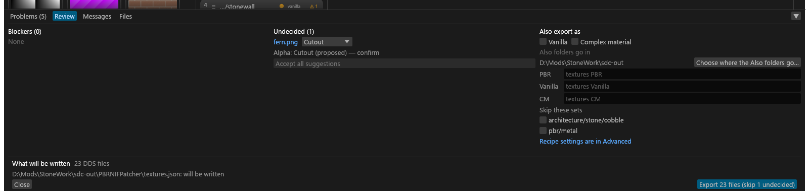

# Getting started

For a modder with a folder of source PNGs who wants one TruePBR set finished and working in game. It goes through the GUI, then what to check in game. It assumes you've unzipped the release ([Installation](Installation.md)).

## The example set

You're making a TruePBR iron plate for Community Shaders. Your source folder looks like this:

```text
C:\Work\IronPlate\
  textures\pbr\armor\ironplate\
    ironplate.png             colour, no alpha channel
    ironplate_n.png           normal map, DirectX green (Skyrim's convention)
    ironplate_roughness.png   grayscale
    ironplate_metallic.png    grayscale
    ironplate_ao.png          grayscale
```

Notice:

- The game path starts at the last `textures` folder, so `ironplate.png` is `textures/pbr/armor/ironplate/ironplate.png`. Rules and sub-type detection read that path.
- The five files share the base name `ironplate`, so they're one set.
- Under `cs` the three raw maps pack into one `ironplate_rmaos.dds` (R roughness, G metallic, B AO, A specular). What makes a set PBR is on [Texture types](Texture-Types.md#suffixes).
- The output mirrors the input tree, with `.dds` extensions.

## In the GUI

### Open the folder

Start `tessalith.exe`, click **Open folder…** and pick `C:\Work\IronPlate`, or drag the folder onto the window. Nothing is written yet. **Mode** (in the Presets tab) should read `cs`.



### Settle the undecided textures

A tile with an amber border is undecided: Tessalith won't guess what it is. The **Undecided** pill above the tiles shows only those. Click a tile, and the centre column lists its settings and where each value came from. **(auto)** means Tessalith picked it; hover it for why.

Answer what the centre column asks: a sub-type dropdown and **Confirm**, the alpha dropdown under "Alpha: … (proposed)", **Treat as OpenGL (flip green)** for a normal map's green channel, or **Acknowledge for this texture** for a blocking warning. Each answer is written to `sdc.toml` as a `[files]` entry. The three raw maps are rows in the **Helpers** group under the tiles, showing → ironplate_rmaos. They feed the `_rmaos` and need no answer.



### Check the set

Click `ironplate` in the Sets column. **Shader** should read `pbr` (auto). TruePBR settings are optional, and **Matching** stays on the diffuse path.



### Export

1. Pick **Export to**. Each project remembers its own folder; the rule is on [Main window](GUI-Main-Window.md#export-to).
2. Optional: in the JSON editor (**Export to ▾ → PGPatcher JSON editor…**), set **JSON name:**, the name of the PGPatcher JSON. It defaults to the folder name.
3. Press **Export**. If Review opens first, something is undecided or blocking: fix it or tick it there, then press Review's **Export** ([Review and Export](GUI-Review-and-Export.md)).



You get the DDS tree, plus `<export folder>\PBRNIFPatcher\<name>.json` for every PBR set that exported completely.

On the command line: [quick start](CLI-Reference.md#quick-start).

## Converting a whole mod folder

Open the folder in the GUI. Expect questions on the first run: a file whose type can't be worked out waits for you instead of being guessed ([why](Texture-Types.md#how-files-form-a-set)). Your answers are saved in `sdc.toml`, so later runs don't ask again.

## Install it

Copy the output into your mod and leave `_sdc` out. Install the JSON from `PBRNIFPatcher`, then run PGPatcher ([Installing the output](Validation-and-Output.md#installing-the-output)).

## Check it in game

Tessalith's validation checks the files, not the game. Look at these, each with what a bad result means:

- **Textures load.** A missing one means its output path differs from the path the mesh uses. The Meshes view shows a mesh's slots.
- **PBR colour brightness.** Compare albedo, `_g` and `_f` with linear lighting on and off. Washed out means a `color.tag = "unorm"` override: `TAG-UNORM-PBR`. [sRGB or UNORM](Texture-Types.md#srgb-or-unorm) has the rule.
- **Ordinary diffuse brightness.** Too dark under Community Shaders means an `_SRGB` override: `TAG-SRGB-NONPBR`.
- **Complex `_m` maps.** Check parallax and complex shading at a distance. `VAL-M-COMPLEX-MARGIN` warns when the smallest mip's alpha nears the point where Community Shaders turns complex material off ([the rule](Validation-and-Output.md#what-is-checked)).
- **Plain `_m` maps and PGPatcher.** PGPatcher treats a plain `_m` as complex when half or more of its alpha is non-white. Tessalith keeps `_m` alpha exactly opaque by default (`exact_opaque`) and warns with `VAL-PGPATCHER-50`.
- **Cutouts at a distance.** Foliage and fences that thin out or thicken point at `alpha.threshold`, and `VAL-COVERAGE`.
- **TruePBR sets.** After PGPatcher, check the material lands on the intended meshes and no others. Watch for delete sections that hit your own sets.

## Where to go next

- [GUI guide](GUI-Guide.md): the window, area by area.
- [Meshes and mod scanning](Mod-Scanning.md): let the GUI read alpha and shaders from the meshes that use your textures.
- [Presets and targets](Presets-and-Targets.md): Vanilla output, or smaller files.
