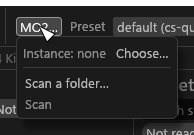
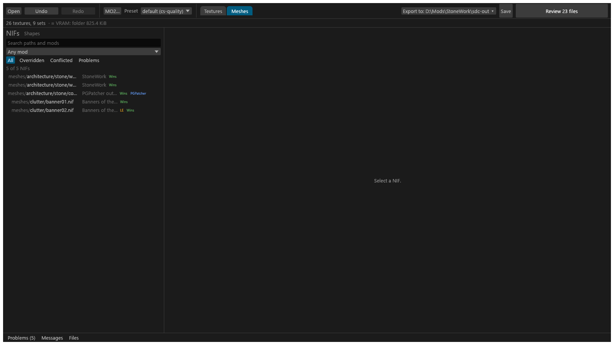

# Mod scanning and the Meshes view

This page is for modders who want Tessalith to read their Mod Organizer 2 load order (or one folder) so it can decide alpha, shaders and grass for you, and to see which meshes use a texture. A scan reads meshes (NIFs, loose or in BSAs) and, for an MO2 instance, the active plugins. It is read-only: it never changes your mods, your MO2 instance or your game folder. Scanning is a GUI feature; what `sdc` doesn't read is on [Review and Export](GUI-Review-and-Export.md).

## What the scan decides for you

| Use | Where you see it |
|---|---|
| Alpha meaning of colour maps | The Alpha row reads "from the meshes that use this texture" ([how](GUI-Texture-Panel.md#alpha-from-the-meshes)). |
| Set shader | When no map in the set decides it (PBR, Advanced skin, complex grass, complex `_m`, `_p`), the shader most scanned meshes use for the diffuse picks the set's shader. |
| Complex grass | After a scan that included plugins, the diffuse of a grass (GRAS) record's mesh gets a `complex_grass` suggestion ([the shape tests](PBR-Landscape.md#complex-grass)). |
| Path pickers | The input name ▾ list and the match pickers in the PGPatcher JSON editor list the texture paths and mesh folders the scan found. |
| Rename warnings | Renaming an output that scanned meshes still use under its old name (as slot 0) is flagged amber. PBR sets under `cs` are not flagged. |
| 3D preview | *Auto* in the set preview shows the set on a scanned game mesh that uses its diffuse. |

Your own choices in `sdc.toml` win over scan evidence.

## Choosing what to scan

The scan source is behind the **MO2…** button in the header, on both the Textures and the Meshes view. **Scan** starts it, **Cancel** stops it.

### An MO2 instance

**Choose…** picks the instance. Tessalith reads `ModOrganizer.ini` and follows the profile's mod list, so the scan sees what the game sees:

- Enabled mods in priority order, with the game's `Data` folder lowest and `overwrite` highest. Disabled mods and separators are skipped.
- Active BSAs: every `Skyrim - *.bsa` in `Data`, then the archives the game INIs list, then the ones the active plugins load.
- Active plugins in load order.

For each file path it works out which copy wins in game. If you start `tessalith.exe` from inside MO2, it finds the instance through `portable.txt` next to `ModOrganizer.exe`, or MO2's current instance under `%LOCALAPPDATA%\ModOrganizer\`, and asks whether to use it.

### A folder

**Scan a folder…** scans the meshes under one folder, for example a mod you are building. A folder scan has no plugin pass, so there are no **Plugin overrides** and no complex-grass auto-tag.

## Running a scan

The scan skips FaceGen and LOD meshes. Skyrim LE meshes are read but not drawn in the 3D preview; anything that isn't a Skyrim SE or LE NIF is counted and skipped. Cancelling during the plugin pass keeps the mesh results and notes that plugin results are incomplete. Only one scan runs at a time. After an update changes the database format you're asked to scan again.

## PGPatcher output

Tessalith finds PGPatcher's output folder by its marker files: `ParallaxGen_Diff.json`, `PGPatcher.esp` or `PG_<number>.esp`, `PGPatcher_UpdateCache.bin` and `meshes\_pgpatcher_dups`. It treats that output as a layer derived from your source mods and links each patched mesh to its source, so you can open the source instead. A banner says when PGPatcher is running (the scan pauses; **Retry** rescans) or when its output looks incomplete (re-run PGPatcher).

## The Meshes view

The **Meshes** tab shows what the scan found. **Scan details** on the scan row lists what the last scan found, with any notes (missing mod folders, archive notes, meshes that failed to read).

### Finding a mesh

The NIFs column lists every mesh path once, with the copy that wins in game. Hover a row's chips for the details.

- **Search paths and mods** matches the path or mod name. ASCII case doesn't matter, `\` reads as `/` and a leading `meshes/` is ignored.
- **Any mod** picks one mod and lists all of its copies, including the ones that lose. PGPatcher's output mod isn't offered.
- **Show in Meshes** under a texture's **Used by meshes** opens this view with a **Uses <texture> ✕** chip, so only the meshes that use that texture are listed ([Used by meshes](GUI-Texture-Panel.md#used-by-meshes)). **✕** shows them all again.
- Filters never deselect: when the selected NIF is hidden by them, the count line says so.

### Mesh detail

Select a mesh to see its copy (**In game**, or **Source** for a PGPatcher-patched one), the **Plugin overrides** (every winning plugin record that uses it) and what overrides it. **Edit** opens it for editing ([Editing a NIF](GUI-NIF-Edit.md)).

### Shape cards

**Shapes of <file>** replaces the list with one card per shape. While **Edit** is open the column stays on the shapes, because the cards are where you pick the shape to edit.

- **#N** is the shape's PGPatcher 3D index, the number plugins use for alternate textures. Textures count from 1, as in the set editor.
- A **Texture set** dropdown appears when a plugin record gives the shape alternate textures (or, on a Skin Tint shape, an armor addon gives it a skin texture). Pick one to see it on the shape in the 3D view; nothing is saved. The game matches alternate textures by the 3D index, so the card lists a TXST under that index whatever shape name the record stores, and **Plugin overrides** flags a swap whose index no shape has. <!-- D:GO2 --> <!-- D:GO4 -->
- A texture that belongs to the open folder has **Open in Textures**.

A Face Tint or Skin Tint shape also has an **Advanced Skin preview** card, for trying Community Shaders' extra skin textures in the 3D view (the textures themselves are on [Skin](Skin.md)). <!-- D:GN1 --> Nothing here is saved: the picks reset when another mesh is shown and when **Edit** opens or closes. <!-- D:GN4 -->

## Scan errors

| Message | Meaning |
|---|---|
| PGPatcher is running | A scan won't read the instance while PGPatcher or PGTools runs. |
| another scan is already running on this scan database | Another Tessalith window is scanning. |
| scan database version N, this build reads M: scan again in the Meshes view | Another version wrote the database. Scan again. |
| no MO2 instance: … | `ModOrganizer.ini` wasn't found, or the profile has no `modlist.txt`. |
| MO2 settings: gamePath missing / selected_profile missing | `ModOrganizer.ini` lacks a required setting. |
