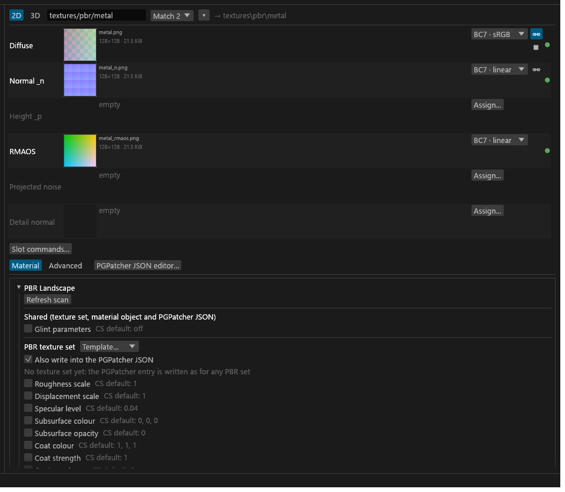
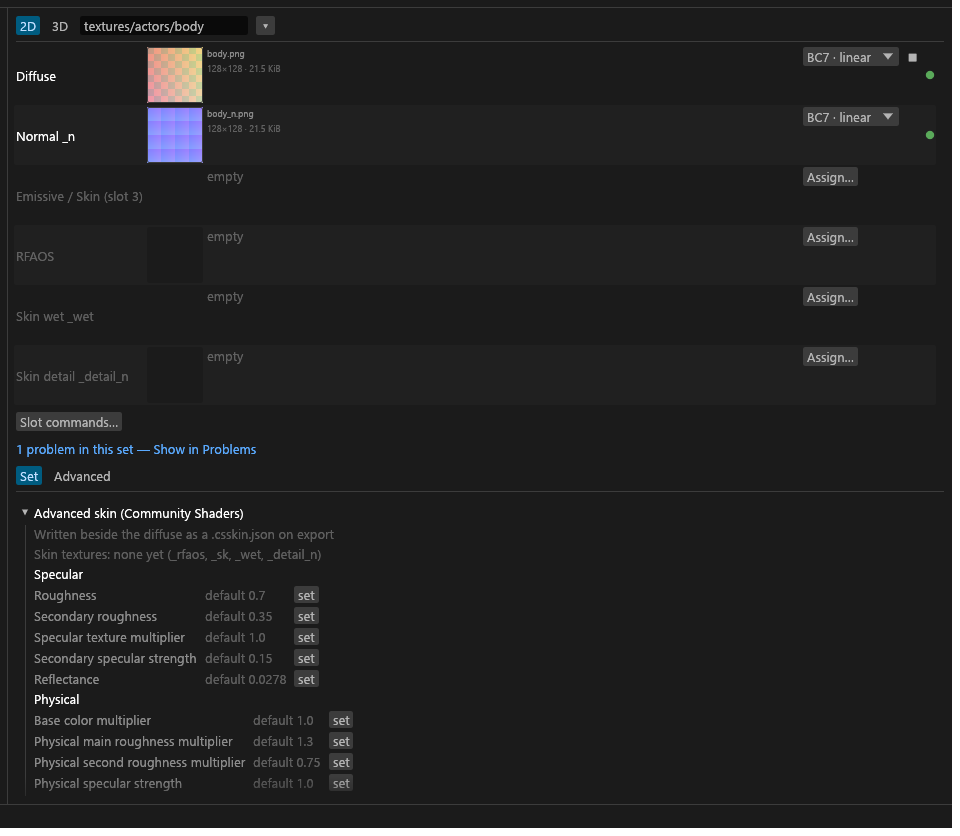

# PBR Landscape, Advanced skin, grass, XPMF and CS PBR records

This page is for terrain, projected-material (snow, ash), skin and grass authors targeting Community Shaders. It covers what each material writes: PBR Landscape sets, Community Shaders' own PBR record files, Advanced skin and its `.csskin.json`, XPMF profiles, PBR grass and complex grass. The ordinary TruePBR settings are on [PGPatcher settings and the JSON](GUI-PGPatcher-JSON.md).

## PBR Landscape sets

Under the `cs` target, a PBR set gets the **PBR Landscape** shader on its own when it sits under `textures\landscape\`, has a `landscape` folder in its path, or has a Community Shaders texture-set block. Trees, grass and mountains under that folder count too, so pick **PBR** in the Shader list for anything that isn't terrain. The set converts exactly like a PBR set; only the cards change. Its maps are the albedo (a landscape diffuse fills it too), `_n`, and optionally `_rmaos` and `_p`.

- **Also write into the PGPatcher JSON** follows the scan until you click it: after a scan it's ticked either way, with "Used by N meshes" when meshes that aren't LOD use the diffuse, and with a note (an info row in [Problems](GUI-Problems.md)) when none do yet. **Back to auto** returns it to the scan. A set whose colour map is a landscape diffuse rather than a PBR albedo has no PGPatcher entry; the box is off and says how to change that.
- The card edits the same texture set and material object blocks as [CS PBR records](#cs-pbr-records), with a **Shared** section for the glint parameters so one edit writes both.
- Roughness and specular are separate rows: the texture set's values multiply the `_rmaos` map, while the material object's replace it.
- Community Shaders' landscape shader reads only roughness, displacement, specular and glint, so the other rows stay hidden while the box is off, unless they hold a value.
- **PGPatcher JSON settings**, under the card, holds the TruePBR settings: open while the entry is written, marked "not written" while it isn't.

## CS PBR records

A set can write Community Shaders' own runtime files: a **PBR texture set** (`<export>\PBRTextureSets\<EDID>.json`) and a **PBR material object** (`<export>\PBRMaterialObjects\<EDID>.json`). On a landscape set they're on the card above; on any other set, open **CS PBR records** in the Material tab and add either block.

- **Template** fills a block from the built-in library: PBR landscape template values by Faultier (https://www.nexusmods.com/profile/Faultierfan?gameId=1704), from Faultier's PBR landscape modders resource. It never removes EDIDs you added.
- **EDIDs** are the records the file is for, and the file name is the EDID exactly, case included, because Community Shaders matches the exact case. After a plugin scan, texture-set EDIDs are suggested from the texture sets that use the diffuse, and material objects can be picked from the scanned records. An amber line flags an EDID that isn't in the scan; a material object that isn't single-pass is ignored by Community Shaders. An EDID that can't be a file name, or that two sets bind, isn't written.
- A texture set also drives the set's PGPatcher entry (roughness, specular, displacement, subsurface, coat and glint come from the block, so the two files can't drift). With no scan the entry isn't written. After a scan it's written whether or not a mesh (not LOD) uses the diffuse yet, and an info row says when none does; **PGPatcher entry for statics** forces it on or off.
- **IMPORTANT** A file you edited outside Tessalith is never overwritten: the export report says so, and you delete it to let Tessalith write it again. A file Tessalith wrote for an EDID no set binds any more is reported, not deleted.
- **Material object layer** in the 3D preview draws the snow or ash layer the game puts on statics that use the object, from the block's values and the record's DATA in your load order. Coverage goes on most non-skinned shapes; the block's material values (colour scale, roughness, specular, glint) change PBR shapes only. <!-- D:GI10,GZ1 -->
- When the set has an [XPMF profile](#xpmf-profiles), the layer takes the profile's four texture paths, `falloffScale`, `falloffBias` and `noiseUVScale` in place of the load order's. <!-- D:GI17 -->

## Advanced skin

For authors of skin textures for Community Shaders: Advanced skin sets, the `.csskin.json` they write, and skin variants that share maps. Which files make a set Advanced skin is on [Texture types](Texture-Types.md#suffixes).

### The Advanced skin card

The set editor shows an **Advanced skin (Community Shaders)** card instead of the TruePBR settings: your skin textures, then the Community Shaders skin settings.

A setting you haven't touched is not set and stores nothing, so Community Shaders uses its own default. Presets, defaults and rules never fill these, and sets don't inherit from each other, because a skin material is one author's decision for one body. Bulk edit doesn't touch them. A value outside its range blocks the export with a red Problems row; it is never clamped.

### The .csskin.json file

Every export writes `<diffuse>.csskin.json` beside the set's exported diffuse: the values you set, the paths of its `_rfaos`, `_wet` and `_detail_n`, and the diffuse's size and hash. A card you never touched writes no values. There is no button and no opt-out. <!-- D:HB1 -->

- **A set with no diffuse, or a borrowed one, writes no file** and gets an amber row. Community Shaders keys a material on the diffuse file, so only the set that exports the diffuse writes it. <!-- D:HB2 -->
- **A texture a slot doesn't export is left out** of the file, with an amber row.
- **A grey `_wet` isn't exported.** Community Shaders doesn't read grey height _wet maps anymore; use a normal with a mask in alpha. The set's other files still write (`SKIN-WET-GREY`). <!-- D:HB3 -->
- **A borrowed `_n` isn't named in the file.** The game reads the normal the mesh names, so point the mesh at the host's `_n`. The `_rfaos` still bakes from the host's `_n`. <!-- D:HC7 -->
- **IMPORTANT** An edited `.csskin.json` is always kept, and Export says so. Delete it to let Tessalith write it again. A file no skin set writes any more is left in place and listed in the export notes.

### Sharing maps between skin variants

A skin set with no colour map, holding only `_n`, `_sk`, `_wet` and `_detail_n`, is a shared-map set: other skin sets borrow its maps. Variants then share one `_n` and `_sk` and keep their own diffuse and `_rfaos`. Only skin sets can borrow the wet and detail slots, and a borrowed slot's menu offers **Clear**. Mapping a set to a target and the slot states are on [the Set editor](GUI-Set-Editor.md#mapping-to-a-target).

To try a skin on a mesh, use the **Advanced Skin preview** card on [the Meshes view](Mod-Scanning.md#shape-cards).

## XPMF profiles

XPMF is an SKSE plugin that reads JSON profiles from `Data\SKSE\Plugins\XPMF\*.json`. Each profile retargets single-pass material objects (MATO records) by EditorID pattern: it swaps the four global projected textures, sets the coverage values, and changes vertex colour and alpha at runtime (roof shelter, water fade). Tessalith writes the profiles; it doesn't edit plugins. Profiles are checked against XPMF 0.8.1's schema before they're written. <!-- D:GI8 -->

A Landscape or PBR Landscape set gets an **XPMF profile** card, with **Write XPMF profile** to turn it on. An amber line at the top says why the profile won't be written. A key you haven't set shows the value Tessalith fills, or XPMF's own default, greyed until you override it.

### The file

Export writes one file per set that has an XPMF block: `SKSE\Plugins\XPMF\tessalith_<name>.json` under the export folder. <!-- D:GI2 -->

- `<name>` is the last `/` part of the set id, lower-cased, with every character outside `a-z`, `0-9`, `_` and `-` replaced by `_`.
- Tessalith never writes `snow.json` or `ash.json`: they are XPMF's own profiles, and in MO2 a file of that name would hide them. Two sets whose ids give one name refuse both.
- The file is written after a clean export, with the same guard as the CS PBR files: a file Tessalith didn't write is kept and never replaced, and a profile no set writes any more is reported, not deleted. <!-- D:GI8 -->
- A profile that can't be written (no EDIDs, not a landscape set, a value the schema refuses, a texture of this project that wasn't exported) is skipped, and the card's amber line says why. <!-- D:GI3,GI8 -->
- **Also export with Vanilla ticked** writes a PBR Landscape set's Projected noise and Detail normal maps to the Vanilla folder as well, plus a copy of the profile with `pbr` set to false and the Vanilla folder's texture paths. A set left out of Also, or with a DDS file (which Also doesn't re-encode), gets none. <!-- D:GI27 -->

### Keys

The block lives in `sdc-project.toml` as `[sets.xpmf]`. A key the block doesn't set takes the value in the second column; every other key is left out of the file, so XPMF uses its own default. An empty text, list or path is also left out. <!-- D:GI7 --> Every key of the schema has a row on the card. <!-- D:GI1 -->

| Keys | Tessalith fills | Range and meaning |
|---|---|---|
| `name` | The set id. | A label. |
| `editorIds`, `excludeEditorIds` | `editorIds`: the EDIDs of the set's `cs_mato` block, as exact names. <!-- D:GI3 --> | Patterns (wildcards allowed) of the material objects the profile applies to and skips. `editorIds` is required. |
| `pbr` | On for a PBR Landscape set under `cs`, off otherwise. <!-- D:GI4 --> | Whether the targeted records are PBR. |
| `diffuseTexture`, `normalTexture` | The set's albedo (or diffuse) and normal outputs, as Data-relative paths. <!-- D:GI5 --> | Two of the four projected textures. |
| `noiseTexture`, `detailNormalTexture` | The outputs of the [Projected noise and Detail normal](#projected-noise-and-detail-normal) slots when filled; otherwise left out, so XPMF keeps the game's texture. <!-- D:GI5 --> | The other two. |
| `falloffScale`, `falloffBias` | Nothing. | The projection's coverage falloff. No bounds. |
| `noiseUVScale` | Nothing. | Above 0. |
| `maxAngle` | Nothing. | 0 to 180. |
| `lodIdentifier`, `lodMaterial`, `lodMaterialHD` | Nothing. | Text that DynDOLOD reads; Tessalith passes it through. <!-- D:GI6 --> |
| `neutralizeVertexColors`, `neutralizeVertexAlpha` and their `Skip` lists | Nothing. | Neutralise vertex colour or alpha at runtime, except on the EDIDs in the `Skip` list. |
| `roofShelter`, `roofShelterSkip`, `roofShelterFixVertices`, `shelterFade`, `shelterRandomness` | Nothing. | Roof shelter. `shelterFade` and `shelterRandomness` are 0 to 128. |
| `waterFade`, `waterFadeRandomness` | Nothing. | Water fade. `waterFadeRandomness` is 0 to 64. |
| `specularMult` | Nothing. | 0 to 10. Hidden and left out while `pbr` is on, because XPMF ignores it on PBR. <!-- D:GI9 --> |
| `comment` | Nothing. | A label. |

The 3D preview shows the texture and coverage keys; every other row says "Not shown in the preview" on hover, because XPMF does that work at runtime. <!-- D:GI1 -->

### Projected noise and detail normal

A Landscape or PBR Landscape set has two optional slots that feed the profile: **Projected noise** and **Detail normal**. They have no PGPatcher slot, so they aren't in the PGPatcher JSON, and a file can't be shared between sets. <!-- D:GI12,GI18 -->

- **Projected noise** is the sub-type `projected_noise`, suffix `_noise`. It's written as BC4 (one linear channel, full mips), half the size of BC7, because Community Shaders reads only its red channel. <!-- D:GI14 --> In a landscape set a `_noise` file is read as projected noise without asking. <!-- D:GI21 -->
- **Detail normal** is the sub-type `detail_normal`. In a landscape set a file with the suffix `_detail`, `_detailnorm` or `_detail_n` is the detail normal ([Detail names](Texture-Types.md#detail-names)). <!-- D:GI13 -->
- **A set made only for a material object needs no `_rmaos`.** The projected layer samples only the noise, normal, detail and diffuse textures; roughness, metallic and specular come from the `cs_mato` values. <!-- D:GI15 -->
- **The Community Shaders build the preview uses doesn't draw the projected normal and detail samples** ([which build](Previews.md)). They show without Community Shaders, or in a later version of it. The slot still exports. <!-- D:GI16 -->

### Problems and Review

With `pbr` on, each listed EDID without a wildcard that no `cs_mato` block of this project names gets an amber Problems row, "XPMF skips <EDID>: no PBRMaterialObjects JSON from this project". PBRMaterialObjects files from other mods aren't scanned. <!-- D:GI4 --> Review lists a row per profile (new, replaced or foreign).

## PBR grass

Community Shaders draws grass with its own shader, which reads only the albedo, `_n`, `_rmaos` and an optional `_s`. A PBR set whose albedo a grass (GRAS) record uses gets the **PBR grass** shader on its own after a scan that included plugins. You can also pick it in the Shader list (`cs` target only).

- The settings and the JSON editor show only what grass reads: roughness scale, specular level, subsurface (Standard or Foliage, on when the set has an `_s`), matching, vertex colours, locks and slots. Other keys the set already has stay in `sdc-project.toml` and come back if you switch to PBR, but aren't exported.
- PGPatcher needs to be 2.1.0 or later to patch PBR grass meshes.
- `PBR-GRASS-DETECT` on the albedo means its bottom-left texel looks like a complex-grass normal, so Community Shaders' grass shadow pass would cut the shadows wrong: change that texel. Packed albedos aren't checked.
- The 3D preview draws PBR grass with the object PBR shader ([Previews](Previews.md)).

## Complex grass

Both targets accept it; only Community Shaders or ENB read it in game. A complex-grass texture is one image twice as tall as it is wide, with power-of-two sides (for example 1024x2048): diffuse and alpha in the top half, normal and specular in the bottom half. Community Shaders detects it from the bottom-left texel.

- Tag it by setting the set's shader to `complex_grass`, by setting `subtype = "complex_grass"` on the file's `[files]` entry, or let the GUI do it after a scan that included plugins: a texture a GRAS record uses, 1:2, with a valid detection corner and a normal-map bottom half gets a High-confidence suggestion. A complex-grass-shaped diffuse nothing tags gets an info row in Problems with **Tag as grass**. The sub-type picker offers **Complex grass** where the set's shader is a grass shader or no `textures` folder is above the file.
- The checks and their codes are under [Diagnostic codes](Diagnostic-Codes.md#shaders-skin-and-grass).
