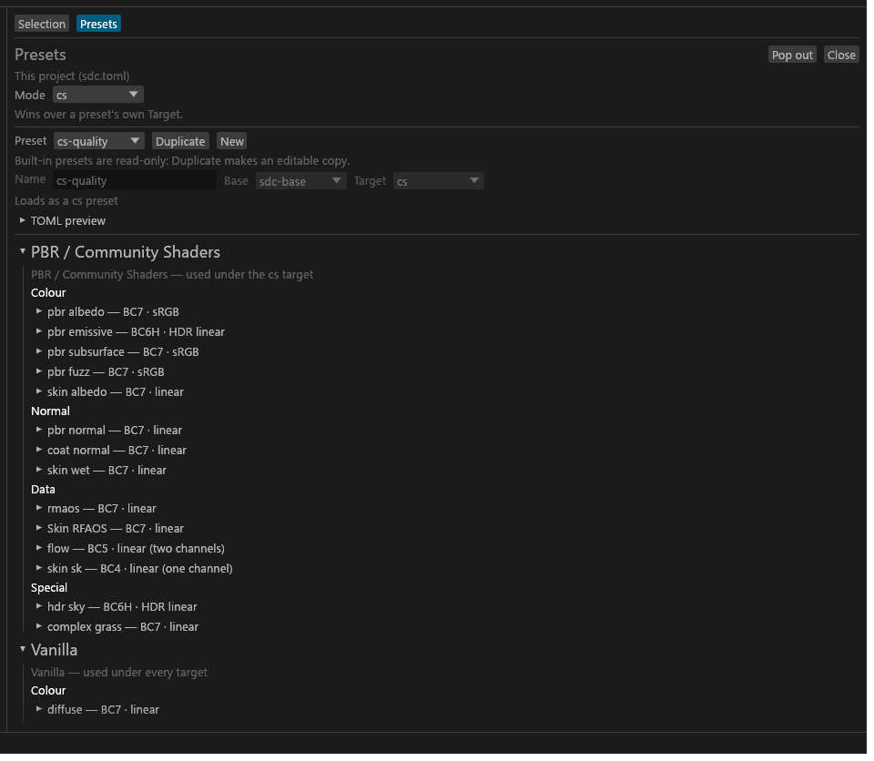

# Presets and targets

For anyone choosing which renderer the textures are for and which bundle of settings to use. Every conversion has exactly one target and one preset.

## Which target

| Target | Id | What it allows |
|---|---|---|
| Community Shaders | `cs` | Everything: TruePBR materials, Advanced skin, `_SRGB` tags on PBR colour maps, BC6H and RGBA16F for HDR data, every set shader. The default. |
| Vanilla | `vanilla` | Bethesda shaders, plus the complex-material `_m` (environment, gloss, metal, height in one map) for a set whose shader is complex material, and complex grass. No `_SRGB`, no BC6H, no PBR. |

There is no `cpm` target: a vanilla set with the complex material shader packs the same `_m`. <!-- D:AZ --> `cpm` is an error in `--target`, `sdc.toml`, the user config, `--preset cpm-quality` and `base = "cpm-quality"`. A user preset file with `target = "cpm"` is skipped with a `CFG-PRESET-SKIPPED` warning that names `cpm`.

The target is chosen from the first of these that is set:

1. `--target` on the command line.
2. `target` in the project `sdc.toml` (the GUI's **Mode** row writes this).
3. `target` in the [user config](Project-Config.md#where-the-files-are).
4. The selected preset's own `target`.
5. `cs`.

What a target changes lives with the thing it changes:

- Sub-types and colour tags: [Texture types](Texture-Types.md#sub-types-what-each-file-becomes).
- Packed maps: [Texture packing](Texture-Packing.md).
- Shaders: [Set shaders](Set-Shaders.md#which-maps-each-shader-needs).

## Built-in presets

| Id | Target | What it does |
|---|---|---|
| `cs-quality` | `cs` | The default. Community Shaders including TruePBR; bc7e at `veryslow`; BC6H for HDR emissive. Adds nothing to the base defaults. |
| `cs-compact` | `cs` | Smaller files: BC1 for opaque colour maps at full size, other maps at half size, BC4/BC5 search radius `fast`. |
| `vanilla-quality` | `vanilla` | Bethesda shaders. No `_SRGB`, no BC6H. `diffuse` and `glow` use perceptual encoding in BC1, BC3 and BC7. <!-- D:FM43 --> |
| `vanilla-compact` | `vanilla` | The vanilla version of `cs-compact`, with perceptual BC1. |
| `fast-preview` | none (uses the batch target) | bc7e `fast`, BC4/BC5 search radius `fast`, PSNR validation on the smallest mip only. |

The preset is chosen from the first of these that is set:

1. `--preset` on the command line.
2. `preset` in the project `sdc.toml` (the header's **Preset** menu writes this; it lists the presets of the current Mode).
3. `preset` in the user config.
4. The default for the target: `cs-quality` or `vanilla-quality`.

Every built-in preset has one rule: any file under an `interface` or `sky` folder gets `mips.levels = "none"`.

## Making your own preset in the GUI

**Presets…** (the last entry of the header's **Preset** menu) opens the preset creator as a tab of the centre column. <!-- D:FB7 --> It edits the files in `%APPDATA%\sdc\presets\`, which `sdc` loads too, so you never write TOML by hand unless you want to. **TOML preview** shows exactly what **Save preset** writes.



- **Built-in presets are read-only.** **Duplicate** makes an editable copy.
- **One row per sub-type**, in two families: **PBR / Community Shaders** and **Vanilla**. Open a row for its Compression, Resize & mips, Alpha, Channel remap and Packing fills. Each field hints the base's value; **↺** drops your change.
- **A preset that wouldn't load is never written.** The creator loads it through the same loader as the presets folder before saving, edits your file in place (comments kept), and re-reads the folder, so the preset appears in the **Preset** menu without a restart.
- **A preset that `sdc.toml` names but is gone** blocks the export: Problems shows "Preset <id> is not installed" with **Choose preset…**, and `sdc convert` exits 2.

### Suffix branches

Open a suffix under a sub-type to change settings only for files with that suffix:

- A branch is saved as one `[[rules]]` entry, and branches apply after your other rules. An alias's branch adds to its canonical suffix's branch.
- A `[files]` value or `--set` still beats a branch.
- **Add alias** adds a suffix alias and opens its empty branch; **Remove alias** removes it with its branch. The creator refuses a bad alias with the engine's message as you type.
- Rules the creator didn't write are listed under **Other rules**, read-only, and kept as they are.

## Writing a preset by hand

A preset is a TOML file. Put it in `%APPDATA%\sdc\presets\` and `sdc` and the GUI load it on every run, or load it for one run with `--preset-file <file>` (load only) or `--preset <file.toml>` (load and select).

```toml
schema_version = 1
id = "my-armor"
version = "1.0.0"
base = "cs-quality"
target = "cs"
description = "Armour textures: slowest bc7e, cutout diffuse with coverage, Kaiser mips on colour."

[defaults]
encoder = { effort = "slowest" }

[subtypes.diffuse]
alpha = { policy = "cutout", threshold = 128 }
mips = { coverage = "on", filter = "kaiser" }

[subtypes.pbr_albedo]
mips = { filter = "kaiser" }

[[rules]]
match = { glob = "**/cloth/**", subtypes = ["diffuse"] }
overrides = { alpha = { policy = "blend" } }

[suffix_aliases]
rmaosultrahigh = "rmaos"
```

| Key | Required | Meaning |
|---|---|---|
| `schema_version` | yes | 1. |
| `id` | yes | The preset's id. Must not clash with one already loaded, built-in or user. |
| `version` | yes | Your version string. |
| `base` | in practice | The preset this one inherits from, such as `cs-quality`. Every sub-type's profile must resolve completely, so a preset without a `base` must supply every field itself; the load names what is missing. A cycle is an error. |
| `target` | no | The preset's target, used when nothing else sets one. Leave it out for a target-neutral preset like `fast-preview`. |
| `hidden` | no | `true` keeps the preset out of `presets list`. |
| `description` | no | Shown by `presets list`. |
| `[defaults]` | no | Partial profile for every sub-type. |
| `[subtypes.<id>]` | no | Partial profile for one sub-type. |
| `[[rules]]` | no | Same format as in `sdc.toml`: [rules](Project-Config.md#rules). |
| `[suffix_aliases]` | no | Extra file-name suffixes, as `alias = "canonical suffix"`. |

The tables take the same fields as `sdc.toml` ([fields](Project-Config.md#fields)); inheritance and rule order follow [How settings layer](Project-Config.md#how-settings-layer).

### Suffix aliases

A suffix alias makes Tessalith read another suffix as a canonical one. With `rmaosultrahigh = "rmaos"`, `iron_rmaosultrahigh.png` joins the `iron` set as its `_rmaos`.

- The alias is lower-case ASCII letters and digits, no underscore.
- It can't be a canonical suffix (`n`, `rmaos`) or an exporter term (`albedo`, `roughness`), and it must map to a canonical suffix.
- Two loaded presets can't declare the same alias.
- A file named with an alias resolves with the declaring preset's settings chain, so that preset can carry settings for those files.

`sdc presets list` shows each preset's aliases.

### Checking and installing

```powershell
# See what a preset resolves to for one sub-type
sdc presets --preset-file my-armor.toml show my-armor --subtype diffuse
```

A file in the user presets folder that fails to load is skipped with `CFG-PRESET-SKIPPED` (a warning naming the file and the reason) and the run continues. A file given with `--preset-file` that fails to load is an error.

After you change a preset, only textures whose resolved settings changed are re-encoded on the next `if-changed` run ([re-runs](Validation-and-Output.md#re-runs-and-if-changed)).
