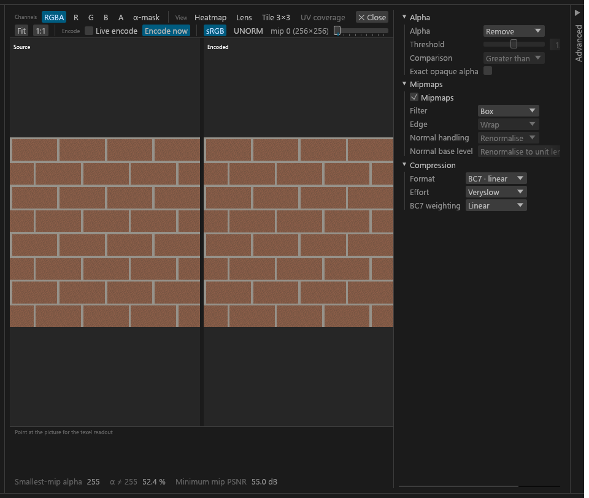
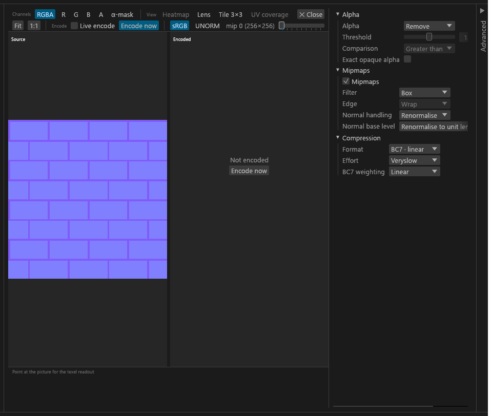

# Previews (2D and 3D)

For checking textures before you export: the 2D preview puts a texture's source beside the exact encode Export would write, and the 3D view shows a set on a mesh in Community Shaders' deferred renderer.

## Open a texture's preview

Double-click a tile (or a set member), or select it and press **Enter** or **Space**. **Esc** or a double-click in a viewport closes it. The other preview keys are in the [GUI guide](GUI-Guide.md). The texture's settings sit in a panel on the right of the preview; in a narrow window it starts as a **Settings** strip you click to open.

- **What you see is what you get.** Each previewed mip is byte-identical to the same mip of the DDS Export writes.
- **Seams and coverage:** **Tile 3×3** (**T**) repeats the picture to check seams; the **UV coverage** toggle is the artist check on [Texture types](Texture-Types.md#uv-coverage).
- **Size limit:** the preview encodes only mips up to 4096 px on the larger side, and lower if your GPU can't hold that; it says so.
- **A DDS input** previews as stored, with no source side. BC2 and signed BC6H show "cannot be previewed".
- **No usable GPU:** the preview is off and says so. Deciding, editing and Export still work.

## See the set on a mesh (3D)

The 3D view renders with Direct3D 11 and the Community Shaders shader files built into Tessalith, so you can check a material close to the game before exporting. It uses Community Shaders 1.9.0 (AIO build 2026-10-03) with default settings, whatever CS you run; your own CS settings or a newer CS can look different in game. <!-- D:GT4 -->

- **The 2D | 3D switch** in a set's heading row swaps the centre pane in place. *2D* (the default) is the [set editor](GUI-Set-Editor.md); *3D* fills the centre. It is remembered in `gui.toml`.
- **TruePBR settings…** in the heading row opens a window you can move and resize, with the set's settings (the coat settings, the skin card, the PBR Landscape card, CS PBR records, the complex material card, whichever the set has). An edit there shows in 3D right away. While the switch is on 3D, selecting any texture of a set shows that set's view, and the window follows the selection.
- **Encoded or Source:** *Encoded (exact export)* shows the bytes Export would write; *Source (faster, no compression)* shows the prepared source.
- **Mesh:** *Auto* picks a scanned mesh that uses the diffuse, loose files before BSA ones; or choose a built-in shape (Sphere, Plane, Cube, Material ball).
- **Copy image** (**Ctrl+Shift+C**) copies the last frame at the size it was rendered.
- **Material object layer:** a set with CS PBR records can draw the snow or ash layer; see [CS PBR records](PBR-Landscape.md#cs-pbr-records).
- The **Meshes** view has the same panel ([Mod scanning](Mod-Scanning.md)).

## Move the camera and light

- Drag to orbit, scroll to zoom, middle-drag or Shift+drag to pan. Double-click or **Home** recentres.
- **Shift+right-drag turns the sun** around the model; the studio HDRI background turns with it. **Reset view** in **View ▾** puts the lights, background and camera back to their defaults.
- **Debug view** (**V** steps through): *Lit* is the normal Community Shaders render; *Albedo*, *Normals*, *Roughness*, *Metallic* and *AO* show one channel. They are offered only when a shape has that channel; the hover names a stand-in (non-PBR roughness as 1 − specular mask, vertex AO).
- **Accurate (deferred)** is on by default: opaque shapes draw through Community Shaders' own deferred pass, as in game. If it can't run, the view falls back to forward and a notice says why.
- **Missing textures** draw in solid magenta (colour slots only; a missing normal, glow, specular or RMAOS map draws neutral) and are listed above the frame, with *Open in Textures* for a path in the open folder. In a NIF edit's **Source** view, a path that no mod ships but PGPatcher's JSON replaces at run time is not listed as missing: one grey line says so, and **In game** shows the replacement.

## What the 3D view assumes

- **The PGPatcher simulation** needs the `cs` target and a PBR set. Other sets show their plain textures.
- **A real mesh needs a scan** ([Mod scanning](Mod-Scanning.md)). "No scanned mesh uses this diffuse" means the scan found none. Meshes from Skyrim LE aren't drawn, and a built-in shape can't match an entry's match keys, so it shows plain textures.
- **Your JSON wins** over other mods' PGPatcher configs.
- **Large textures** are previewed at a capped size ("Preview at N px, export writes full size").
- **These Community Shaders features are off:** Light Limit Fix, Skylighting, Screen-Space Shadows, Subsurface Scattering, Image-Based Lighting, Physical Sky, Wetness, Cloud Shadows, terrain effects, water, fog, Volumetric Shadows.
- **PBR grass** is drawn with the object PBR shader, so it can look different from in game ([PBR grass](PBR-Landscape.md#pbr-grass)). The exported files aren't affected.
