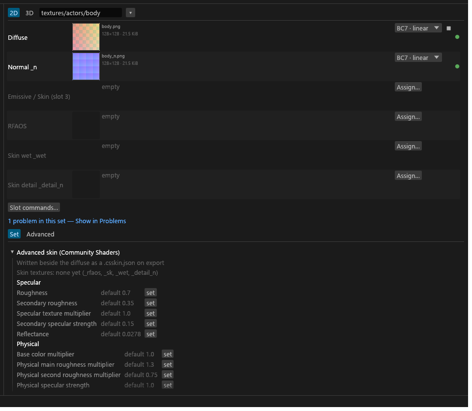

# Skin and Advanced skin

This page is for authors of body, face and creature skin for Community Shaders. It covers Advanced skin sets, the `.csskin.json` they write, skin variants that share maps, and model-space normals (`_msn`). The TruePBR JSON is on [PGPatcher settings and the JSON](GUI-PGPatcher-JSON.md); texture formats are on [Texture types](Texture-Types.md).

## What Advanced skin needs

- The maps: `skin_albedo`, `_n` (or `_msn`) and `_rfaos`, plus optional `_sk`, `_wet` and a detail normal. Formats are in [Texture types](Texture-Types.md); the three detail spellings (`skin_detail` in a skin set) are under [Detail names](Texture-Types.md#detail-names).
- The `cs` target. Advanced skin sets get no PGPatcher JSON entry, no TruePBR settings and no PGPatcher checks, because PGPatcher doesn't know them. If no PBR set is left, the JSON isn't written and the old file stays as it was.

## Making a set Advanced skin

Pick **Advanced Skin** in the set's Shader list. The diffuse becomes `skin_albedo` and a packed `_rmaos` becomes `_rfaos`, in the same undo step. Picking another shader, or Auto, puts back what was there.

- It only re-types a diffuse whose sub-type was inferred or is plain `diffuse`. A sub-type you picked yourself (say `pbr_albedo`) stays, and so does a pinned Diffuse slot: Tessalith writes nothing into a pinned slot.
- A set with only a metallic map, or a pre-packed `_rmaos`, keeps its `_rmaos`.
- Tessalith remembers which diffuses it changed in `sdc-project.toml` (`[project] auto_skin`), so reverting restores yours.
- A set's `_msn` stays `msn` through all of this. <!-- D:IA3 -->
- Skin sets write to the normal mirrored paths, not under `textures\pbr\`. **Rename** gives their outputs an output name.

## The Advanced skin card

The set editor shows an **Advanced skin (Community Shaders)** card instead of the TruePBR settings: your skin textures, then the Community Shaders skin settings.

A setting you haven't touched is not set and stores nothing, so Community Shaders uses its own default. Presets, defaults and rules never fill these, and sets don't inherit from each other, because a skin material is one author's decision for one body. Bulk edit doesn't touch them. A value outside its range blocks the export with a red Problems row; it is never clamped.

## The .csskin.json file

Every export writes `<diffuse>.csskin.json` beside the set's exported diffuse: the values you set, the paths of its `_rfaos`, `_wet` and `_detail_n`, and the diffuse's size and hash. A card you never touched writes no values. There is no button and no opt-out. <!-- D:HB1 -->

- **A set with no diffuse, or a borrowed one, writes no file** and gets an amber row. Community Shaders keys a material on the diffuse file, so only the set that exports the diffuse writes it. <!-- D:HB2 -->
- **A texture a slot doesn't export is left out** of the file, with an amber row.
- **A grey `_wet` isn't exported.** Community Shaders doesn't read a grey wet map; use a normal with a mask in alpha. The set's other files still write (`SKIN-WET-GREY`). <!-- D:HB3 -->
- **A borrowed `_n` isn't named in the file.** The game reads the normal the mesh names, so point the mesh at the host's `_n`. The `_rfaos` still bakes from the host's `_n`. <!-- D:HC7 -->
- **IMPORTANT** An edited `.csskin.json` is always kept, and Export says so. Delete it to let Tessalith write it again. A file no skin set writes any more is left in place and listed in the export notes.

## Sharing maps between skin variants

A skin set with no colour map, holding only `_n`, `_sk`, `_wet` and `_detail_n`, is a shared-map set: other skin sets borrow its maps. Variants then share one `_n` and `_sk` and keep their own diffuse and `_rfaos`. Only skin sets can borrow the wet and detail slots, and a borrowed slot's menu offers **Clear**. Mapping a set to a texture set record and the slot states are on [the Set editor](GUI-Set-Editor.md#texture-set-records).

To try a skin on a mesh, use the **Advanced Skin preview** card on [the Meshes view](Mod-Scanning.md#shape-cards).

## Model-space normals (MSN)

An `_msn` stores each normal in the model's own frame instead of relative to the surface. Vanilla skin and eyes use it. It only fits the mesh and UVs it was baked for, and it handles deformation badly, so I'd pick a tangent-space `_n` for anything morphed (RaceMenu bodies and faces) and keep `_msn` for meshes that never deform.

- **Axis layout.** Skyrim reads R as X, G as Z and B as Y. A bake from another tool needs a swap or an invert to match, which the next section covers.
- **Naming.** `_msn` is typed `msn` and wins over `_n`. The Eye shader re-types an eye's `_n` to `msn`. It goes in texture-set slot 2 (normal).
- **The `_s` companion.** An `_s` in a set with `_msn` is `msn_specular`: BC4, red only, in slot 8. The game reads its red as glossiness. An `_msn` without an `_s` gives `SET-MISSING-COMPANION` (info), except under Eye.
- **The NIF flag.** The mesh needs the `Model_Space_Normals` flag (SLSF1 bit 12), or the game reads the map as tangent space. The [NIF editor](GUI-NIF-Edit.md) names slot 8 "Model-space specular" when it's set.
- **Shaders.** `skin` and `advanced_skin` take `_n` or `_msn`; `eye` needs model-space ([Set shaders](Set-Shaders.md)).
- **Encoding.** BC7, alpha removed, no green flip, no Z rebuild: Tessalith keeps the vectors as you baked them.

### Baking an MSN for Skyrim

Tell Tessalith which baker made the map and it makes the change when it encodes. The **Baked in** row appears on an `_msn` file and is saved per file (key `channels.msn_source`, see [Project config](Project-Config.md#channels)). Unset means the map is already Skyrim MSN and is stored as it is. <!-- D:IA2 -->

| Source | Change to reach Skyrim MSN | **Baked in** |
|---|---|---|
| Blender object-space bake | Swap G and B | Blender object-space (swap G and B) |
| Marmoset default (right-handed) | Invert B | Marmoset right-handed or Substance (invert B) |
| Substance (DirectX and OpenGL give the same MSN) | Invert B | Marmoset right-handed or Substance (invert B) |
| Marmoset left-handed | Invert G and B | Marmoset left-handed (invert G and B) |
| Already Skyrim MSN | None | Skyrim MSN (no change) |

Tessalith doesn't detect the baker or warn about a wrong choice: a wrong guess would silently ruin the map, so it applies exactly what you pick.
