# Specular reference (F0)

For mod authors building a True PBR material for Community Shaders (CS): the F0 of common materials, the albedo colour of metals, and what every PBR effect does and which map drives it. F0 is the share of light a surface reflects head-on.

Jump to: [PBR effects](#pbr-effects), [coat vs vanilla multilayer](#coat-vs-vanilla-multilayer-parallax), [inner-layer parallax](#inner-layer-parallax-vs-regular-parallax), [Non-metals](#non-metals), [Metals](#metals).

## Setting F0 on a True PBR set

Community Shaders computes `F0 = _rmaos alpha × Specular level`, so you can type the F0 straight in.

1. Find the material under [Non-metals](#non-metals).
2. One material in the texture: set **Specular level** to its F0 and leave the `_rmaos` alpha at 255.
3. Several materials in one texture: set **Specular level** to the highest F0 and paint each material's alpha as its F0 ÷ that level. Leather at 0.044 beside a material at 0.055: level 0.055, leather alpha 204 (0.80), the other 255.
4. A metal uses neither: paint its colour from [Metals](#metals) into the albedo and set metallic to 255.

**Specular level** is on the Shader tab of a PBR shape ([Editing a NIF](GUI-NIF-Edit.md)) and is `specular_level` in the JSON ([PGPatcher settings](GUI-PGPatcher-JSON.md#whats-on-the-material-tab)).

## PBR effects

What each True PBR effect does in Community Shaders. The files in your set turn most of them on ([which file turns on what](GUI-PGPatcher-JSON.md#your-textures-turn-features-on)), and some can't go together ([which](GUI-PGPatcher-JSON.md#features-that-cant-go-together)). Landscape reads only a few of them ([PBR Landscape](PBR-Landscape.md#pbr-landscape-sets)); skin has its own shader ([Advanced skin](PBR-Landscape.md#advanced-skin)).

### Which map drives each effect

Each setting multiplies its channel, so a white channel gives you the setting as you typed it. Formats and sRGB flags are in [Texture types](Texture-Types.md#sub-types-what-each-file-becomes).

| Slot | File | Channel | Effect | Setting that scales it |
|---|---|---|---|---|
| 1 | albedo | RGB | Base colour | - |
| 2 | `_n` | RGB | Normal | - |
| 3 | `_g` | RGB | Emissive | **Emissive colour**, **Emissive scale** |
| 4 | `_p` | R | Parallax | **Displacement scale** |
| 6 | `_rmaos` | R, G, B, A | Roughness, metallic, AO, specular | **Roughness scale** (R), **Specular level** (A) |
| 7 | `_cnr` | RGB, A | Coat normal, coat roughness | **Coat roughness** (A) |
| 7 | `_f` | RGB, A | Fuzz colour, fuzz weight | **Fuzz colour**, **Fuzz weight** |
| 8 | `_s` | RGB, A | Subsurface colour, thickness | **Subsurface colour**, **Subsurface opacity** |
| 8 | `_s` with **Multilayer (coat)** on | RGB, A | Coat colour, coat strength | **Coat colour**, **Coat strength** |
| - | none | - | Glint | the four **Glint settings** |

### What each effect looks like

Each ball adds one effect to the baseline ball, or to the ball its tip names. `tools/pbr-balls.py` draws them with CS's shading maths, one light and a made-up sky, so they compare effects; they are not in-game captures.

| Ball | Effect | What it simulates | Tip |
|---|---|---|---|
|  | Baseline | Grey albedo 150, roughness 0.55, metallic 0, F0 0.04. | The ball the others start from. |
| 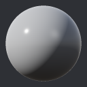 | Roughness | Tiny scratches and bumps that blur reflections: low is polished, high is chalky. | Ball: 0.15. CS never goes below 0.04, so a mirror keeps a slight blur. |
| 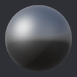 | Metallic | Bare metal: no diffuse colour, and the reflection takes the albedo colour. | Paint 0 or 255; values between are for blends such as rust on steel. Metal colours: [Metals](#metals). |
| 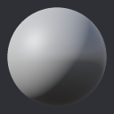 | Specular | How much a non-metal reflects head-on (F0). | Ball: 0.17 (diamond). Values: [Setting F0](#setting-f0-on-a-true-pbr-set). |
|  | Normal | Small dents and bevels that catch light without extra geometry. | DirectX green: [Green direction](Texture-Types.md#green-direction). |
|  | AO | Cracks and corners that ambient light can't reach. | CS dims ambient light and reflections with it; direct light only where the AO is dark and the light comes in low. Keep AO out of the albedo, or cavities go dark twice. |
|  | Parallax | Real depth: raised parts hide what is behind them as you move. | The normal ball plus a `_p`. Needs CS's Extended Materials parallax on. Height rules: [Height maps](Texture-Types.md#height-maps). |
| 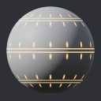 | Emissive | Light the surface gives off: embers, runes, lava. | Unaffected by lighting, and lights nothing else. Above 1.0 needs a float source: [Texture types](Texture-Types.md#which-files-tessalith-reads). |
| 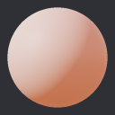 | Subsurface | Light that enters skin, wax or marble, scatters, and comes out tinted. | Lights the shadow side and glows when the light is behind. Strength is 1 - **Subsurface opacity** × `_s` alpha: opacity 1 with a white alpha turns it off. |
|  | Foliage subsurface | Thin leaves lit from behind. | Only light from behind comes through. CS uses this on Tree Anim meshes and the standard subsurface on all others: [Subsurface](GUI-PGPatcher-JSON.md#subsurface). |
| 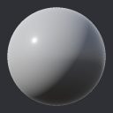 | Coat | A clear layer on top: varnish, lacquer, glaze, ice. | Adds a second reflection and dims the base under it. **Coat specular level** is the coat's F0: take it from [Non-metals](#non-metals). The sky reflection keeps the base roughness; only lights get the coat's sharp highlight. |
| 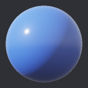 | Coat diffuse | A coloured coat: enamel, stained varnish. | The coat ball with a blue **Coat colour**. Without **Coat diffuse**, **Coat colour** and `_s` RGB do nothing. At **Coat strength** 1 you see almost only the coat colour. |
|  | Coat normal | A coat with its own surface: drips, orange peel, ripples. | The coat ball plus a `_cnr`. Only the coat's highlight from lights follows `_cnr`, and with **Coat parallax** the ray bending too. Without it the coat uses `_n`. |
| 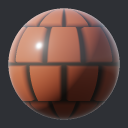 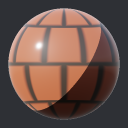 | Coat parallax | The base seen through a thick clear layer: inlay under resin, a floor under ice. | The coat ball with tiled albedo and one `_p`: left regular parallax, right **Coat parallax**. [How they differ](#inner-layer-parallax-vs-regular-parallax). |
| 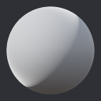 | Fuzz | Fibres that catch light at grazing angles: velvet, felt, peach skin. | **Fuzz weight** 0 keeps the normal reflection, 1 is all sheen. The sheen's width follows roughness. |
| 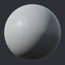 | Glint | Sparkling flakes: snow, sand, frost, mica. | No texture. Nothing sparkles until **Log microfacet density** is above 1.1. This ball uses random flakes, not CS's glint model. |

**Hair** has no ball. It swaps the reflection model for a strand model meant for hair cards, ignores the specular level (it uses a fixed hair IOR of 1.55), and shows nothing useful on a sphere.

### Coat vs vanilla multilayer parallax

The two are opposite: they put your main texture on different layers.

- **Vanilla multilayer parallax:** your diffuse, `_n` and env map are the top layer. The `_i` inner layer is under it, seen where the diffuse alpha is low, and shifted by the view angle and the inner thickness.
- **CS True PBR coat:** your albedo, `_n` and `_rmaos` are the bottom layer. `_s` and `_cnr` describe the layer on top: its colour, strength, normal and roughness.
- **Porting a vanilla multilayer material:** the `_i` plays the part of the PBR albedo, not the diffuse.

### Inner-layer parallax vs regular parallax

Both read the same `_p`. They differ in what moves and which grey sits on the surface.

- **Regular parallax:** `_p` 0.5 is on the mesh, white is raised and black sunk. Albedo, `_n`, `_rmaos`, emissive and `_cnr` all move with it; the coat colour (`_s`) stays put.
- **Coat parallax:** white touches the coat and black is deepest, so nothing rises above the coat. A mostly white `_p` is normal here ([neutral heights](Texture-Types.md#height-maps)).
- **What moves:** only the base. The coat (`_s`, `_cnr`) stays on the mesh.
- **Bent rays:** view and light rays bend where they enter the coat, more with a higher **Coat specular level** and **Coat strength**, and shadows on the base use the bent light.

## Non-metals

`F0 = ((IOR - 1) / (IOR + 1))²`; the usual default is 0.04 (IOR 1.5). Rows are sorted by F0. A range is the low and high index of the material, not an error bar.

| Material | IOR | F0 | Src |
|---|---|---|---|
| Soap Bubble | 1 | 0.000 | PB |
| Ketchup | 1.3 | 0.017 | PB |
| Ice, Snow | 1.3098 | 0.018 | PB |
| Beer (Pale Lager) | 1.33 | 0.020 | PB |
| Cola, Juice (Apple), Juice (Cranberry), Juice (Grape), Juice (Ruby Grapefruit), Juice (White Grapefruit), Water, Wine (Red), Wine (White) | 1.3325 | 0.020 | PB |
| Coffee | 1.34 | 0.021 | PB |
| Cream, Milk | 1.348 | 0.022 | PB |
| Blood (Deoxygenated), Blood (Oxygenated), Spectralon | 1.35 | 0.022 | PB |
| Vodka (40%) | 1.3583 | 0.023 | PB |
| Ethanol | 1.362 | 0.023 | PB |
| Eye (Cornea) | 1.376 | 0.025 | PB |
| Eye (Lens) | 1.386 | 0.026 | PB |
| Eye (Sclera), Skin I, Skin II, Skin III, Skin IV, Skin V, Skin VI | 1.4 | 0.028 | PB |
| Gasoline | 1.427 | 0.031 | PB |
| Wet hide (hydrated collagen) | 1.43 | 0.031 | Co |
| Fluorite | 1.434 | 0.032 | G |
| Kerosene (lamp oil) | 1.44 | 0.033 | W |
| Beeswax (candle wax) | 1.440–1.449 | 0.033–0.034 | C |
| Paraffin wax | 1.442–1.448 | 0.033 | C |
| Opal | 1.370–1.520 | 0.024–0.043 | G |
| Fused silica glass | 1.458 | 0.035 | W |
| Plastic (PLA) | 1.4586 | 0.035 | PB |
| Cooking Oil | 1.47 | 0.036 | PB |
| Glycerol | 1.4729 | 0.037 | W |
| Sugar syrup (75%) | 1.4774 | 0.037 | W |
| Plastic (Acrylic) | 1.4905 | 0.039 | PB |
| Plastic (PP) | 1.492 | 0.039 | PB |
| Amber, Banana, Blackboard, Bone, Brick, Car Paint, Cardboard, Carrot, Charcoal, Chocolate, Clay, Concrete, Egg Shell (Brown), Egg Shell (White), Grass, Gray Card, Lemon, Marble, MIT Black, Musou Black, Office Paper, Orange, Petroleum, Porcelain, Rust, Sand, Terracotta, Tire, Toilet Paper, Toner (Black), Toothpaste, Whiteboard | 1.5 | 0.040 | PB |
| Lapis lazuli | 1.500 | 0.040 | G |
| No source found, default: bark, soil, leaves, whole rock such as granite | 1.5 | 0.040 | L |
| Obsidian | 1.450–1.550 | 0.034–0.047 | G |
| Honey (Crystallized), Honey (Liquid) | 1.504 | 0.041 | PB |
| Glass (Borosilicate), Glass (Soda-lime) | 1.52 | 0.043 | PB |
| Moonstone, orthoclase feldspar | 1.518–1.530 | 0.042–0.044 | G |
| Gypsum (alabaster) | 1.520–1.529 | 0.043–0.044 | G |
| Leather, parchment, rawhide (dry collagen) | 1.53 | 0.044 | Co |
| Agate, chalcedony | 1.530–1.540 | 0.044–0.045 | G |
| Jasper, petrified wood | 1.540 | 0.045 | G |
| Quartz | 1.54 | 0.045 | PB |
| Plastic (PVC) | 1.542 | 0.045 | PB |
| Amber (gem table) | 1.539–1.545 | 0.045–0.046 | G |
| Salt | 1.5441 | 0.046 | PB |
| Pine wood cell wall (S2 layer) | 1.538–1.555 | 0.045–0.047 | D |
| Amethyst, citrine, rose and smoky quartz | 1.544–1.553 | 0.046–0.047 | G |
| Hair, fur | 1.55 | 0.047 | F |
| Ivory | 1.535–1.570 | 0.045–0.049 | G |
| Feather (keratin); nearest for horn, hoof, claw, nail | 1.548–1.569 | 0.046–0.049 | K |
| Linen (flax fibre) | 1.52–1.60 | 0.043–0.053 | X |
| Fabric | 1.5–1.62 | 0.040–0.056 | F |
| Cellulose (wood fibre) | 1.5312–1.5956 | 0.044–0.053 | N |
| Labradorite feldspar | 1.559–1.570 | 0.048–0.049 | G |
| Talc (soapstone) | 1.540–1.590 | 0.045–0.052 | G |
| Serpentine | 1.560–1.571 | 0.048–0.049 | G |
| Calcite, coral (limestone and marble mineral) | 1.486–1.658 | 0.038–0.061 | G |
| Plastic (PET) | 1.575 | 0.050 | PB |
| Chitin (insect shell) | 1.54–1.61 | 0.045–0.055 | S |
| Emerald, aquamarine (beryl) | 1.562–1.602 | 0.048–0.054 | G |
| Plastic (PC) | 1.5848 | 0.051 | PB |
| Muscovite mica | 1.552–1.618 | 0.047–0.056 | G |
| Asphalt (Fresh), Plastic (PUR), Polystyrene (Foam) | 1.6 | 0.053 | PB |
| Wood (lignin) | 1.596–1.604 | 0.053–0.054 | D |
| Pearl (gem table) | 1.520–1.690 | 0.043–0.066 | G |
| Flint glass (lead crystal) | 1.60–1.62 | 0.053–0.056 | W |
| Nephrite jade | 1.600–1.627 | 0.053–0.057 | G |
| Topaz | 1.609–1.643 | 0.054–0.059 | G |
| Teeth | 1.63 | 0.057 | F |
| Turquoise | 1.610–1.650 | 0.055–0.060 | G |
| Apatite | 1.628–1.649 | 0.057–0.060 | G |
| Tourmaline | 1.614–1.666 | 0.055–0.062 | G |
| Jet | 1.640–1.680 | 0.059–0.064 | G |
| Jadeite jade | 1.652–1.688 | 0.060–0.066 | G |
| Peridot | 1.650–1.703 | 0.060–0.068 | G |
| Pearl | 1.68 | 0.064 | PB |
| Spinel | 1.712–1.762 | 0.069–0.076 | G |
| Sapphire | 1.7682 | 0.077 | PB |
| Ruby, sapphire (corundum, gem table) | 1.762–1.778 | 0.076–0.078 | G |
| Garnet (pyrope to almandine) | 1.720–1.820 | 0.070–0.085 | G |
| Malachite | 1.655–1.909 | 0.061–0.098 | G |
| Zircon | 1.810–2.024 | 0.083–0.115 | G |
| Sulfur | 1.958–2.245 | 0.105–0.147 | G |
| Diamond | 2.4168 | 0.172 | PB |

- **Many physicallybased.info rows share exactly IOR 1.5:** brick, cardboard, concrete, grass, sand and the foods among them.
- **The `L` row is a default, not a measurement.** A search found no index for bark, cork or humus. For soil it found one estimate, a natural clay mix at 1.5–1.7 (IAA Granada scattering database, https://scattering.iaa.csic.es/en/node/152, from a search excerpt). For leaves it found one figure, a wet cell wall at 1.415 at 800 nm (Woolley 1975, from a search excerpt). Whole rock has no single index: use its minerals. The quartz, feldspar and mica rows span IOR 1.518–1.618, F0 0.042–0.056.
- **Organic rows are the clean, dry material** unless the name says wet. Horn, hoof, claw and nail are keratin; no direct measurement was found, so the feather row stands in. The wax figures come with no temperature.
- **A wet surface** reflects from its water film: use Water.

## Metals

A metal's F0 is its albedo colour. Paint the sRGB value into the albedo and set metallic (the `_rmaos` green channel) to 255. All rows are from physicallybased.info. `n` and `k` are the complex IOR per colour channel; True PBR does not take them as input, they are here for renderers that do.

| Metal | n (R, G, B) | k (R, G, B) | sRGB (0–255) | Hex |
|---|---|---|---|---|
| Aluminum | 0.73, 0.59, 0.78 | 6.46, 5.20, 4.38 | 245, 246, 246 | `#f5f6f6` |
| Aluminum (Anodized Black) | 0.73, 0.59, 0.78 | 6.46, 5.20, 4.38 | 63, 63, 63 | `#3f3f3f` |
| Aluminum (Anodized Blue) | 0.73, 0.59, 0.78 | 6.46, 5.20, 4.38 | 48, 173, 203 | `#30adcb` |
| Aluminum (Anodized Green) | 0.73, 0.59, 0.78 | 6.46, 5.20, 4.38 | 63, 203, 89 | `#3fcb59` |
| Aluminum (Anodized Orange) | 0.73, 0.59, 0.78 | 6.46, 5.20, 4.38 | 242, 89, 25 | `#f25919` |
| Aluminum (Anodized Purple) | 0.73, 0.59, 0.78 | 6.46, 5.20, 4.38 | 227, 108, 242 | `#e36cf2` |
| Aluminum (Anodized Red) | 0.73, 0.59, 0.78 | 6.46, 5.20, 4.38 | 203, 0, 0 | `#cb0000` |
| Aluminum (Anodized Yellow) | 0.73, 0.59, 0.78 | 6.46, 5.20, 4.38 | 203, 170, 0 | `#cbaa00` |
| Beryllium | 3.21, 3.33, 3.77 | 3.30, 3.12, 2.67 | 194, 193, 193 | `#c2c1c1` |
| Brass | 0.34, 0.53, 1.43 | 4.14, 2.68, 1.88 | 245, 228, 174 | `#f5e4ae` |
| Cast Iron | - | - | 46, 45, 45 | `#2e2d2d` |
| Cesium | 0.20, 0.27, 0.45 | 1.19, 0.91, 0.52 | 220, 196, 134 | `#dcc486` |
| Chromium | 4.19, 3.54, 2.92 | 4.86, 4.90, 4.26 | 211, 216, 218 | `#d3d8da` |
| Cobalt | 3.34, 2.68, 2.58 | 5.28, 4.74, 3.82 | 218, 218, 214 | `#dadad6` |
| Copper | 0.13, 1.06, 1.69 | 3.11, 2.63, 2.43 | 247, 207, 191 | `#f7cfbf` |
| Germanium | 5.63, 5.07, 4.81 | 1.44, 2.25, 0.28 | 188, 190, 182 | `#bcbeb6` |
| Gold | 0.00, 0.35, 1.86 | 6.59, 2.08, 1.50 | 255, 228, 150 | `#ffe496` |
| Iridium | 2.79, 2.56, 2.72 | 5.69, 5.05, 4.20 | 224, 222, 218 | `#e0deda` |
| Iron | 2.73, 2.94, 3.16 | 3.15, 2.93, 2.46 | 192, 190, 187 | `#c0bebb` |
| Lead | 2.71, 2.69, 2.91 | 4.04, 4.01, 4.17 | 207, 209, 217 | `#cfd1d9` |
| Lithium | 0.14, 0.22, 0.48 | 2.74, 2.48, 2.36 | 245, 242, 232 | `#f5f2e8` |
| Magnesium | 0.29, 0.32, 0.59 | 6.76, 4.95, 4.25 | 250, 250, 249 | `#fafaf9` |
| Manganese | 2.22, 2.02, 2.03 | 3.60, 3.25, 2.86 | 204, 202, 199 | `#cccac7` |
| Mercury | 1.87, 1.54, 1.50 | 5.37, 4.60, 3.93 | 229, 229, 228 | `#e5e5e4` |
| Molybdenum | 4.14, 4.15, 4.28 | 3.90, 4.01, 3.21 | 202, 205, 203 | `#cacdcb` |
| Nickel | 1.86, 1.92, 2.23 | 4.21, 3.57, 2.88 | 217, 209, 198 | `#d9d1c6` |
| Palladium | 1.88, 1.80, 2.01 | 4.67, 4.04, 3.44 | 222, 218, 213 | `#dedad5` |
| Platinum | 2.18, 2.03, 2.34 | 5.45, 4.55, 3.74 | 227, 222, 215 | `#e3ded7` |
| Potassium | 0.00, 0.04, 0.22 | 3.37, 1.56, 2.06 | 253, 250, 244 | `#fdfaf4` |
| Rubidium | 0.04, 0.10, 0.21 | 1.23, 1.28, 1.13 | 246, 238, 224 | `#f6eee0` |
| Silicon | 3.65, 4.09, 4.36 | 0.97, 0.00, 0.00 | 159, 164, 175 | `#9fa4af` |
| Silver | 0.00, 0.06, 0.38 | 8.07, 3.63, 3.80 | 254, 253, 252 | `#fefdfc` |
| Sodium | 0.00, 0.07, 0.33 | 4.94, 2.32, 2.89 | 252, 251, 248 | `#fcfbf8` |
| Stainless Steel | 2.23, 2.04, 2.16 | 4.22, 3.64, 3.07 | 214, 209, 203 | `#d6d1cb` |
| Titanium | 1.93, 1.87, 2.06 | 2.34, 2.05, 1.75 | 177, 170, 162 | `#b1aaa2` |
| Titanium (Anodized) | 1.93, 1.87, 2.06 | 2.34, 2.05, 1.75 | 177, 170, 162 | `#b1aaa2` |
| Tungsten | 3.83, 3.93, 4.53 | 3.26, 3.07, 2.10 | 194, 193, 191 | `#c2c1bf` |
| Vanadium | 3.65, 3.73, 4.95 | 3.25, 3.01, 2.18 | 193, 192, 195 | `#c1c0c3` |
| Zinc | 3.15, 1.89, 1.49 | 7.39, 6.29, 4.93 | 232, 237, 239 | `#e8edef` |

- **At Metallic 1 True PBR takes F0 from the albedo.** In the pinned CS source, `material.F0 = lerp(S texel × specular level, baseColor, Metallic)`, so the S channel and the specular level drop out. The albedo is multiplied by the vertex colour first.
- **Save the albedo in an sRGB format.** The pinned shader applies no gamma of its own to a PBR albedo: `DiffuseToWorking(..., PBRTextures)` skips it, and `LinearToPBRMaterial` and `PBRMaterialToLinear` cancel before the F0 line. The decode therefore comes from the DDS format; a non-sRGB albedo gives a brighter F0 than the table.
- **sRGB values are clipped at 255:** gold's linear red is 1.059.
- **`n` and `k` are the site's fit per linear-sRGB channel**, not a spectrum; a 0.00 is as the source gives it. `((n-1)² + k²) / ((n+1)² + k²)` gives the linear colour back to within 0.067 (worst: Silver). Cast iron has no IOR in the source.
- **Anodized rows** show the bare metal's IOR; their colour is the dye.
- **Bronze, pewter and carbon steel:** no measured colour found in physicallybased.info, in Adobe's Standard Material metal table (13 pure metals) or on refractiveindex.info's shelf for 3D artists (11 metals, the source of the brass, iron and stainless steel rows). **Tin:** refractiveindex.info has only near-infrared data (Golovashkin 1964, from 0.73 µm: n 2.16, k 6.35, reflectance 0.83), so no colour.
- **Sources disagree on iron:** Adobe's table lists F0 0.895, 0.876, 0.815 against 0.530, 0.513, 0.494 here (https://experienceleague.adobe.com/en/docs/substance-3d/general-knowledge/asm/metal-material-references).

## Sources

- **PB:** physicallybased.info, API v2, read 2026-11-11 (https://physicallybased.info/)
- **F:** Filament, table 4, which cites Real-Time Rendering 4th ed. (https://google.github.io/filament/Filament.md.html)
- **G:** International Gem Society, refractive index table (https://www.gemsociety.org/article/table-refractive-index-double-refraction-gems/)
- **W:** Wikipedia, List of refractive indices (https://en.wikipedia.org/wiki/List_of_refractive_indices)
- **N:** Niskanen et al. 2011, J. Wood Science: quotes cellulose's ordinary and extraordinary index at the sodium D line and 1.557 as its effective value; the paper's own pine measurement was not read (https://link.springer.com/article/10.1007/s10086-011-1222-x)
- **D:** Donaldson 1985, NZ J. Forestry Science 15: 349–360, Pinus radiata at 546 nm: lignin in the S2 wall layer and in the middle lamella; whole-wood S2 wall of 15 specimens, Table 1 (https://www.scionresearch.com/__data/assets/pdf_file/0006/59712/NZJFS1531985DONALDSON349_360.pdf)
- **Co:** Wang et al. 1996, J. Biomedical Optics 1(2): 212–216: type I collagen films, group index at 850 nm, ±0.02 (https://doi.org/10.1117/12.227699)
- **S:** PLoS ONE 2012, "Sexual Dichromatism of the Damselfly Calopteryx japonica...": insect chitin is about 1.55; 1.61 at 400 nm to 1.54 at 700 nm (https://pmc.ncbi.nlm.nih.gov/articles/PMC3502265/)
- **K:** Leertouwer, Wilts and Stavenga 2011, Optics Express 19(24): goose feather keratin, 1.569, 1.556 and 1.548 at 400, 500 and 600 nm (abstract: https://pubmed.ncbi.nlm.nih.gov/22109431/; paper: https://doi.org/10.1364/OE.19.024061)
- **X:** MicrolabNW gallery, Flax, citing DuPont Technical Bulletin X-156 (1961): index across and along the fibre (https://microlabgallery.com/gallery/Flax3Ac)
- **C:** CAMEO, Museum of Fine Arts Boston: Beeswax (https://cameo.mfa.org/wiki/Beeswax) and Paraffin wax, which credits the CRC Handbook, 1980 (https://cameo.mfa.org/wiki/Paraffin_wax)
- **L:** Lagarde's rule, not a measurement: F0 0.04 when there is no reference; non-gem dielectrics stay within F0 0.02–0.05 (https://seblagarde.wordpress.com/2011/08/17/feeding-a-physical-based-lighting-mode/)
