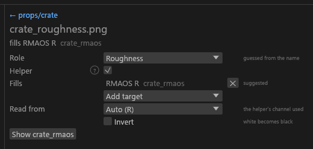

# Packing PBR maps and helpers

For modders whose sources come as separate maps (Substance or Blender exports): what packs into which file and channel under each target, and how helper textures fill another output's channel. The names these maps are recognised by are on [Texture types](Texture-Types.md#exporter-names).

## Packing loose maps

- **Raw maps are never their own DDS.** They pack into the layout the target reads.
- **A raw map is read from its red channel.** For a map that keeps its value elsewhere, set [`channels.grayscale_source`](Project-Config.md#channels).
- **Packed maps in a different format, _orm, can be used for the maps they contain.

### Community Shaders

`_rmaos` or `_rfaos` is built when the set has a roughness, glossiness, AO or metallic map:

| Channel | Source | Default when missing |
|---|---|---|
| R | roughness, or inverted glossiness | `packing.roughness_default` |
| G | metallic\fuzzmask | 0 |
| B | AO | 1 |
| A | specular | 1 |

`_rfaos` replaces it when you picked **Advanced Skin** as the set's shader, or when a skin fuzz mask fills G: a `_fuzz` or `_sheen` map in a set its other maps or types make skin ([which sets are skin](Texture-Types.md#suffixes)). Under a picked **Advanced Skin** the fuzz map fills G too. In a PBR set the same map is written as the PBR fuzz texture (`<base>_f.dds`), and the set keeps `_rmaos`. <!-- D:JQ1,JQ2 --> The recipe key is [`packing.recipe`](Project-Config.md#packing).

The channels are the same as in the `_rmaos` table, except G is the fuzzmask (default 0).

### Vanilla

A set whose shader is complex material (picked in the GUI, or automatic because the set already has a complex `_m`) builds the complex `_m` from a roughness, glossiness, metallic, height or `_orm` map. An existing `_m` file still wins unless `packing.prefer = "raw"`.

| Channel | Source | Default when missing |
|---|---|---|
| R | environment: metallic, else specular | 0 |
| G | glossiness, or inverted roughness | 128 |
| B | metallic | 0 |
| A | height | 0 |

Any other set gets a BC4 environment `_m`, built from metallic (else specular) only when one exists. Its other raw maps are not used (`PACK-UNUSED-INPUT`).

## Fills, conflicts and sizes

A channel with no source gets the neutral default and a `PACK-DEFAULTED` warning that names the output and the channel. To pick the value yourself, set a fill (0 to 255) on the packed output:

```toml
[files."textures/armor/iron/iron_rmaos"]
packing.fill.metallic = 255     # fully metallic
packing.fill.specular = 128
```

Use the packed output's card in the [set editor](GUI-Set-Editor.md#packed-channel-sources).

- **Packed file and raw maps both present:** the packed file (`iron_rmaos.png`) wins and the raw maps are reported (`PACK-CONFLICT`). `packing.prefer = "raw"` builds from the raw maps instead.
- **Sizes:** sources of one recipe may differ if they share an aspect ratio; each smaller one is enlarged to the largest (`PACK-SOURCE-RESIZED` names it). Different aspect ratios fail the recipe (`PACK-SIZE-MISMATCH`).
- **`packing.enabled = false`** turns that packed output off ([key](Project-Config.md#packing)).

## Helper textures

A **helper** is a source file that fills one channel of another output in its own set and is never written as its own DDS: the raw maps above, an opacity map, and fuzz or subsurface weight maps you mark by hand. The GUI writes them as `sdc.toml` keys.

| Role (`helper.role`) | Suggested target | Also offered |
|---|---|---|
| Opacity (`opacity`) | the colour texture's alpha (`diffuse.a`) | packed channels |
| Specular (`specular`) | `n.a` on a texture of sub-type `normal`, plus the [packed channel for the target](#packing-loose-maps) | other packed channels |
| Fuzz weight, PBR (`fuzzweight`) | the PBR `_f` alpha (`f.a`) | packed channels |
| Subsurface weight, PBR (`subsurfaceweight`) | the PBR `_s` alpha (`s.a`) | packed channels |
| Roughness, glossiness, metallic, AO, height, fuzz mask (skin), `_orm`, curvature, cavity | the packed channels of the tables above | any planned alpha target; the `_cnr` alpha (`cnr.a`, coat roughness) is offered, never suggested |

Fuzz weight and subsurface weight have no file-name term: a file is one only when you set its role.

A `_fuzz` or `_sheen` map is a helper only in an Advanced skin set. Under any other shader it isn't one ([Texture types](Texture-Types.md#exporter-names)).

### Which data wins

- A **suggested** helper (role and targets from its name) fills an alpha only when that alpha is empty in the source: none, fully opaque, or one flat value. A colour PNG with a real alpha keeps it, and the helper reads "not used: x.png already has alpha".
- An **assigned** helper (you set its role or targets) always replaces what the channel holds, a PNG's own alpha included.
- Two helpers on one channel: an assigned one beats a suggested one; otherwise the first by path wins and the other reads "`<target>` is filled by `<winner>`".
- A value fill (`packing.fill.*`) applies only when no helper fills the channel.

A `_fuzz` or `_sheen` map that no set reads is not converted. [Problems](GUI-Problems.md#problems-and-notes) lists it under **Notes** as *{file} isn't used: {reason}. Nothing else changes.* <!-- D:JQ28 --> The reasons and their fixes:

| Reason | Fix |
|---|---|
| `the <shader> shader reads no fuzz map` | Pick **Advanced Skin** or a PBR shader for the set, or leave the map out: no other shader reads a fuzz map. <!-- D:JQ3 --> |
| `<f file> is the set's PBR fuzz texture (_f)` | Remove one of the two fuzz files: both would be `<base>_f.dds`. The `_f` can be an image or a kept `_f.dds`, but not the `<base>_f.dds` the map itself wrote when you export into the source folder: the map keeps converting to that file. <!-- D:JQ4,JQ53 --> |
| `<f file> (<type>) is written at the set's _f path` | Check the type Tessalith gave the file, including any preset rule. For example, a height map called `iron_f.png` takes the output name `iron_f.dds`. Rename the height map if you want the fuzz map to write there. If the set also has a PBR fuzz texture or a kept `_f.dds`, the Note names that file first. <!-- D:JQ53 --> |
| `the <shader> shader of set <id> reads no fuzz map, and set <id> (<shader> shader) would read it as its fuzz texture, which only the file's own set can convert` | The map is shared between sets. Pick **Advanced Skin** or a PBR shader for the set that holds the file. <!-- D:JQ51 --> |

A shared fuzz map does the job its own set gives it. An Advanced skin set that borrows a map its own PBR set converts gets the default G, and its `_rfaos` row reads *{output} G: the shared {file} is converted by its own set {id} ({shader} shader) and is not read here, so the default 0 (no fuzz) is used.* A PBR set that borrows a skin set's fuzz map gets no `<base>_f.dds` and no row. <!-- D:JQ51 -->

### Alpha targets and sizes

- **Valid alpha targets:** the colour texture's alpha (a `diffuse`, `pbr_albedo` or `skin_albedo` file, never complex grass, UI/sky or landscape), the alpha of a plain `normal` (`n.a`), `pbr_fuzz` (`f.a`), `pbr_subsurface` (`s.a`) and `coat_normal` (`cnr.a`). A target must be planned under the active target: vanilla has no `_f`, `_s`, `_cnr` or `_rmaos`, so a fuzz-weight helper reads "not used: no _f planned under vanilla". Cubemaps and Also export outputs never take a fill.
- **Sizes:** a suggested fill whose helper isn't the target's size is skipped ("512x512, target 1024x1024: sizes differ"). An assigned one with the same aspect ratio is resized like a packed source, so a helper larger than its colour texture makes that texture larger; another aspect ratio fails the target with `PACK-SIZE-MISMATCH`.

The fill happens before analysis, so alpha policy, format choice and coverage mips see the filled alpha. A diffuse that would be BC1 can move to an alpha format.

### Helper settings

Every control writes the helper file's own `[files]` entry in `sdc.toml` as one undo step, and the folder is planned again.

| GUI control | Key | Effect |
|---|---|---|
| **Role** | `helper.role` | What the file is. Unticking **Helper** (`"none"`) makes it an ordinary texture again. Any other role makes it a helper even when its name says otherwise. Picking the guessed role also writes it, so it counts as set by hand. **Reset** goes back to the name's guess. |
| **Fills** and **Add target** | `helper.fills` | One line per channel the helper fills, each with a **✕**. **Add target** lists what the engine would accept in this set. Once you edit the list it is yours; removing the last target reads "not used: no targets chosen". **Reset** returns to the suggestion. |
| **Read from** | `helper.read` | `r`, `g`, `b`, `a` or `luma` (Rec. 709). **Auto (R)** removes the key. For a mask stored in another channel. |
| **Invert** | `helper.invert` | One minus the value. In a packed channel it flips on top of the recipe's own conversion. |

- **Gloss maps:** give the file the role *Glossiness* and leave **Invert** off. Packing already turns gloss into roughness, so Invert would write gloss into the roughness channel. An alpha fill has no automatic conversion, so there Invert is the only flip.
- **`_cnr` alpha** (coat roughness) is never suggested; add it yourself if your roughness map is meant for the coat.
- **A file with a role and no known suffix** (`iron_mask.png`) joins the set `iron`, its name without the last `_part`, when that set exists.
- **Without the GUI:** `helper.role = "opacity"` on the file's `[files]` entry ([keys](Project-Config.md#files)). On the command line: [CLI reference](CLI-Reference.md#packing-and-helpers-from-the-command-line).

### In the GUI

Under the tiles, the Textures column has a **Helpers (n)** group, one compact row per helper. <!-- D:FB12 --> A row shows **→ targets** or **not used**; hover for the reason. A role you set shows as an amber **✎** chip. Tick **Helper** under any tile's Sub-type and pick a role to turn that texture into a helper. The set card's channel rows edit the same `helper.fills` ([Set editor](GUI-Set-Editor.md#packed-channel-sources)).



A helper that fills nothing is reported (`PACK-UNUSED-INPUT`, or `IN-PACKING-INPUT` with packing off), never a failure. The next re-run re-encodes an output when its helper, or the helper's read or invert, changes.

## Variance and gloss bake

On `cs`, a variance bake adds detail lost from the normal’s smaller mips to the roughness mips of an `_rmaos` or `_rfaos`. Distant surfaces then look less shiny. Mip 0 stays as authored. `mips.bake_clamp` limits the amount added. A `_cnr` bakes into its own coat roughness. <!-- D:HD1 -->

Tessalith looks for a `pbr_normal` first under any shader. A chosen or automatic PBR, PBR Grass or PBR Landscape shader can then use a plain `normal`, followed by a `landscape_normal`. Advanced Skin can use a plain normal too. It flags a landscape normal as an extra map and leaves the roughness unbaked if that is its only normal. Ties within a type go to the first source path in sort order. <!-- D:JS2 -->

When you borrow a Normal slot, your set’s shader decides which normals it can bake from in the other set. For example, the slot can show that set’s landscape normal while your PBR roughness bakes from its plain normal. The bake takes the highest-priority normal your shader accepts. Even if the other set shows a borrowed normal, it can lend you its own. <!-- D:JS2 -->

- **Include both inputs in the batch.** A decided normal and a writable linear roughness map with smaller mips can bake. DDS inputs and a shared roughness map skip the bake. With `mips.levels = "none"` the roughness has no smaller mips to bake. Different sizes or shapes work. Set `mips.normal = "renormalize"` on the normal to opt out. See [companion diagnostics](Diagnostic-Codes.md#sets-and-suggestions) for a missing input. <!-- D:HD2,HD5 -->
- **Complex `_m` gloss bake (opt-in).** Set `mips.normal = "renormalize_bake"` (GUI: *Normal handling: Renormalise and bake*) on the set's `_n`. Every smaller mip of the `_m`'s green channel then gets the detail the normal loses, so distant surfaces shimmer less; mip 0 is unchanged. The conditions above apply. The bake's own setting on a plain normal is not this opt-in. <!-- D:JS2 -->
