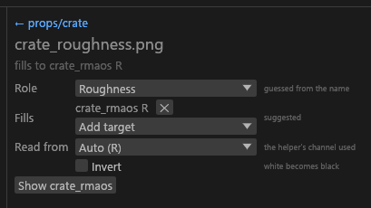

# Packing PBR maps and helpers

For modders whose sources come as separate maps (Substance or Blender exports): what packs into which file and channel under each target, and how helper textures fill another output's channel. The names these maps are recognised by are on [Texture types](Texture-Types.md#exporter-names).

## Packing loose maps

- **Raw maps are never their own DDS.** They pack into the layout the target reads.
- **One source per role.** With two roughness maps the first by path wins and the other is reported as `PACK-UNUSED-INPUT`.
- **A raw map is read from its red channel.** For a map that keeps its value elsewhere, set [`channels.grayscale_source`](Project-Config.md#channels).
- **`_orm` counts as three maps at once:** AO from R, roughness from G, metallic from B. A separate map for the same slot (`_roughness` next to the `_orm`) wins that slot. An `_rfaos` has no metallic channel, so it leaves the `_orm` metallic unused. Slots an `_orm` doesn't hold (specular, height, fuzz) come from their own maps, the fill, or the default.

### Community Shaders

`_rmaos` is built when the set has a roughness, glossiness, AO or metallic map:

| Channel | Source | Default when missing |
|---|---|---|
| R | roughness, or 1 minus glossiness | `packing.roughness_default` |
| G | metallic | 0 |
| B | AO | 1 |
| A | specular | 1 |

`_rfaos` (Advanced skin) replaces it when a fuzz map exists or the set's shader is Advanced Skin (`packing.recipe = "auto"`), or always with `packing.recipe = "rfaos"`:

| Channel | Source | Default when missing |
|---|---|---|
| R | roughness, or 1 minus glossiness | `packing.roughness_default` |
| G | fuzz | 0 |
| B | AO | 1 |
| A | specular | 1 |

`packing.recipe = "rfaos"` on a set with only a metallic map builds an `_rmaos` instead (`PACK-RECIPE-UNBUILDABLE`). `_p` is built from a raw height map.

### Vanilla

A set whose shader is complex material (picked in the GUI, `--set set:<id>.shader=complex_material`, or automatic because the set already has a complex `_m`) builds the complex `_m` from a roughness, glossiness, metallic, height or `_orm` map. An existing `_m` file still wins unless `packing.prefer = "raw"`.

| Channel | Source | Default when missing |
|---|---|---|
| R | environment: metallic, else specular | 0 |
| G | glossiness, or 1 minus roughness | 1 minus `roughness_default` |
| B | metallic | 0 |
| A | height | 0 |

Any other set gets a BC4 environment `_m`, built from metallic (else specular) only when one exists. Its other raw maps are not used (`PACK-UNUSED-INPUT`).

## Fills, conflicts and sizes

A channel with no source gets the neutral default and a `PACK-DEFAULTED` warning that names the output and the channel. To pick the value yourself, set a fill (0 to 255) on the packed output:

```toml
[files."textures/armor/iron/iron_rmaos"]
packing.fill.metallic = 255     # fully metallic
packing.fill.specular = 128
```

Use `--set packing.fill.metallic=255` for a whole run, or the packed output's card in the [set editor](GUI-Set-Editor.md#packed-channel-sources).

- **Packed file and raw maps both present:** the packed file (`iron_rmaos.png`) wins and the raw maps are reported (`PACK-CONFLICT`). `packing.prefer = "raw"` builds from the raw maps instead.
- **Sizes:** sources of one recipe may differ if they share an aspect ratio; each smaller one is enlarged to the largest (`PACK-SOURCE-RESIZED` names it). Different aspect ratios fail the recipe (`PACK-SIZE-MISMATCH`).
- **`packing.enabled = false`** turns that packed output off ([key](Project-Config.md#packing)).

## Helper textures

A **helper** is a source file that fills one channel of another output in its own set and is never written as its own DDS: the raw maps above, an opacity map, and fuzz or subsurface weight maps you mark by hand. The GUI and the CLI read the same `sdc.toml` keys, so both write the same bytes.

| Role (`helper.role`) | Suggested target | Also offered |
|---|---|---|
| Opacity (`opacity`) | the colour texture's alpha (`diffuse.a`) | packed channels |
| Specular (`specular`) | the `_n` alpha of a non-PBR set (`n.a`), plus its packed channel as above | other packed channels |
| Fuzz weight, PBR (`fuzzweight`) | the PBR `_f` alpha (`f.a`) | packed channels |
| Subsurface weight, PBR (`subsurfaceweight`) | the PBR `_s` alpha (`s.a`) | packed channels |
| Roughness, glossiness, metallic, AO, height, fuzz mask (skin), `_orm`, curvature, cavity | the packed channels of the tables above | any planned alpha target; the `_cnr` alpha (`cnr.a`, coat roughness) is offered, never suggested |

Fuzz weight and subsurface weight have no file-name term: a file is one only when you set its role.

### Which data wins

- A **suggested** helper (role and targets from its name) fills an alpha only when that alpha is empty in the source: none, fully opaque, or one flat value. A colour PNG with a real alpha keeps it, and the helper reads "not used: x.png already has alpha".
- An **assigned** helper (you set its role or targets) always replaces what the channel holds, a PNG's own alpha included.
- Two helpers on one channel: an assigned one beats a suggested one; otherwise the first by path wins and the other reads "`<target>` is filled by `<winner>`".
- A value fill (`packing.fill.*`) applies only when no helper fills the channel.

### Alpha targets and sizes

- **Valid alpha targets:** the colour texture's alpha (a `diffuse`, `pbr_albedo` or `skin_albedo` file, never complex grass, UI/sky or landscape), the alpha of a plain `normal` (`n.a`), `pbr_fuzz` (`f.a`), `pbr_subsurface` (`s.a`) and `coat_normal` (`cnr.a`). A target must be planned under the active target: vanilla has no `_f`, `_s`, `_cnr` or `_rmaos`, so a fuzz-weight helper reads "not used: no _f planned under vanilla". Cubemaps and Also export outputs never take a fill.
- **Sizes:** a suggested fill whose helper isn't the target's size is skipped ("512x512, target 1024x1024: sizes differ"). An assigned one with the same aspect ratio is resized like a packed source, so a helper larger than its colour texture makes that texture larger; another aspect ratio fails the target with `PACK-SIZE-MISMATCH`.

The fill happens before analysis, so alpha policy, format choice and coverage mips see the filled alpha. A diffuse that would be BC1 can move to an alpha format.

### Helper settings

Every control writes the helper file's own `[files]` entry in `sdc.toml` as one undo step, and the folder is planned again.

| GUI control | Key | Effect |
|---|---|---|
| **Role** | `helper.role` | What the file is. **Not a helper** (`"none"`) makes it an ordinary texture again. Any other role makes it a helper even when its name says otherwise. Picking the guessed role also writes it, so it counts as set by hand. **Reset** goes back to the name's guess. |
| **Fills** and **Add target** | `helper.fills` | One line per channel the helper fills, each with a **✕**. **Add target** lists what the engine would accept in this set. Once you edit the list it is yours; removing the last target reads "not used: no targets chosen". **Reset** returns to the suggestion. |
| **Read from** | `helper.read` | `r`, `g`, `b`, `a` or `luma` (Rec. 709). **Auto (R)** removes the key. For a mask stored in another channel. |
| **Invert** | `helper.invert` | One minus the value. In a packed channel it flips on top of the recipe's own conversion. |

- **Gloss maps:** give the file the role *Glossiness* and leave **Invert** off. Packing already turns gloss into roughness, so Invert would write gloss into the roughness channel. An alpha fill has no automatic conversion, so there Invert is the only flip.
- **`_cnr` alpha** (coat roughness) is never suggested; add it yourself if your roughness map is meant for the coat.
- **A file with a role and no known suffix** (`iron_mask.png`) joins the set `iron`, its name without the last `_part`, when that set exists.
- **Without the GUI:** `helper.role = "opacity"` on the file's `[files]` entry, or `--set "file:**/<name>.helper.role=opacity"` ([keys](Project-Config.md#files)).

### In the GUI

Under the tiles, the Textures column has a **Helpers (n)** group, one compact row per helper. <!-- D:FB12 --> A row shows **→ targets** or **not used**; hover for the reason. A role you set shows as an amber **✎** chip. The **Helper role** combo in any tile's settings turns that texture into a helper. The set card's channel rows edit the same `helper.fills` ([Set editor](GUI-Set-Editor.md#packed-channel-sources)).



A helper that fills nothing is reported (`PACK-UNUSED-INPUT`, or `IN-PACKING-INPUT` with packing off), never a failure. `--on-existing if-changed` re-encodes an output when its helper, or the helper's read or invert, changes.

## Variance and gloss bake

In a `cs` PBR set with an `_n` and an `_rmaos` or `_rfaos`, the detail the normal map loses in each smaller mip is added to the roughness mips, so distant surfaces don't look too shiny. Mip 0 stays as authored; `mips.bake_clamp` limits the amount. A `_cnr` bakes into its own coat roughness. <!-- D:HD1 -->

- **Both files must be in the batch.** Otherwise the bake is skipped and reported (`SET-MISSING-COMPANION`, `SET-COMPANION-DDS`). Sizes needn't match: a smaller, larger or differently shaped map bakes from the `_n` at the matching detail. A map with `mips.levels = "none"` isn't baked. A shared `_rmaos` (borrowed by several sets in the GUI) is never baked. <!-- D:HD2,HD5 -->
- **Complex `_m` gloss bake (opt-in).** Set `mips.normal = "renormalize_bake"` (GUI: *Normal handling: Renormalise and bake*) on the set's `_n`. Every smaller mip of the `_m`'s green channel then gets the detail the normal loses, so distant surfaces shimmer less; mip 0 is unchanged. The conditions above apply, and the CLI writes the same bytes.
